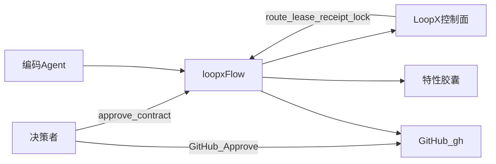

# LoopX Workflow 详细设计

- **产品需求**：[docs/prd/loopx-workflow.md](../prd/loopx-workflow.md)
- **增量决策**：[docs/adr/README.md](../adr/README.md)
- **状态**：目标设计（ADR-0008~[ADR-0015](../adr/0015-todo-managed-execution-and-capability-probe.md) 已 Accepted；现有实现差异由 M0~M5 跟踪）

本文是命令、阶段、资产和失败条件的唯一设计正文。`docs/guides/loopx-workflow-architecture.html` 是展示页，不参与需求或设计裁决。原 `docs/design/coding-workflow-tools-spec.md` 已删除，管线内容在这里。

需求编号的含义以 PRD 为准。本文只说明它们怎样落到命令和文件。

---

## 1. 所有者

| 事情 | 所有者 | 不归谁 |
|---|---|---|
| 谁、为什么、范围、`REQ-*` | `docs/prd/loopx-workflow.md` | feature 的 `02-prd.md` |
| 命令、阶段、失败矩阵、资产路径 | 本文 | README、HTML 展示页 |
| 对产品正文的修订 | `docs/adr/NNNN-*.md` | feature 的 `01-decisions.md` |
| 一次交付的故事、契约、证据 | `specs/features/<feature>/` | 产品正文 |
| 租约、收据、合入锁、可行性路由、Goal 停机 | LoopX CLI | `loopx-flow` 不得改写其结论 |
| 跨权威来源的绑定、校验、投影 | `bin/loopx-flow` + Conductor | 不拥有 Goal/Todo/Lease/Gate 权威 |
| 场景串联、参数、退出码、文件落点 | `bin/loopx-flow` | 临时脚本，除非 ADR 说明缺口 |

`01-decisions.md` 可以记录“这个胶囊选了哪条实现”，但产品行为的取舍写进 ADR，并改 PRD。

## 2. 运行结构



编排器是 `bin/loopx-flow`（bash），Conductor 以 Skill + Agent 指令 + 少量确定性脚本实现；Conductor 只读回状态、计算下一步、路由领域 Skill、校验产物并在 Gate 停，不拥有权威状态。编排器在仓库根解析 `.loopx/registry.json`，存在则给 LoopX 命令加上 `--registry`；本地不存在时向 LoopX 探询其运行时 registry（`loopx --format json status` 的 `registry` 字段）再传 `--registry`，探询失败保持 fail-closed（[ADR-0024](../adr/0024-resolve-runtime-registry-from-loopx.md)）。事实来源分三类：Git（规格/决策）、LoopX（执行控制）、GitHub/CI（交付/审批）。`review` 与 PR 正文调用 `skills/code-review/scripts/authentic-review.js`。`respond` 调用 `skills/code-review/scripts/respond-report.js`。质量收据适配在 `skills/code-review/scripts/ingest-to-loopx-quality.js`。

## 3. 命令与需求

用法以 `usage()` 为准。下表是设计映射，不是第二份帮助文本。

| 命令 | 实现函数 | 满足的需求 | 失败即停的要点 |
|---|---|---|---|
| `doctor` | `cmd_doctor`、`cmd_doctor_control_plane` | 环境哨兵、`REQ-ENV-1`、`REQ-ENV-2`、`REQ-CAPABILITY-1`、`REQ-SKILL-READY-1` | preflight 失败（含本机已有 `loopx` 时 required skills/routes/新鲜度未通过）、`loopx doctor` 失败、本机没有 `loopx`、或集中式三层能力/`schema_version` 探针命中 BLOCK 缺口均非 0，并输出「能力→探测信号→PASS/WARN/BLOCK」矩阵与诊断卡（含原因/影响/修复命令）。控制面路由/registry 一致性、`~/.loopx` 半迁移残留、运行时工件被跟踪、GitHub API 50% 预算基线为 WARN 级检查（见 ADR-0007、ADR-0015） |
| `init` | `cmd_init` | `REQ-MAIN-1`、`REQ-AUTH-MODE-1`、`REQ-SKILL-READY-1` | 安装 pre-commit；确认 `authorization_mode` 与风险接受；preflight 在已有 `loopx` 时阻断缺失或过期的 required skills；有 `loopx` 时 `bootstrap` 失败则退出 |
| `feature <name>` | `cmd_feature` | `REQ-FAILCLOSED-2`、`REQ-CAPSULE-1` | 分支创建或切换失败则退出，不写胶囊 |
| `approve contract <feature>` | `cmd_approve` | `REQ-CHECKPOINT-1`、`REQ-GATE1-AUTH-1`、`REQ-AUTH-MODE-1`、`REQ-PR-LIFECYCLE-1` | 缺配置/规格不完整/未授权（默认校验 `accepted_by` 的 GitHub `gate=1` 评论；`--prepare` 打印模板；`--interactive` 回退 TTY）/规格包未跟踪或未推送/无 PR/`presentation=pending`/`configure-goal`/`user_gate` 写入失败均非 0；先核验发布前置与规格完整性，再锁最终内容 SHA256，成功后才原子写入批准标记 |
| `gate verify decisions\|contract` | `cmd_gate` | `REQ-GATE-DECISIONS-1`、`REQ-CONTRACT-LOCK-1`、`REQ-GATE1-AUTH-1` | 见第 5 节：SHA + user_gate 授权记录 + evidence 串；没有 `pr` 这个 stage |
| `check [feature] [--goal-id] [--with-ocr]` | `cmd_check` | `REQ-GATE-1`、`REQ-QUALITY-1`、`REQ-QUALITY-3`、`REQ-EVIDENCE-1`、`REQ-CHECK-IDENTITY-1`、`REQ-FAILCLOSED-1` | 无 feature 且无 `--goal-id` 则非 0；有胶囊时先 `gate verify contract`；前置解析真实远程基线并诊断 Goal 资格；四门禁后必须收据 `ok=true` 才打印成功 |
| `todo list\|claim\|done` | `cmd_todo` | `REQ-NATIVE-1`、`REQ-LEASE-1`、`REQ-CAPABILITY-1` | 没有 `loopx` 或三层能力/`schema_version` 探针不通过则退出。`claim` 先按 `next_cursor` 完整分页读完 `agent-directory` 解析已注册 owner（缺失、歧义、游标异常或 `LOOPX_AGENT_ID` 未注册时非 0 且不申领），随后直接委托受管 `loopx --format json todo claim --goal-id --todo-id --agent-id --claimed-by`，将 `claim_operation_id` 与五元组（`goal_id`/`todo_id`/`agent_id`/`registry_path`/`handoff_mode`）缓存至 `$LOOPX_TMP_DIR/claims/<gid>--<tid>.json`（透明适配 `hard_lease`/`soft_claim`）。`done` 委托 `loopx --format json todo complete` 原子完成并释放租约，执行 Q1 双分流停机恢复：缓存缺失或五元组不匹配时仅在租约有效且同 Owner 自动补领 receipt；已过期（`lease_state=expired`）/已释放/已转让/`deferred` 一律 Fail-Closed 非 0 停机并原样透出 LoopX `recovery` 指引，严禁静默重 `claim`（见 ADR-0015） |
| `issue <id>` | `cmd_issue` | `REQ-NATIVE-1`、`REQ-ISSUE-PIPELINE-1`、`REQ-FAILCLOSED-1` | 读取 `decision.route`；`fix_pr` 走同一 Goal/Evidence/Gate2；不得直推 main |
| `integrate [--execute\|--status]` | `cmd_integrate` | `REQ-NATIVE-1` | 默认 preview，不落盘。`--execute` 才 sync 落盘 |
| `pr create\|preview\|update\|ready` | `cmd_pr` | `REQ-PR-BODY-1`、`REQ-PR-LIFECYCLE-1` | 调用 `authentic-review.js --generate-pr-body`；draft→ready 不代表合并授权；`create` 失败写 `presentation=pending` 持久标记并非 0（Gate1 据此阻断） |
| `review <pr>` | `cmd_review` | `REQ-REVIEW-1`、`REQ-REVIEW-2`、`REQ-GATE2-MODE-1` | 发布 formal review（Agent 只发 COMMENT）；基于文件流契约与两阶段解耦；模板/审查不可用 `NOT_VERIFIED`，不发评论 |
| `respond <pr>` | `cmd_respond` | `REQ-RESPOND-1` | 只接受精确 head artifact；四门禁或既有产物失败不发评论；无 `loopx` 时 status 记为跳过 |
| `merge <pr> [feature]` | `cmd_merge` | `REQ-CHECKPOINT-2`、`REQ-CHECKPOINT-3`、`REQ-GATE2-MODE-1`、`REQ-CI-PROTECTION-1`、`REQ-GOAL-1`、`REQ-CAPSULE-1` | 见第 6 节；按 Mode A/B 校验审批与 readiness；已 MERGED 可重跑补步骤，任何未完成步骤非 0 |
| `context <feature>` | `cmd_context` | 审阅入口 | 打印 `00-INDEX.md` |
| `status` | `cmd_status` | 观察 | 只读；`loopx` 不可用时的退出码保持现状，不纳入失败即停 |
| `status --next` | `cmd_status_next` | `REQ-STATUS-NEXT-1` | 只读投影 + 下一步建议，不写状态；不是 resume |
| `release-approve <pr>` | `cmd_release_approve` | `REQ-GATE2-MODE-1` | Mode B 专用；默认校验 `accepted_by` 的 GitHub `gate=2` 评论（`--prepare` 打印模板，`--interactive` 走 TTY 并写评论）；`--yes` 非 0 |
| `archive <feature>` | `cmd_archive` | 手动归档 | 有目录则移动；合入由 `merge` 移动；重复移动前判重 |
### 3.1 L0 命令契约与能力矩阵

L0 命令不是 LoopX 转发器，而是场景操作契约（遵循 [ADR-0010](../adr/0010-command-contracts-and-execution-protocol.md) `REQ-CMD-CONTRACT-1` 与 [ADR-0015](../adr/0015-todo-managed-execution-and-capability-probe.md)）。下表完整覆盖全部 13 条 L0 命令的 5 项必填契约维度（**原生能力映射 / Workflow 增强约束 / 前置与后置条件 / 失败与恢复策略 / 证据契约**，正式关闭 ADR-0010 项 1）：

| 命令 | 原生能力映射（LoopX/GitHub） | Workflow 增强约束 | 前置与后置条件 | 失败与恢复策略 | 证据契约 |
|---|---|---|---|---|---|
| `feature` | `loopx bootstrap --goal-id <feature>-goal --state-file` + `sync-global` | 强制 `1 Feature : 1 Goal`；创建/切换 `feature/<name>` 分支、初始化胶囊骨架；运行态 `ACTIVE_STATE.md` 归 LoopX runtime 不入 Git | **前置**：工作区允许建/切分支；若含 LoopX 则 `goal.bootstrap` 能力可用。<br>**后置**：位于 `feature/<name>` 分支，胶囊文件存在，Goal 已注册且 `sync-global` 完成 | 分支创建/切换失败立即非 0 且不创建胶囊；重入先读回 Goal 是否已存在，不重复建 Goal；`sync-global` 重试后仍失败返回 `PARTIAL`（非 0） | 胶囊目录 `specs/features/<feature>/`（`00-INDEX.md`～`05-evidence.md`）与 LoopX registry Goal 条目（均不含运行态 `ACTIVE_STATE.md` 入 Git） |
| `approve contract` | `loopx configure-goal --progress-review-contract-revision <sha>` + `loopx todo add/complete`（`user_gate`）+ `gh api`（Mode A 核验）+ `git ls-files`/`git ls-remote`/`gh pr view`（发布前置） | 发布前置核验（规格包三件套被 Git 跟踪、`specs/features/<feature>/**` 无未提交/未跟踪文件、`HEAD == origin/<branch>`、存在 `OPEN` 且 `headRefOid == HEAD` 的可读 PR、无 `presentation=pending` 标记）；规格包完整性核验（`01-decisions` APPROVED、`04-contract` 含 AC/Scope/Verification Plan/依赖顺序、Story 与 AC 对齐、引用 ≥1 条 REQ/ADR）；按 `authorization_mode`（`single_owner` 默认 `accepted_by` 的 GitHub `gate=1` 评论，`--interactive` 回退 TTY + 风险接受 / `independent` 第二账号 Draft PR `gate=1` 评论）核验审批主体 | **前置**：`loopx` 与 `todo.user_gate` 可用；`loopx-workflow.config.json` 合法；规格包完整且审批主体通过；规格包已提交并推送、存在可读 PR。<br>**后置**：最终带 `Contract-Status: FROZEN & APPROVED` 的 SHA256 已写入 Goal `contract_revision`、`user_gate` 审计记录落盘、契约批准标记原子写入且 `sync-global` 完成 | 任一步失败非 0 且不得在 `04-contract.md` 留下批准标记；规格包未跟踪/未推送/无 PR/`presentation=pending` 一律阻断（不得降级 WARN）；重跑以新 SHA 与新 `user_gate` 记录取代旧授权 | LoopX `progress_review.contract_revision` + `user_gate` 记录（`decision-scope=other:goal:<sha>`、`decision-outcome=approve`、固定 `evidence` 串）+ `04-contract.md` 批准标记 |
| `todo` | `loopx agent-directory` + 受管 `loopx --format json todo claim` / `loopx --format json todo complete` / `loopx todo list`（ADR-0015） | 完整分页解析已注册 Agent 身份；直接委托受管执行（`manage_execution=True`，透明适配 `hard_lease` / `soft_claim`）；在 `$LOOPX_TMP_DIR/claims/<gid>--<tid>.json` 缓存 `claim_operation_id` 与五元组（`goal_id`/`todo_id`/`agent_id`/`registry_path`/`handoff_mode`）；禁止编排层手工调用 `task-lease acquire/release/renew` | **前置**：`loopx` 可用、三层能力/`schema_version` 探针通过、当前 Goal 存在且已解析唯一合法已注册 `agent_id`；`done` 需有效 `claim_operation_id`。<br>**后置**：`claim` 成功写入五元组缓存并返回 `claim_operation_id`；`done` 原子置 Todo 为 `done` 并释放租约（`released`）且清理缓存 | 身份缺失/歧义/游标异常非 0 且不申领；`done` 走 Q1 双分流：缓存缺失或五元组失配时仅租约有效且同 Owner 自动补领 receipt；租约已过期（`lease_state=expired`）/已释放/已转让/`deferred` 一律 Fail-Closed 非 0 停机并原样透出 LoopX `recovery`，严禁静默重 `claim`；`todo update` CAS 冲突先 `todo list` 对账 `provider_revision` | LoopX Todo/Lease 权威状态（`loopx_coordination_todo_*_v0` 返回体）+ 临时跨进程凭证缓存 `$LOOPX_TMP_DIR/claims/<gid>--<tid>.json`（非第二权威状态源） |
| `integrate` | `loopx integration-branch status` / `sync` | 严格分离默认 preview（只读预演）与显式 `--execute`（落盘同步），不改写 LoopX 结论 | **前置**：`loopx` 与 `integration-branch` 能力探测通过（缺失/UNKNOWN 仅阻断本命令）；有效仓库与目标上下文。<br>**后置**：preview 零落盘副作用；`--execute` 完成目标分支同步且返回 LoopX 状态 | 缺能力/探针失败立即 `BLOCKED`（非 0）；同步冲突按 LoopX 输出停机，先读回真实状态不重复落盘 | LoopX `integration-branch` JSON/状态输出及同步后的 Git 分支状态 |
| `check` | 本地四大门禁（`npm run typecheck/lint/build/test`）+ `loopx change-quality prepare/record/verify`（via `ingest-to-loopx-quality.js`） | 无 feature 且无 `--goal-id` 直接阻断；有胶囊先跑 `gate verify contract`；前置解析真实远程基线（`origin/HEAD→origin/main→origin/master`）与 Goal 资格；Adapter 只翻译不造假；四门禁禁标 `not_applicable`；可选 `--with-ocr` | **前置**：契约锁定有效（有胶囊时）；远程基线可解析；Goal 已启用 `change-quality` 资格；`change-quality.strict-receipt` 能力与 `change_quality_*_v2` Schema 探针通过。<br>**后置**：四门禁全部退出码 0，`05-evidence.md` 按六状态更新，LoopX `change-quality verify` 收据 `ok=true` | 任一前置/门禁/收据校验失败非 0（`BLOCKED`/`FAILED`/`NOT_VERIFIED`），不写入 `passed` 也不打印成功；缺资格打印带 `--execute` 的 `configure-goal` 修复指令 | `specs/features/<feature>/05-evidence.md`（六状态与 `Real-vs-Mock` 验证矩阵）+ LoopX `change_quality_receipt_v2` / `change_quality_receipt_verification_v2` 权威收据 |
| `issue` | `gh issue view` + `gh repo view` + `loopx issue-fix feasibility --format json` | 严格读取 `decision.route`（仅接受 `fix_pr` / `comment_only` / `triage_only`）；`fix_pr` 复用管线 A 的 Goal/Todo/Evidence/Gate2，Fast Path 不得绕过 Gate2 且禁止直推 `main` | **前置**：`loopx`、`gh` 与 `issue-fix.feasibility` 能力探针通过；目标 Issue 可读。<br>**后置**：输出合法路由；进入 `fix_pr` 后落入同标准 Goal/Branch/Evidence/Gate2 轨迹 | 缺 `loopx`/`gh`/`issue-fix.feasibility` 或路由为空/非法值立即 `BLOCKED`/`NOT_VERIFIED`（非 0），不进入直推分支 | LoopX `issue-fix feasibility` JSON（`decision.route`）与后续 `fix_pr` 对应的 Goal/PR/证据链 |
| `gate verify` | 只读核验 `${LOOPX_REGISTRY:-.loopx/registry.json}` + LoopX `user_gate` 记录 | 校验 `decisions` APPROVED 标记或 `contract` 双重锁定（文件 SHA256 == Goal `contract_revision` + 最新未 supersede `user_gate` 记录 + `evidence` 固定串与 `authorization_mode` 一致） | **前置**：目标胶囊存在（活跃或归档）；`contract` 校验需可读有效 registry（附属 worktree 缺 registry Fail-Closed）。<br>**后置**：纯只读核验通过返回 0，零写入副作用 | 缺文件/缺 `FROZEN & APPROVED`/SHA 不匹配/缺授权记录/模式不一致/缺键均返回 `BLOCKED`（非 0）并打印差异诊断 | 只读核验输出（对比 `04-contract.md` SHA256、`registry.json` 与 `user_gate` 审计记录），不产出第二份授权文件 |
| `pr` | `gh pr create` / `edit` / `ready`（正文经 stdin 传入）+ `authentic-review.js --generate-pr-body` | 固定四段正文（动机/改动思路/具体改动/对主干的风险）+ 含 `Real-vs-Mock` 列的验证矩阵 + 六问；支持阶段 4 `create --draft` 与阶段 7 `ready`；正文经 stdin 零落盘临时文件；缺信息写 `NOT_PROVIDED` | **前置**：`gh` 可用且已认证；当前为非主干特性分支；胶囊与真实 Git diff 可读。<br>**后置**：PR 创建/更新/就绪完成，远端 PR 正文与当前 diff / 胶囊一致；`draft→ready` 不代表合并授权 | 缺 `gh` 或正文生成/远端 API 失败非 0；重入 `create` 先读回当前分支是否已有 PR 禁止重复建 PR；`create` 失败写 `.loopx/presentation/<feature>.json`（`presentation=pending`）并打印明确 stderr，非 0 且阻断 Gate1（不再降级 WARN） | GitHub PR 元数据与四段正文 + 验证矩阵 + 六问（来源于胶囊与真实 `git diff`） |
| `review` | `loopx pr-review` 原生评审包 + `loopx pr-review --check-result` + 审查者 CLI（stdin 管道）+ `gh api` formal review | 遵循 ADR-0013 文件/流输入契约与两阶段解耦；仅发布 Agent `COMMENT`/`REQUEST_CHANGES` formal review（严禁自动生成 author-owned 批准标题）；评审缓存落入 `$REPO_ROOT/.loopx/cache/reviews/`（`v1`）且命中仍须重跑 `--check-result` | **前置**：`loopx`、`gh`、`pr-review.check-result` 能力与 `pull_request_review_*` Schema 探针通过；PR 非 Draft；原生 `review_template` 章节非空且审查者 CLI 可用。<br>**后置**：`check-result` 返回 `ok=true` 且 formal review 已发布至当前 `headRefOid` | 模板缺失/审查者不可用/输出不可解析/`check-result` 未通过均返回 `NOT_VERIFIED`（非 0）且不发布自造报告；复审存在未清 `reproducible` 时 verdict 上限 `REQUEST_CHANGES` | GitHub formal review（绑定精确 `headRefOid`、五段报告、verdict 与模型声明）+ LoopX `pull_request_review_result_v1` 校验通过 + 可丢弃缓存 `loopx_flow_review_cache_v1` |
| `respond` | 本地四门禁 + `loopx status`（若本机有 `loopx`）+ `gh api` 评论（via `respond-report.js`，stdin 传输） | 复用五段结构回复审阅意见；**只接受与当前 PR `headRefOid` 精确匹配的既有审查产物**，严禁回退旧 head 缓存 | **前置**：`gh` 可用；当前 PR `headRefOid` 存在精确对应的既有审查产物；四门禁全绿（本机有 `loopx` 时 `loopx status` 亦须成功）。<br>**后置**：回复评论已发布至目标 PR | 精确 head 审查产物缺失、四门禁任一失败或 `loopx status` 失败均 Fail-Closed 非 0 且不发评论（无 `loopx` 时 `loopx status` 记为跳过） | GitHub PR 审阅回复评论（绑定精确 `headRefOid` 与实测四门禁结果） |
| `merge` | `gh pr view` + `loopx pr-review --check-merge-readiness <pr>@<oid>` + `gh pr merge --squash --delete-branch` + `loopx goal-lifecycle stop` / `retire-global-goal` / `sync-global` + Git archive push | 按 `authorization_mode`（Mode A 非作者 `APPROVED` / Mode B Agent COMMENT + `release-approve` 评论 + `blocking_reasons` 三档判定）校验 Gate2；二次核对 `headRefOid` 防换头；已 `MERGED` 时跳过合并进入幂等前向补偿；可选接入 `goal-acceptance` | **前置**：`loopx`、`gh`、`pr-review.merge-readiness`、`goal.lifecycle` 能力与 Schema 探针通过；PR 非 Draft 且满足 Mode A/B Gate2 授权与 CI/分支保护；二次读取 `headRefOid` 一致。<br>**后置**：PR 已 Squash 合入，Goal 已 stop + retire + sync-global，胶囊归档至 `specs/archive/<feature>/` 并推送远端 | 授权/readiness/HEAD 校验失败非 0 且不调用 `gh pr merge`；合并后 stop/retire/sync/archive 任一步失败返回 `PARTIAL`（非 0）并打印「已合入、未闭环」与重跑命令，重跑先读回真实状态补齐剩余步骤、不重复合并 | GitHub `MERGED` 状态 + Gate2 授权记录 + LoopX 已退役 Goal 状态 + `specs/archive/<feature>/`（可选独立命名 `ACTIVE_STATE.snapshot.md`，`historical_snapshot: true`） |
| `archive` | 本地 `git mv` + Git commit / push | 将已完成特性胶囊从 `specs/features/<feature>/` 移至 `specs/archive/<feature>/`；归档快照仅允许独立命名 `ACTIVE_STATE.snapshot.md`（`historical_snapshot: true`） | **前置**：目标特性目录存在（或已归档用于幂等判重）；工作区可安全提交推送。<br>**后置**：胶囊位于 `specs/archive/<feature>/` 且已提交推送至远端 | 移动前判重（已存在于 `specs/archive/<feature>/` 时跳过不嵌套）；commit 或 push 失败返回 `PARTIAL`/`FAILED`（非 0） | Git 归档提交与 `specs/archive/<feature>/` 不可变目录快照 |
| `release-approve` | `gh api user` + `gh api` 发布结构化 PR 评论（stdin 传输） | Mode B（`single_owner`）专用 Gate2 人工发布授权；默认校验 `accepted_by` 的 GitHub `gate=2` 评论（`--prepare` 打印模板，`--interactive` 走 TTY 并写评论）；拒绝 `--yes`；不宣称 `separation_of_duties` | **前置**：`gh` 可用；配置 `authorization_mode == single_owner` 且风险接受有效；存在 `accepted_by` 的合法 `gate=2` 评论（或 `--interactive` TTY 确认通过）；当前 PR 非 Draft 且存在合法 `headRefOid` 与 `contract_sha`。<br>**后置**：PR 上存在绑定当前 `head` 与 `contract_sha` 的结构化 `gate=2` 评论（评论路径复用不重复写；`--interactive` 写入） | 无 `accepted_by` 合法评论且未加 `--interactive`、传入 `--yes`、配置模式非 `single_owner`（或 `--interactive` 下 `principal != accepted_by`）均返回 `BLOCKED`/`NEEDS_HUMAN`（非 0），不写授权评论 | GitHub PR 结构化评论（标记 `<!-- loopx-flow:release-authorization:<pr>@<head> -->` 与固定键值串 `gate=2;mode=single_owner;head=...;contract_sha=...;principal=...;risk_acceptance=...（`approved_at` 为 `--interactive` 写入的可选字段，评论路径不要求）`） |

**上游契约锚点与三层能力探针矩阵（`REQ-CAPABILITY-1` / [ADR-0015](../adr/0015-todo-managed-execution-and-capability-probe.md)）**：

- **上游锚点**：`loopx-project/loopx@f4c5d6d7`（本机实测 `loopx 2.3.0`）。不 Pin 精确版本号，通过集中式 `probe_loopx_capabilities` 执行三层校验：
  1. **第 1 层（`--help` 子命令与必填 Flag 签名探针 · Fail-Closed）**：按子命令实际帮助入口探测，不依赖顶层 `--help` 粗匹配；
  2. **第 2 层（JSON `schema_version` 白名单探针 · Fail-Closed）**：所有经 `read_loopx_json` 统一入口消费的载荷都按其登记路径校验，当前 9 个消费方（锚点 `loopx 2.3.0` 实测）：`status` / `todo.list` 读 `projection_envelope.schema_version=loopx_projection_envelope_v0`；`agent-directory=peer_agent_directory_v0`、`task-lease.inspect=task_lease_v0`、`todo.add=loopx_coordination_todo_create_result_v0`、`todo.claim=loopx_coordination_todo_claim_result_v0`、`todo.complete=loopx_coordination_todo_terminal_lifecycle_result_v0`、`change-quality.prepare=change_quality_prepare_packet_v2`、`change-quality.verify=change_quality_receipt_verification_v2` 读顶层 `schema_version`。L0 命令消费路径遇到白名单外或缺失 `schema_version` 立即 Fail-Closed 非 0 并输出《LoopX 升级契约差异诊断卡》（`doctor` 的 `status` 视图按 ADR 降级为 WARN）；**覆盖边界**：`pr-review --check-merge-readiness` 与 `issue-fix feasibility` 因成功包/错误包 schema 不同，仍由调用点判定 `ok` 与业务字段，不经过本 wrapper，也不登记在白名单内；
  3. **第 3 层（版本号软提示 · 非阻断）**：`loopx --version` 偏离已验证锚点但第 1、2 层全通过时，仅输出 `WARN` 软提示而不阻断。
- **隔离 Registry Real-CLI Canary 边界**：本地 `loopx` 主路径与边界验证须在 `$LOOPX_TMP_DIR` / 测试临时目录创建的独立 `--registry` 与 `--runtime-root` 中运行真实 `loopx` 二进制并在结束时清理，主仓 `.loopx/registry.json` 与宿主机 `~/.loopx` 保持 **0 残留**；Contract Fake CLI 仅用于隔离 `gh` 外部网络与负向能力/Schema 故障注入（ADR-0010 T2/T3）。

`doctor` 输出「能力 → 探测信号 → PASS / WARN / BLOCK」矩阵：

| 档位 | 能力标识 | 探测信号（`--help` 子命令入口与 `schema_version` 白名单） | 缺失 / `UNKNOWN` 处置 |
|---|---|---|---|
| **BLOCK**（关键） | `goal.bootstrap` | `loopx bootstrap --help`（`--goal-id` / `--state-file`） | 阻断 `feature` / `init`（非 0 + 诊断卡） |
| **BLOCK**（关键） | `todo.lease`（受管 Todo 执行） | `loopx todo claim --help`（`--goal-id` / `--todo-id` / `--agent-id` / `--claimed-by` / `--claim-operation-id`）、`loopx todo complete --help` + `loopx_coordination_todo_*_v0` | 阻断 `todo claim/done`（非 0 + 诊断卡） |
| **BLOCK**（关键） | `todo.user_gate` | `loopx todo add --help`（`--task-class` / `--decision-scope` / `--decision-outcome` / `--global-gate`） | 阻断 `approve contract` / `gate verify`（非 0 + 诊断卡） |
| **BLOCK**（关键） | `change-quality.strict-receipt` | `loopx change-quality prepare\|record\|verify --help`（`--goal-id` / `--result-json` / `--execute` / `--base-ref`）+ `change_quality_*_v2` | 阻断 `check`（非 0 + 诊断卡） |
| **BLOCK**（关键） | `pr-review.merge-readiness` | `loopx pr-review --help`（`--check-merge-readiness`）+ `pull_request_review_*` | 阻断 `merge`（非 0 + 诊断卡） |
| **BLOCK**（关键） | `pr-review.check-result` | `loopx pr-review --help`（`--check-result`）+ `pull_request_review_execution_contract_v2` / `pull_request_review_result_v1` | 阻断 `review`（非 0 + 诊断卡） |
| **BLOCK**（关键） | `goal.lifecycle` | `loopx goal-lifecycle --help`（`stop`）+ `sync-global` | 阻断 `merge` / `approve` 收尾（非 0 + 诊断卡） |
| **BLOCK**（命令专属） | `issue-fix.feasibility` | `loopx issue-fix --help`（`feasibility`） | 仅阻断 `issue`（非 0）；`doctor` 查其他命令时 WARN |
| **BLOCK**（命令专属） | `integration-branch` | `loopx integration-branch --help`（`configure\|status\|sync`） | 仅阻断 `integrate`（非 0）；`doctor` 查其他命令时 WARN |
| **BLOCK**（外部 CLI） | `gh` | `command -v gh` 与认证状态 | 阻断 `pr` / `review` / `merge` / `issue` / `release-approve`（非 0） |
| **WARN**（非关键） | `goal.acceptance`、`change-quality.safe-fix`、OCR/open-code-review、Lark/goal-channel | 对应子命令 `--help` 或可选二进制/配置探针（`goal.acceptance` 显式启用时切入 `schema_version` 白名单校验） | 输出 WARN 并披露降级，不阻断主流程 |

`feature` 在分支成功后创建尚不存在的胶囊文件，并注册 Goal。它不代替阶段 1–4 的正文；契约审批与 `gate verify contract` 会按 `REQ-TRACE-2` 检查契约是否引用至少一条 REQ/ADR。

### 3.2 L0 7 步执行协议及六结果语义 (ADR-0010 / REQ-L0-PROTOCOL-1)

所有 L0 命令必须遵循统一的 7 步执行协议，并将操作结果映射到统一的六结果语义视图，供 Conductor/Agent 决定继续、停机等待人类、或读回状态后前向补偿。

#### 3.2.1 统一 7 步执行协议

```text
1. Resolve Context
   ↓
2. Validate Preconditions
   ↓
3. Execute
   ↓
4. Validate Postconditions
   ↓
5. Persist Evidence
   ↓
6. Commit Checkpoint
   ↓
7. Return Result
```

| 步骤 | 职责与边界 | 失败时的处置要求 |
|---|---|---|
| **1. Resolve Context** | 通过 `lib/paths.sh` / `lib/paths.js` 锚定 `REPO_ROOT` 与 `WORKFLOW_ROOT`；解析 `--registry` / `LOOPX_REGISTRY`（附属 worktree 缺 registry 直接 Fail-Closed）；加载 `loopx-workflow.config.json` 与目标 `feature` / `goal_id` / `pr` / `headRefOid` | 上下文不可解析或配置 JSON 非法 → `BLOCKED` / `FAILED`（非 0），不触发任何写入 |
| **2. Validate Preconditions** | 执行集中式三层能力与 `schema_version` 探针（[ADR-0015](../adr/0015-todo-managed-execution-and-capability-probe.md)）；校验分支/工作区、契约双重锁定、审批主体、Goal 资格、已注册 Agent 身份或租约状态 | 任一前置不满足 → `BLOCKED` / `NEEDS_HUMAN` / `NOT_VERIFIED`（非 0），零业务副作用 |
| **3. Execute** | 委托 LoopX 原生高层事务入口（如 `todo claim/complete`、`change-quality`、`pr-review`、`goal-lifecycle`）或 Git / `gh` 命令；严禁自造第二控制面或改写 LoopX 结论 | 执行失败且未产生不可逆远端副作用 → `FAILED`；若跨系统副作用已部分发生 → 进入 `PARTIAL` 诊断路径 |
| **4. Validate Postconditions** | 校验 LoopX JSON 载荷的 `schema_version` 白名单与权威结论（如收据 `ok=true`、`check-result` 通过、`merge` 二次读取 `headRefOid` 一致） | 后置不成立或上游载荷不可解析 → `NOT_VERIFIED` / `FAILED`（非 0），不得宣称成功 |
| **5. Persist Evidence** | 写入或刷新该命令对应的证据工件（`05-evidence.md`、评审缓存 `loopx_flow_review_cache_v1`、PR 评论/结构化授权记录、或 `$LOOPX_TMP_DIR/claims/<gid>--<tid>.json` 凭证缓存） | 证据持久化失败 → 阻断完成上报（`FAILED` / `PARTIAL`，非 0） |
| **6. Commit Checkpoint** | **Checkpoint = 本次操作的持久化产物**（LoopX Receipt、`user_gate` 记录、Git Commit、GitHub PR、归档胶囊目录），**严禁新建独立 checkpoint 日志文件或第二状态账本** | 检查点写入/推送未闭环 → 返回 `PARTIAL`（非 0）并给出可重跑补偿命令 |
| **7. Return Result** | 按六结果语义输出结构化结论、诊断卡或原样透出的 LoopX `recovery` 指引，并以对应退出码退出 | 仅 `SUCCESS` 返回退出码 `0`；其余 5 种语义一律返回非 `0` |

#### 3.2.2 六结果语义与退出码映射

六结果语义是面向 Conductor 与 Agent 的统一控制语义视图，**不是 6 个新的 Shell 退出码**；底层进程退出码契约维持二元规则——**只有 `SUCCESS` 对应退出码 `0`，其余 5 种语义一律返回非 `0`**。

| 结果语义 | 退出码 | 精确含义 | 典型触发场景 | Conductor / 调用方规定动作 |
|---|---|---|---|---|
| **`SUCCESS`** | `0` | 7 步全部完成，后置校验与检查点产物已落盘 | 四门禁与收据均绿、`todo claim/done` 完成、`merge` 全链路收尾完毕 | 按编排流转继续下一非 Gate 步骤 |
| **`FAILED`** | 非 `0` | 执行期确定性失败或校验未通过，未进入半完成态（或未写入批准/完成标记） | 任一 `npm run` 门禁红灯、质量扫描含 blocker、`configure-goal` 失败且未写批准标记 | 修复根因后重跑当前命令，不得跳过或伪造通过 |
| **`BLOCKED`** | 非 `0` | 前置条件、契约锁、关键能力探针或 `schema_version` 白名单阻断 | 缺 BLOCK 能力或探测 `UNKNOWN`、`schema_version` 失配、契约 SHA 漂移、租约异主持有/`deferred` | 按诊断卡或 LoopX `recovery` 指引解除阻塞后重跑 |
| **`PARTIAL`** | 非 `0` | 跨系统副作用已部分发生但闭环未完成；**绝不能当成已完成** | PR 已 `MERGED` 但 `goal-lifecycle stop` / `retire` / `sync-global` / `archive` 某步失败；`feature` 建分支后 `sync-global` 失败 | **先读回真实状态再执行前向幂等补偿**（禁止重复建 PR、重复合并、伪造完成） |
| **`NEEDS_HUMAN`** | 非 `0` | 命中必须由人类显式介入的断点或授权裁决 | Gate1 `approve contract`、Gate2 Mode A GitHub Approve / Mode B `release-approve`、过期租约（`lease_state=expired`）待人类/显式确认后重新 `todo claim` | 停机并输出精确人工动作指引，严禁自动化越权代签或静默重 `claim` |
| **`NOT_VERIFIED`** | 非 `0` | 权威验证信号缺失、模板或审查者 CLI 不可用、上游输出无法解析 | `review` 缺 `review_template` 或审查者 CLI 失败、`respond` 缺精确 head 产物、`status --next` 缺失权威来源、JSON 无法解析 | 保持未验证态并停机，严禁将缺失/异常当成“通过”或“状态为空” |

#### 3.2.3 跨系统副作用恢复不变式

- **先读回、再决策**：任何发生 `PARTIAL` 或中断的 L0 命令重入时，必须先读回 Git / LoopX / GitHub 真实状态，再决定重试或前向补偿：
  - `merge`：已 `MERGED` 则跳过合并与 readiness，仅补齐未完成的 stop/retire/sync/archive；
  - `feature`：重入先检查 Goal 与胶囊是否已存在，避免重复注册；
  - `archive`：移动前判重，已归档则不嵌套；
  - `approve contract`：重跑以新 SHA 与新 `user_gate` 记录取代旧授权；
  - `todo done`：按 [ADR-0015](../adr/0015-todo-managed-execution-and-capability-probe.md) Q1 双分流契约处理（有效同 Owner 补领 receipt；过期/释放/转让/`deferred` 一律 Fail-Closed 停机并原样透出 `recovery`）。

### 3.3 环境治理与 API 预算前置检查 (ADR-0007)

`doctor` 在原生 `loopx doctor` 之后追加 3 段检查，输出统一为“状态 + 原因 + 影响 + 修复指令”，
非阻断但必须可见：

1. **控制面一致性**：`loopx status` 的 `runtime_root` 对比项目 `.loopx/registry.json` 的
   `common_runtime_root`；不一致时提示重新 bootstrap 或统一声明。
2. **迁移可行性**：`~/.loopx` 若存在半迁移残留（有内容但无 `registry.global.json`）则告警，
   因为 `loopx migrate-local-state` 会以 `target runtime root already exists` 失败；
   registry 中缺 `state_file` 的 goal 单独列出（迁移校验会拒绝）。
3. **测试隔离**：写 registry 的测试必须用 `LOOPX_REGISTRY` 指向临时 registry；
   `cmd_gate` 指纹核验读 `${LOOPX_REGISTRY:-<project>/.loopx/registry.json}`，真实 registry 不得被造出
   缺 `state_file` 的 orphan goal（会阻塞迁移）。
4. **运行时工件隔离**：`git ls-files` 中不得出现 `.codex/` 或 `.loopx/**/*.lock`；
   出现则提示 `git rm --cached` 并确认 `.gitignore`（收据证据污染源，见 `REQ-ENV-3`）。
5. **API 预算**：`gh api rate_limit` 展示 core limit/remaining 与 50% 基线对比；
   固定打印 secondary 与 content-generating 的官方上限和基线值。

收据证据 refs 只取已提交 scope：`ingest-to-loopx-quality.js` 的 `committedScopeFiles(baseCommit)`
使用 `git diff --name-only <base>...HEAD`，并用 `isRuntimeArtifact()` 过滤
`.codex/**`、`.loopx/**`、`*.lock`、`node_modules/**`、`.DS_Store`。

## 4. 管线 A：特性

阶段由 Conductor 依据 LoopX/GitHub/Capsule 读回状态建议推进；**非 Gate 步骤可连续执行，Gate1/Gate2 必须显式人工触发**。阶段号仍是人读的顺序，命令不会替人签授权。

| 阶段 | 人要留下的文件 | 命令 |
|---|---|---|
| 0 体检 | 无 | `doctor`，必要时 `init`（确认 `authorization_mode`） |
| 1 实现取舍 | `01-decisions.md`，产品级取舍另写 ADR | `gate verify decisions` 只检查 APPROVED 标记 |
| 2 需求切片 | `02-prd.md` 列出 `REQ-*` 或 ADR | 若行为超出 PRD，先改 PRD |
| 3 故事 | `03-stories.md` | 按独立可验证的业务结果与边界拆分（不设 diff 行数上限，禁止为减小行数切碎代码；增量 PR 须声明剩余 gap、下一 owner 与独立可测性） |
| 4 规格包与断点 1 | `04-contract.md`（签名/不变量 + AC 矩阵/Scope/Verification Plan/依赖顺序）；`00-INDEX.md` 规格包视图 | `approve contract`（Specification Authorization） |
| 5 实现 | 代码与测试 | `todo claim` 后再改；红灯测试先写 |
| 6 门禁 | `05-evidence.md` | `check` |
| 7 预集成与 PR | GitHub PR | `integrate`，`pr ready`，`review` |
| 8 断点 2 | 归档目录与已停机的 Goal | Mode A：GitHub 非作者 Approve；Mode B：`release-approve`；之后 `merge` |


**Gate1（Specification Authorization）**：`approve contract` 读取 `loopx-workflow.config.json` 的 `authorization_mode`；先核验发布前置（规格包三件套被 Git 跟踪、`specs/features/<feature>/**` 无未提交/未跟踪文件、`HEAD == origin/<branch>`、存在 `OPEN` 且 `headRefOid == HEAD` 的可读 PR、无 `presentation=pending` 标记）；`single_owner` 默认由 `accepted_by` 的 GitHub `gate=1` 评论授权（`--prepare` / `--interactive` 见 ADR-0019）并需风险接受，`independent` 需 Draft PR 上另一 GitHub 账号的 `gate=1` 评论；核对 01-decisions APPROVED、04-contract 的 AC/Scope/Verification Plan/依赖顺序、每个 story id 在 AC 矩阵中的一行、至少一条 REQ/ADR；锁 04-contract SHA 并写 `user_gate` 授权记录（固定 evidence 串）；任一失败非 0 且不写批准标记。

**Gate2（Release Authorization）**：Mode A（`independent`）要求非作者 formal review `APPROVED` 且 `review.commit_id == headRefOid`；Mode B（`single_owner`）要求当前 head 的 Agent COMMENT + `release-approve` 评论（head/contract 与当前 PR 一致）；`merge` 按模式复核 readiness、二次 HEAD 后合入。Gate1 批准不得继承为 Gate2。

断点 1 之前改契约，等于还没锁定。断点 1 之后改契约，下一次 `gate verify contract` 会因 SHA256 不一致失败，直到决策者再次 `approve contract`。

## 5. 契约双重锁定

`gate verify contract` 的顺序：

1. 找到 `specs/features/<feature>/04-contract.md`，否则找 `specs/archive/<feature>/04-contract.md`。都没有则失败。
2. 文件中须有 `Contract-Status` 且包含 `FROZEN & APPROVED`。
3. 用 node、`sha256sum` 或 `shasum -a 256` 计算当前文件 SHA256。
4. 读 `.loopx/registry.json`。没有文件则失败。
5. 用 `<feature>-goal` 或 `<feature>-feature` 找 Goal。找不到则失败。
6. 读取 `control_plane.progress_review.contract_revision`，缺省再看 `progress_review.contract_revision`。空则失败。
7. 与当前 SHA256 比较，不等则失败，并打印两个指纹。
8. 读最新 `user_gate` 授权记录：`decision-scope == other:goal:<当前 SHA>`、`decision_outcome=approve`、未被 supersede。
9. 解析其 `--evidence` 固定串：`authorization_mode` 与 `loopx-workflow.config.json` 一致；`contract_sha` == 当前 SHA；`single_owner` 要求 `principal == 配置 accepted_by` 且 `risk_acceptance == accepted_by@accepted_at`；`independent` 要求 `principal` 等于 ADR-0012 `gate=1` 评论的 approver（评论在 `approve` 时核验）。缺键/值不一致非 0。`spec_commit` 只作追溯，不参与比对。

`gate verify decisions` 只做文本标记检查，不计算指纹。标记须匹配 frontmatter `status: APPROVED`，或列表项里的 `Status` / `方案状态` 含 `APPROVED`。

`hard-guard` 胶囊里写过的 `docs/decisions/<feature>-decisions.md` 和 `.feat/specs/<feature>/tasks.md` 不是当前路径。不要按那份历史 PRD 恢复这两处。

## 6. 合入

`cmd_merge` 的顺序（ADR-0002）：

1. 未传 feature 时，用 `headRefName` 匹配 `feature/<name>`。
2. 读取 `gh pr view --json state,mergedAt,reviewDecision,headRefOid`。
3. 若 PR 未合并：读取 `headRefOid`；没有 `loopx` 则退出；按 `authorization_mode` 校验授权——**Mode A**：formal review `commit_id == headRefOid`、author ≠ PR author、`reviewDecision == APPROVED`；**Mode B**：当前 head 有 Agent COMMENT 且 `release-approve` 评论的 `head`/`contract_sha` 与当前 PR 一致。随后有 feature 时附加 `--goal-id <feature>-goal`；调用 `loopx pr-review --check-merge-readiness <pr>@<oid>`：Mode A 以 `ready` 字段为准；Mode B 解析 `blocking_reasons` 做三档判定（允许列表→非0；忽略列表→跳过；其余/缺失/解析失败→非0），不看退出码与 `ok`。再读 `headRefOid`，与前面不同则退出；`gh pr merge --squash --delete-branch`。
4. 若 PR 已 `MERGED`：跳过第 3 步的合并与 readiness，只进入补偿。
5. 有 feature 且有 `loopx` 时执行 `goal-lifecycle --operation stop`。失败时检查 Goal 是否已停止；已停止视为成功，否则非 0。
6. `retire-global-goal` 与 `sync-global`：失败时先判断是否已退役/已同步；未完成则非 0。
7. 若 `specs/features/<feature>` 仍在，移到 `specs/archive/<feature>/`；已在 archive 则跳过。
8. 刷新本地 base 分支，提交并推送 archive 移动；push 失败非 0。
9. 只有 stop/retire/sync/archive 全部完成才打印“交付闭环完成”。部分失败打印“已合入、未闭环”与重跑命令。

squash 不可回滚，merge 只做前向补偿；补偿以 PR/Goal/目录的可观测状态为准，不新增独立状态机。

## 7. 管线 B：Issue

`cmd_issue`：

1. 要求本机有 `loopx` 和 `gh`。
2. 可选 `--reproduction`、`--scope`，默认 `missing` 与 `uncertain`。
3. `gh issue view` 取标题，`gh repo view` 取 `nameWithOwner`。
4. 调用 `loopx issue-fix feasibility --format json`，读 `decision.route`（不是顶层 `route`）。
5. 只接受 `fix_pr`、`comment_only`、`triage_only`。空路由或其他值退出。
6. `fix_pr` 走与 Feature 相同的 Goal/Todo/Evidence/Gate2：先 red test，再修复、`check`、PR、Review、Gate2、`merge`；Fast Path 不得绕过 Gate2；`scripts/fast-fix-push.sh` 不得直推 `main`（改为分支+PR 或显式受控操作）。

AGENTS 管线 B 的规程必须在 `REQ-ISSUE-PIPELINE-1` 内执行，不能把 Fast-Path 当作绕过 Gate2 的例外。`fix_pr` 进入 Review 时，审查输入遵循 §8：大 Diff 落在运行沙箱并以只读路径传给审查者，stdin 超限或宿主截断标记一律 Fail-Closed，不在本管线内联大 Diff。

## 8. 审查

`skills/code-review/scripts/authentic-review.js` 的发布条件：

- 先取 LoopX 原生评审包。没有 `review_template`，或章节为空，则 `NOT_VERIFIED`，退出码非 0，不发布自造五段。
- 提示词把模板的 `agent_instruction` 原样带上。章节就是 PRD `REQ-REVIEW-1` 的五段。
- 审查者使用本机默认模型的 CLI（主路径是 `codex exec`，不在编排器里写死型号）。CLI 不存在、执行失败、输出缺 `review_body` / verdict / declaration，均 `NOT_VERIFIED`。
- 代码类变更要在「具体改动」下有 `### 关键代码讲解`。
- 仅当原生 `check-result` 的 `ok === true` 才发布。
- PR 准入遵循 LoopX「结果锚定 + 证据核验 + 边界声明」三判据：核验可观察的 `before -> after`、逐条标注 `implemented`/`deferred`/`out_of_scope`/`not_met`（杜绝 `not_met`）及增量 PR 的剩余 gap / 下一 owner / 独立可测性；禁止以代码行数（LOC）评判质量或拒绝有效 PR，禁止要求仅为减小行数而切碎代码；测试文件超过 500 行的提醒仅作人工 Review Prompt，绝非自动阻断门禁。
- 复审：上轮 findings 必须逐条判定 `fixed` / `reproducible` / `obsolete`，并在 `check-result` **之前**进入 `review_body`；`reproducible` 未清时 verdict 上限 `REQUEST_CHANGES`。
- 审查者 CLI 缺失时不得隐式改用另一个 CLI；只有显式 `--agent-bin` / `--cross-validate` 才换审查者。Reviewer 行与证据必须记录实际使用的模型。
- **输入契约与两阶段解耦 (ADR-0013 / REQ-REVIEW-2)**：
  - **输入通道**：严禁通过 CLI argv 传递全量 Prompt（避免 `ARG_MAX`）。240,000 字符静默截断已删除。`packet.json`、`pr.diff`、`evidence-output.md`、`remote-checks.txt`、`prior-findings.md` 与阶段 2 的 `stage1-review.md` 写入 `$LOOPX_TMP_DIR/review-pr<N>-XXXXXX/`。`stdin` 只含紧凑引导、原生模板/契约与路径及字节/行数清单；有清单时远端检查与上轮 findings 只留 1 行计数或 id 摘要。`codex exec` 使用 `--sandbox read-only -C <runDir>`（`--add-dir` 在 codex 中表示可写，禁止使用）。`claude -p` 使用 `--tools Read --permission-mode dontAsk --add-dir <runDir>`。stdin 超过 `REVIEW_STDIN_BYTE_LIMIT`（默认 65536）或输出含未出现在本次 `pr.diff` 的 `[... N bytes omitted ...]` 时 `[NOT_VERIFIED]`、非 0 退出、保留沙箱且不发布。`codex` 退出码为 0 且模型输出非空时不把 stderr 工具回显当作截断。
  - **两阶段解耦**：阶段 1 由模型产出对抗性缺陷与五段式报告正文；阶段 2 由主机静态装配四门禁、代码行分类、代码体量与符号行号等事实性证据，禁止在单轮 Prompt 中强迫模型手写庞大深层嵌套 JSON。
  - **非适用字段标准化免除**：`default_off_isolation` 等不适用字段提供标准化的 `not_applicable` 声明规范，本地校验与 LoopX 结果检查视同合规放行，杜绝伪造数据与封顶死锁。
  - **临时文件治理**：审查产生的全部中间 Prompt、Packet 与 Result 统一存放于 `.loopx/tmp/`，严禁写入系统根 `/tmp/`。

`respond` 不调用 `authentic-review.js`。它要求 `.loopx/reviews/` 里已有对应该 PR HEAD 的审查产物，并在发布前跑完四门禁。没有 `loopx` 时不把 `loopx status` 当作失败。

`review` 通过 `gh api` 发布 formal review：Agent 发 COMMENT/REQUEST_CHANGES，正文含精确 head + 五段 + verdict；**自动化绝不生成 author-owned 批准标题**。Mode A 的人类审批来自非作者 formal review；Mode B 来自 `release-approve`。

PR 正文的逐文件说明来自真实 diff hunk/符号或模型输出；无法生成时写 `NOT_PROVIDED`。不得使用 `describeFile` 的固定路径映射，也不得写静态“已通过”。PR 正文增六问（依据/缺口/AC/真实 vs mock/Head/未验证）与 `Real-vs-Mock` 列。

`--with-ocr` 只影响 `check` 里的扫描脚本，不改变 `review` 的发布条件。

### 8.1 纯文档 PR 的审查豁免与静态三项自检 (ADR-0006)

当 PR 为纯 Markdown 变动（如全局架构规范治理、docs-only 决策批）时，触发双轨流转中的纯文档路径：
- **豁免 L2 代码对抗审查**：不调用 `authentic-review.js` 跑模型审查，不要求 `### 关键代码讲解`，不阻塞于缺失的 CI 状态（启用 `--no-pr-review-wait-for-ci`），不强制生成代码质量收据。
- **替代门禁：文档静态三项核验**：
  1. ADR 元数据完整（包含 `Status: Accepted`、审批人与决策日期）。
  2. 需求与设计交叉引用无死链（所引用的 `REQ-*`、`ADR-*` 存在且一致）。
  3. Markdown 语法合规。
- **合入依据**：以线下/线上研讨纪要或 `design-grill` 决策记录为准，人类 Maintainer 在 PR 页面直接 Approve 后 Squash 合入。日常特性研发采用契约与代码同分支单 PR 交付。

### 8.2 证据契约与新鲜度 (ADR-0011)

`05-evidence.md` 由 `ingest` 生成：Evidence Ref 用既有 REQ/Story/AC/Test 拼接，不新开编号；六状态 `passed/failed/blocked/not_run/not_applicable/deferred`；四门禁不得标 `not_applicable`。`ingest` 只消费 `check` 的退出码，缺结果拒绝写 `passed`。

LoopX `validation.status` 只映射 `passed/failed/skipped`：`not_run/blocked/deferred → skipped + required:true`（check 非 0）；`not_applicable` 只留 05-evidence。Freshness 只对齐 `scope_fingerprint` / `headRefOid` / `contract_revision`；纯 docs（全部在 `docs/**` 与非契约 `*.md`）不使代码证据失效；`package.json`/`package-lock.json` blob 变化使全部 Test 行失效。

#### 8.2.1 证据核验清单投影与 Stage 2 Fail-Closed（ADR-0013 2026-11-25 增补）

`authentic-review.js` 的 Stage 2 在 `capVerdictInBody` 触发封顶时，将 LoopX `pr-review --check-result` 的 `approval_blockers` 完整明细**机械投影**为第 5 段 `### 证据核验清单（LoopX 契约投影）`（位于 `## 我的整体评价` 之前），列示"应审 N / 通过 X / 未通过 Y + 逐项原因"；数据 100% 来自 `check-result.json`/`result.json`，编排层不改写 LoopX 结论，注入清单后二次过 `check-result` 且必须 `ok === true` 才允许发布。

Stage 2 的超时、非 0、截断标记、JSON 不可解析一律 `[NOT_VERIFIED]`、非 0 退出、保留 `$LOOPX_TMP_DIR/review-pr<N>-XXXXXX/` 留证，且禁止调用 `gh` 发布；补证由 `check-result` 报错驱动按内聚域分批（≤3 域、≤2 轮有界收敛）。`gates()` 与 `buildEvidenceGraph` 锚定 `runDir/repo/` 的精确 `headRefOid` 只读代码树；本机 HEAD 不匹配时跳过本地实测并将对应 validation 行标 `unverified`。INV2/INV4/INV5 不变量分别挂靠 `REQ-RESPOND-1`/`REQ-EVIDENCE-1`/`REQ-REVIEW-2`（见 ADR-0013 增补决策 4），不新开编号体系。

#### 8.2.2 审查管线可靠性契约（ADR-0017）

以下契约以 ADR-0017（Proposed）为准；`REVIEW_MAX_TOTAL_ATTEMPTS`、`REVIEW_MAX_TOTAL_MS`、`REVIEW_STATE_STALE_MS`、`owner.lock` 与三件齐全 salvage 判据为提案项，ADR 接受并实现前不改变现有行为与失败条件。

**阶段状态**：`loopx_flow_review_stage_state_v1` 是本地运行状态，不是证据。身份组（`pr`/`stage`/`head_oid`/`prompt_sha256`/`agent_bin`/`selection_hash`）任一变化即作废旧状态；`attempts_total` 跨进程累计；产物只落本进程运行目录；`pipeline.log` 写失败只告警，不阻断审查。

**预算**：单次 `REVIEW_TIMEOUT_MS` 默认 600000、硬上限 `REVIEW_TIMEOUT_MS_MAX` 默认 7200000，非法值 fail-closed；单 head 总尝试 `REVIEW_MAX_TOTAL_ATTEMPTS` 默认 3、硬上限 6，总时间 `REVIEW_MAX_TOTAL_MS` 默认 `REVIEW_TIMEOUT_MS × 总尝试上限`，两者必须跨进程累计，达上限即停止重试；只有 `ETIMEDOUT` 可重试，CLI 缺失、stdin 超限、截断一次即终。

**salvage**：只有 `review_body` + `verdict` + `declaration` 三件齐全且可解析才按成功恢复；缺一即按 `TRUNCATED` fail-closed。被接受的 salvage 必须在 `## 我的整体评价` 机械披露恢复字段清单，并写入 `05-evidence.md`，`Status` 不得因 salvage 升为 `passed`。

**并发与续跑**：运行子目录 `review-pr<N>/<pid>-<random>/` 创建时原子写 `owner.lock`（`O_EXCL`）；发现候选目录必须跳过活跃锁；`pid` 不存在或 mtime 超过 `REVIEW_STATE_STALE_MS`（默认 `2 × REVIEW_TIMEOUT_MS_MAX`）视为陈旧；只删本进程子目录，父目录仅在已空时删除。

**复用分工**：阶段状态只复用"同 head + 同 prompt + 同模型身份"的模型输出；`.loopx/cache/reviews` 只做整轮短路且命中必须重跑 `--check-result`；结论是否仍有效只由原生 `--fresh-audit-exact-head` 判定。三者都不得替代发布前的 `--check-result ok === true`。

**Goal 身份**：`review` 必须解析 `<feature>-goal` 或显式 `--goal-id`，并以 `--goal-id` 传给 `loopx pr-review`；拉包与 `--check-result` 必须使用同一 Goal 配置与同一 packet；无法解析时 fail-closed，不得回落机器默认。

**证据交叉**：`05-evidence.md` 必须同时记录本轮 `check-result` 摘要（`ok`、`approval_blockers` 计数、`reviewed_head`）与 `change-quality` receipt 标识（goal、diff SHA、receipt 路径/ID），两者绑定同一 `headRefOid` 与 `scope_fingerprint`。

### 8.3 原生 pr-review 能力消费矩阵（ADR-0017）

编排层只做绑定、校验与投影；审查队列与结论有效性以 `loopx pr-review` 为准。新增消费项必须先在本节登记并写明失败条件。

| 原生能力 | 当前状态 | 消费约束 |
| :--- | :--- | :--- |
| `--target-exact-head` 评审包 | 已消费 | 只按精确 head 拉包；命令失败 `NOT_VERIFIED` |
| `review_template` 五段 | 已消费 | 版式唯一来源；缺失 `NOT_VERIFIED`，不自造五段 |
| `agent_response_contract.review_execution_contract` | 已消费 | 证据项由主机装配，模型不手写全量 JSON |
| `review_plan.required_evidence_ids` / `evidence_commands` | 已消费 | 只执行清单内命令；输出落沙箱 |
| `--check-result` | 已消费（硬门禁） | `ok === true` 才允许发布；封顶时投影 `approval_blockers` |
| `--check-merge-readiness` | 已消费 | Mode A/B/默认三种判定；exact head + 二次 HEAD 校验 |
| `--goal-id` | 待实现（D6） | 当前 `review` 未传；实现后 `review` 与 `merge` 都必须传，缺失 fail-closed |
| `--fresh-audit-exact-head` | 待收敛（D5） | 结论有效性唯一权威；`--force-recheck` 必须对齐，不得只清本地缓存 |
| `--check-approval-closeout` | 未消费 | 归 ADR-0012；Mode A/B 审批事实源待从 `gh pr view` 收敛 |
| 队列 `--state` / `--review-order` / `--since` / `--limit` | 未消费 | 当前单 PR 定向；他人 PR 优先无执行保障 |
| `--autonomous-observation` 系列 | 未消费 | 自主巡检未启用；启用前登记状态目录与幂等键 |
| `loopx review-batch` | 未消费 | 批量审查走独立 Issue；禁止自建第三套批量逻辑 |
| `loopx review-packet` | 未消费 | Goal 交付包，与本管线不同层；需要时显式接入 |

**写权限边界**：原生 skill 是只读入口，不 comment / approve / merge。`loopx-flow review` 发布 formal review 的前提是：PR 非 Draft、精确 head、`check-result ok === true`、人类断点授权（Mode A 非作者 Approve / Mode B `release-approve`）。Agent 只发 COMMENT / REQUEST_CHANGES，不生成 author-owned 批准标题。`respond` 与复审 carryover 复用同一五段，不另立报告格式。

## 9. 资产

```
specs/features/<feature>/
├── 00-INDEX.md
├── 01-decisions.md      # 实现取舍；产品决策指向 docs/adr/
├── 02-prd.md            # 本胶囊覆盖的 REQ-* / ADR
├── 03-stories.md
├── 04-contract.md       # Contract-Status + 签名；SHA256 被控制面锁定
└── 05-evidence.md       # 门禁与收据

specs/archive/<feature>/  # merge 或 archive 移入后的整包
docs/prd/loopx-workflow.md
docs/design/loopx-workflow-design.md
docs/adr/NNNN-title.md
```

胶囊可以随特性归档。PRD、本文、ADR 不归档、不按 feature 拆分。

Goal 标识：`cmd_feature` 使用 `<feature>-goal`。契约核验同时接受 `<feature>-feature`。运行态 `ACTIVE_STATE.md` 归 LoopX runtime，不入 Git；胶囊归档只允许 `ACTIVE_STATE.snapshot.md`（`historical_snapshot: true`，不得作为当前权威恢复依据）。合入停机使用 `--goal-id <feature>-goal`。

### 9.1 特性与规范生命周期五态模型 (ADR-0006)

严禁在代码未落地验证时在胶囊中标记 `DELIVERED`。全流程统一采用五态模型：
1. **`Proposed`**（方案研讨）：ADR 或 Feature 方案刚提出，消除“it depends”。
2. **`Accepted`**（决策获批）：决策通过人类审批（docs-only 决策 PR 合并，或阶段 4 `approve contract` 规格授权 + 契约指纹锁定），允许认领实现。
3. **`Implemented`**（代码就绪）：代码编写完毕，四大门禁本地通过。
4. **`Verified`**（验证完成）：真实路径测试与质量收据融合通过，0 未决 Blocker。
5. **`Released`**（主干发布）：`loopx-flow merge` 完成 Squash 合入，胶囊原子归档至 `specs/archive/<feature>/`。

## 10. 失败矩阵

> 下表按 §3.2 六结果语义（`SUCCESS / FAILED / BLOCKED / PARTIAL / NEEDS_HUMAN / NOT_VERIFIED`）标注每项条件的语义归类与退出处置；除 `SUCCESS` 返回退出码 `0` 外，其余 5 种语义一律返回非 `0`（详见 [ADR-0010](../adr/0010-command-contracts-and-execution-protocol.md) 与 [ADR-0015](../adr/0015-todo-managed-execution-and-capability-probe.md)）。

| 条件 | 命令 | 结果语义 | 结果与处置 |
|---|---|---|---|
| 工作区阻止分支切换 | `feature` | `BLOCKED` | 非 0，不创建胶囊 |
| 契约 SHA256 与锁定值不同 | `gate verify contract` | `BLOCKED` | 非 0，打印期望与当前指纹 |
| 注册表或锁定指纹缺失（含附属 worktree 缺 registry） | `gate verify contract` | `BLOCKED` | 非 0，Fail-Closed 停机 |
| 任一 npm 门禁失败 | `check` | `FAILED` | 非 0，不进入后续门禁 |
| 有 feature 但无 `loopx` 或收据 `ok !== true` | `check` | `FAILED` / `NOT_VERIFIED` | 非 0，不打印成功 |
| 无 feature 且无 `--goal-id` | `check` | `BLOCKED` | 非 0，不执行收据核验 |
| 无 `loopx` | `todo` / `issue` / `integrate` / `merge` | `BLOCKED` | 非 0 |
| Goal 无已注册 Agent，或 `LOOPX_AGENT_ID` 未注册 | `todo claim` / `todo done` | `BLOCKED` | 非 0，打印带 `--execute` 的 `loopx register-agent`（占位符 `<registered-agent-id>` 原样输出），不调用 `loopx todo claim` |
| 多个已注册 Agent 且未设置 `LOOPX_AGENT_ID` | `todo claim` / `todo done` | `BLOCKED` | 非 0，列出完整分页读取后的已注册身份并要求设置 `LOOPX_AGENT_ID`，不申领 |
| `agent-directory` 游标重复/停滞，或翻页后仍少于 `registered_agent_count` | `todo claim` / `todo done` | `NOT_VERIFIED` | 非 0，不把残页报成缺失或歧义，不申领 |
| 受管 `loopx todo claim` 被 LoopX 拒绝（写范围冲突 / 前置未解封 / `idempotency_key_reuse` 等） | `todo claim` | `BLOCKED` | 非 0，原样保留 LoopX 拒绝与 `recovery` 输出；`idempotency_key_reuse` 严禁改写为“已被其他 Agent 持有” |
| 凭证缓存 `$LOOPX_TMP_DIR/claims/<gid>--<tid>.json` 缺失、JSON 损坏或五元组（`goal_id`/`todo_id`/`agent_id`/`registry_path`/`handoff_mode`）不匹配，但目标租约仍**有效且同 Owner** | `todo done` | `SUCCESS`（补领后） | 按 ADR-0015 Q1 分流 A：拒绝直接复用失效缓存，自动调用受管 `loopx todo claim` 补领 receipt、刷新五元组缓存后再执行 `loopx todo complete` 并清理缓存 |
| 租约已过期（`lease_state=expired`）、已释放（`released`）、已转让/异主持有（`owner_conflicts_with_claim`）、Todo 处于 `deferred` 挂起态（`todo_not_open`）或 `execution_authority_granted=false` | `todo done` | `BLOCKED` / `NEEDS_HUMAN` | 按 ADR-0015 Q1 分流 B：**一律 Fail-Closed 非 0 停机并原样透出 LoopX `recovery` 指引**（过期态提示核对现状后显式重跑 `loopx-flow todo claim`；`deferred` 提示先 `loopx todo update --status open --clear-resume-when` 再认领），**严禁静默重新 `claim`** |
| `todo update` 携带 `--update-expected-provider-revision` 触发 CAS 冲突 | `todo`（恢复路径） | `BLOCKED` | 非 0，先调用 `loopx todo list --todo-id` 对账最新 `authority_read.provider_revision` 后再重试，禁止静默 rebase |
| BLOCK 档必需能力缺失或 `--help` 子命令签名探测为 `UNKNOWN`（含 `issue` 缺 `issue-fix.feasibility`、`integrate` 缺 `integration-branch`） | 相关 L0 命令 / `doctor` | `BLOCKED` | 非 0，输出《LoopX 升级契约差异诊断卡》（`issue-fix.feasibility`/`integration-branch` 在 `doctor` 查其他命令时仅 WARN） |
| LoopX JSON 载荷缺失 `schema_version`、返回白名单外 `schema_version` 或非预期 JSON 结构 | 消费 LoopX JSON 的 L0 命令 / `doctor` | `NOT_VERIFIED` / `BLOCKED` | 非 0 Fail-Closed，输出《LoopX 升级契约差异诊断卡》，严禁静默降级或 fail-open |
| WARN 档非关键能力缺失或 `UNKNOWN`（`goal.acceptance` 未启用时、`change-quality.safe-fix`、OCR、Lark） | `doctor` / 相关命令 | `SUCCESS`（带 WARN） | 输出 WARN 并披露降级，不阻断主流程 |
| `loopx --version` 偏离已验证锚点（`2.3.0` / `loopx-project/loopx@f4c5d6d7`），但 `--help` 签名与 `schema_version` 白名单全部通过 | `doctor` / L0 命令 | `SUCCESS`（带 WARN） | 输出版本号软提示（建议运行隔离 Registry Real-CLI Canary），不阻断执行 |
| 无 `loopx` | `doctor` | `BLOCKED` | 非 0，输出诊断卡 |
| 本机有 `loopx`，required skills 缺失、路由过期或冲突，新鲜度为 `stale` / `repair_recommended` / `missing`，或 `skill_delivery` 为 `repair_recommended` | `preflight` / `init` / `doctor` | `BLOCKED` | 非 0，打印修复指令。`loopx doctor` 退出码 0 也不放行 |
| 本机有 `loopx`，但 `loopx doctor` 非 0 或 stdout 不是 JSON | `preflight` / `init` / `doctor` | `NOT_VERIFIED` | 非 0，不把环境标为就绪 |
| 技能检查 `applicable: false` | `preflight` / `init` | `SUCCESS` | 不因宿主自管技能阻断 |
| 本机没有 `loopx` | `preflight` / `init` | `SUCCESS`（带 WARN） | 只告警；退出码仍由其余阻断项决定（ADR-0003） |
| Mode A `reviewDecision != APPROVED` 或 review `commit_id != headRefOid` | `merge` | `NEEDS_HUMAN` / `BLOCKED` | 非 0，不调用 `gh pr merge` |
| 合入锁失败或 HEAD 在锁后变化 | `merge` | `BLOCKED` | 非 0，不调用 `gh pr merge` |
| 无 `loopx` | `approve` | `BLOCKED` | 非 0，且不写批准标记 |
| `configure-goal` 失败 | `approve` | `FAILED` | 非 0，契约保持未批准 |
| `sync-global` 重试后仍失败 | `feature` / `approve` | `PARTIAL` | 非 0，先读回真实状态后重跑补偿 |
| 质量扫描存在 blocker | `ingest` / `check` | `FAILED` | record 前非 0 |
| 远程默认基线为 `origin/master`（无 `origin/main`） | `check` / `ingest` | `SUCCESS` | 按 `origin/HEAD` → `origin/main` → `origin/master` 解析真实基线并透传 `--base-ref`，正常生成收据 |
| 三种远程默认基线均不存在 | `check` / `ingest` | `BLOCKED` | 前置非 0，提示 `git fetch origin && git remote set-head origin -a` |
| Goal 未启用 change-quality 资格 | `check` / `doctor` | `BLOCKED` | `check` 前置非 0（先于四大门禁）并输出诊断卡与 `loopx configure-goal --goal-id <goal> --change-quality-enabled --execute`；`doctor` 输出同类诊断卡并告警 |
| PR 已 MERGED 且仍有未完成步骤 | `merge` | `PARTIAL` → 补偿至 `SUCCESS` | 不重复合并，补步骤；全部完成才成功 |
| `goal-lifecycle stop` 失败 | `merge` | `PARTIAL` | 非 0；GitHub squash 可能已完成，打印重跑补偿指令 |
| 全局退役、`sync-global` 或 archive 失败 | `merge` | `PARTIAL` | 非 0；打印「已合入、未闭环」与重跑命令 |
| 审查模板或审查者不可用 | `review` | `NOT_VERIFIED` | 非 0，不发评论 |
| 四门禁失败或没有既有精确 head 审查产物 | `respond` | `FAILED` / `NOT_VERIFIED` | 非 0，不发评论 |
| 无 `loopx` | `respond` | `SUCCESS`（按其余条件） | `loopx status` 记为跳过，其余条件仍生效 |
| 当前分支是 `main` 或 `master` | 已安装的 pre-commit | `BLOCKED` | 拒绝 `git commit` |
| 未跑过 `init` | `git commit` on `main` | —（未安装钩子） | 钩子不存在，本仓库命令不会拦截 |
| 缺 `loopx-workflow.config.json` 或 Gate1 配置无效 | `approve contract` | `BLOCKED` | 非 0，不写批准标记 |
| 规格包缺 AC/Scope/Verification Plan、Story 无 AC，或 story id 在 AC 矩阵无行 | `approve contract` | `BLOCKED` | 非 0，不写批准标记 |
| 规格包三件套未被 Git 跟踪、`specs/features/<feature>/**` 有未提交/未跟踪文件，或 `HEAD != origin/<branch>` | `approve contract` | `BLOCKED` | 非 0，不写批准标记 |
| 当前分支无可读 `OPEN` PR，或存在 `presentation=pending` 标记 | `approve contract` | `BLOCKED` | 非 0，不写批准标记（不再降级 WARN） |
| `pr create --draft` 失败 | `pr create` | `FAILED` | 非 0 + 明确 stderr + `.loopx/presentation/<feature>.json` 持久标记，阻断 Gate1 |
| 配置文件存在但 JSON 非法或 `authorization_mode` 非法 | `merge` | `BLOCKED` | 非 0，不退回 `reviewDecision`，不调用 `gh pr merge` |
| `single_owner` 缺风险接受 | `approve contract` | `NEEDS_HUMAN` / `BLOCKED` | 非 0 |
| `independent` 缺有效第二账号 `gate=1` 评论 | `approve contract` | `NEEDS_HUMAN` | 非 0 |
| 授权记录缺失/被取代/evidence 缺键/模式不一致 | `gate verify contract` | `BLOCKED` | 非 0 |
| Mode A formal review `commit_id != headRefOid` | `merge` | `BLOCKED` | 非 0 |
| Mode B 缺 Agent COMMENT 或 `release-approve` head/contract 不匹配 | `merge` | `NEEDS_HUMAN` / `BLOCKED` | 非 0 |
| Mode B `blocking_reasons` 缺失/解析失败/命中允许列表 | `merge` | `BLOCKED` / `NOT_VERIFIED` | 非 0 |
| 四门禁结果缺失或 receipt 失效 | `check` | `NOT_VERIFIED` / `FAILED` | 非 0，不写 passed |
| 四门禁被标 `not_applicable` | `check` | `FAILED` | 非 0 |


## 11. 需求到现有胶囊

胶囊是这些需求的历史实现记录。它们的 `02-prd.md` 正文不改。产品含义以 PRD 编号为准。

| 需求 | 历史胶囊 | 代码落点 |
|---|---|---|
| `REQ-FACADE-1` `REQ-FACADE-2` | `cli-flow` | `bin/loopx-flow` `usage()` |
| `REQ-CHECKPOINT-1` `REQ-CONTRACT-LOCK-1` `REQ-FAILCLOSED-2` | `fail-closed-hardening` | `cmd_approve`、`cmd_gate`、`cmd_feature` |
| `REQ-CHECKPOINT-2` `REQ-MAIN-1` `REQ-GATE-DECISIONS-1` | `hard-guard` | `cmd_merge` 前段、`scripts/git-hooks/pre-commit`、`cmd_gate` decisions |
| `REQ-CHECKPOINT-3` | `delivery-review-merge-lock` | `cmd_merge` 的 readiness 与二次 HEAD |
| `REQ-GATE-1` | `core-gates-hardening` | `cmd_check` 的四个 `npm run` |
| `REQ-QUALITY-1` | `change-quality-failclosed` | `ingest-to-loopx-quality.js`、`change-quality verify` |
| `REQ-REVIEW-1` `REQ-REVIEW-2` `REQ-PR-BODY-1` `REQ-RESPOND-1` | `authentic-review-pipeline`、`loopx-ecosystem-alignment` | `authentic-review.js`、`respond-report.js`、`cmd_pr`、`cmd_respond` |
| `REQ-NATIVE-1` | `native-dispatch-deep-integration` | `cmd_todo`、`cmd_issue`、`cmd_integrate` |
| `REQ-LEASE-1` | 历史修复 GitHub #12（手工 `task-lease` 已由 [ADR-0015](../adr/0015-todo-managed-execution-and-capability-probe.md) 取代，待 W3 `#41` 实施受管委托） | `resolve_claim_owner`、`cmd_todo`（受管 `todo claim/complete` 与五元组缓存迁移目标见 ADR-0015） |
| `REQ-SKILL-READY-1` | 本次修复 GitHub #11，无新胶囊 | `scripts/preflight-check.sh`、`scripts/loopx-skill-readiness.js`、`scripts/workflow-init.sh` |
| `REQ-GOAL-1` | `loopx-ecosystem-alignment`、`fail-closed-hardening` | `cmd_merge` 的 goal stop/retire/sync/archive 补偿 |
| `REQ-CHECK-IDENTITY-1` | `fail-closed-hardening` | `cmd_check`、`ingest-to-loopx-quality.js` |
| `REQ-QUALITY-2` | `change-quality-failclosed` | `ingest-to-loopx-quality.js`、`authentic-review.js` 的 PR body |
| `REQ-CAPSULE-*` `REQ-TRACE-*` | 本次文档变更，无新胶囊 | `docs/prd`、`docs/design`、`docs/adr`、`AGENTS.md` |

## 12. 以后改设计时删什么

- 改一条命令的失败条件：改 PRD 里对应 `REQ-*` 或新增编号，改本文矩阵的同一行，删掉与之矛盾的句子。不要在 README 再写一遍。
- 退役一条命令：从 `usage()`、本文第 3 节和 PRD `REQ-FACADE-1` 一起删。
- 不要把产品需求写回某个 `02-prd.md` 来“补充正文”。那个文件只加编号。
- 仍暴露的 LoopX 原生命令封装按 issue #6 的清单逐步收敛；每关闭一条，同步更新本节、PRD `REQ-FACADE-*` 与 usage。
