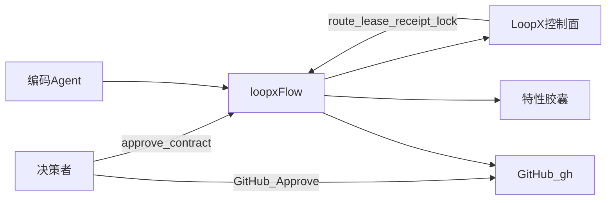

# LoopX Workflow 详细设计

- **产品需求**：[docs/prd/loopx-workflow.md](../prd/loopx-workflow.md)
- **增量决策**：[docs/adr/README.md](../adr/README.md)
- **状态**：目标设计（ADR-0002~0005 已收紧失败条件；R1/R2/R3/R4 代码落地前，现行为差异见对应 ADR 与 issue #15）

本文是命令、阶段、资产和失败条件的唯一设计正文。`docs/guides/loopx-workflow-architecture.html` 是展示页，不参与需求或设计裁决。原 `docs/design/coding-workflow-tools-spec.md` 已删除，管线内容在这里。

需求编号的含义以 PRD 为准。本文只说明它们怎样落到命令和文件。

---

## 1. 所有者

| 事情 | 所有者 | 不归谁 |
|---|---|---|
| 谁、为什么、范围、`REQ-*` | `docs/prd/loopx-workflow.md` | feature 的 `02-prd.md` |
| 命令、阶段、失败矩阵、资产路径 | 本文 | README、HTML 展示页 |
| 对产品正文的修订 | `docs/adr/NNNN-*.md` | feature 的 `01-decisions.md` |
| 一次交付的故事、契约、证据 | `specs/features/<feature>/` | 产品正文 |
| 租约、收据、合入锁、可行性路由、Goal 停机 | LoopX CLI | `loopx-flow` 不得改写其结论 |
| 场景串联、参数、退出码、文件落点 | `bin/loopx-flow` | 临时脚本，除非 ADR 说明缺口 |

`01-decisions.md` 可以记录“这个胶囊选了哪条实现”，但产品行为的取舍写进 ADR，并改 PRD。

## 2. 运行结构



编排器是 bash，入口 `bin/loopx-flow`。它在仓库根解析 `.loopx/registry.json`，存在则给 LoopX 命令加上 `--registry`。`review` 与 PR 正文调用 `skills/code-review/scripts/authentic-review.js`。`respond` 调用 `skills/code-review/scripts/respond-report.js`。质量收据适配在 `skills/code-review/scripts/ingest-to-loopx-quality.js`。

## 3. 命令与需求

用法以 `usage()` 为准。下表是设计映射，不是第二份帮助文本。

| 命令 | 实现函数 | 满足的需求 | 失败即停的要点 |
|---|---|---|---|
| `doctor` | `cmd_doctor`、`cmd_doctor_control_plane` | 环境哨兵、`REQ-ENV-1`、`REQ-ENV-2` | preflight 失败、`loopx doctor` 失败、或本机没有 `loopx` 均非 0。诊断卡含原因/影响/修复命令。控制面路由/registry 一致性、`~/.loopx` 半迁移残留、运行时工件被跟踪、GitHub API 50% 预算基线为 WARN 级检查（见 ADR-0007） |
| `init` | `cmd_init` | `REQ-MAIN-1` | 安装 pre-commit；有 `loopx` 时 `bootstrap` 失败则退出 |
| `feature <name>` | `cmd_feature` | `REQ-FAILCLOSED-2`、`REQ-CAPSULE-1`、`REQ-GOAL-1` | 分支创建或切换失败则退出，不写胶囊；注册前把未注册 Goal 的残留 `ACTIVE_STATE.md` 隔离为 `.stale-<UTC>`，隔离失败非 0（ADR-0008） |
| `approve contract <feature>` | `cmd_approve` | `REQ-CHECKPOINT-1` | 缺契约文件、缺 `loopx`、`configure-goal` 失败均非 0；先锁最终内容 SHA256，成功后才原子写入批准标记 |
| `gate verify decisions\|contract` | `cmd_gate` | `REQ-GATE-DECISIONS-1`、`REQ-CONTRACT-LOCK-1` | 见第 5 节。没有 `pr` 这个 stage |
| `check [feature] [--goal-id] [--with-ocr]` | `cmd_check` | `REQ-GATE-1`、`REQ-QUALITY-1`、`REQ-CHECK-IDENTITY-1`、`REQ-FAILCLOSED-1` | 无 feature 且无 `--goal-id` 则非 0；有胶囊时先 `gate verify contract`；四门禁后必须收据 `ok=true` 才打印成功 |
| `todo list\|claim\|done` | `cmd_todo` | `REQ-NATIVE-1` | 没有 `loopx` 则退出。`claim` / `done` 走租约，冲突由 LoopX 拒绝 |
| `issue <id>` | `cmd_issue` | `REQ-NATIVE-1`、`REQ-FAILCLOSED-1` | 只打印路由，不执行修复 |
| `integrate [--execute\|--status]` | `cmd_integrate` | `REQ-NATIVE-1` | 默认 preview，不落盘。`--execute` 才 sync 落盘 |
| `pr create\|preview\|update` | `cmd_pr` | `REQ-PR-BODY-1` | 调用 `authentic-review.js --generate-pr-body` |
| `review <pr>` | `cmd_review` | `REQ-REVIEW-1` | 模板或审查不可用则 `NOT_VERIFIED`，不发评论 |
| `respond <pr>` | `cmd_respond` | `REQ-RESPOND-1` | 四门禁或既有审查产物失败则不发评论。无 `loopx` 时 status 记为跳过 |
| `merge <pr> [feature]` | `cmd_merge` | `REQ-CHECKPOINT-2`、`REQ-CHECKPOINT-3`、`REQ-GOAL-1`、`REQ-CAPSULE-1` | 见第 6 节；已 MERGED 可重跑补步骤，任何未完成步骤非 0 |
| `context <feature>` | `cmd_context` | 审阅入口 | 打印 `00-INDEX.md` |
| `archive <feature>` | `cmd_archive` | 手动归档 | 有目录则移动。正常合入由 `merge` 移动 |
| `status` | `cmd_status` | 观察 | 没有失败即停承诺 |

`feature` 在分支成功后创建尚不存在的胶囊文件。它不代替阶段 1–4 的正文，也不检查正文是否引用了 `REQ-*`（`REQ-TRACE-2`）。状态文件的首次创建权属于 `loopx bootstrap`；编排器在注册前只能隔离未注册 Goal 的残留文件，不能预创建或改写（ADR-0008）。

### 3.1 环境治理与 API 预算前置检查 (ADR-0007)

`doctor` 在原生 `loopx doctor` 之后追加 3 段检查，输出统一为“状态 + 原因 + 影响 + 修复指令”，
非阻断但必须可见：

1. **控制面一致性**：`loopx status` 的 `runtime_root` 对比项目 `.loopx/registry.json` 的
   `common_runtime_root`；不一致时提示重新 bootstrap 或统一声明。
2. **迁移可行性**：`~/.loopx` 若存在半迁移残留（有内容但无 `registry.global.json`）则告警，
   因为 `loopx migrate-local-state` 会以 `target runtime root already exists` 失败；
   registry 中缺 `state_file` 的 goal 单独列出（迁移校验会拒绝）。
3. **测试隔离**：写 registry 的测试必须用 `LOOPX_REGISTRY` 指向临时 registry；
   `cmd_gate` 指纹核验读 `${LOOPX_REGISTRY:-<project>/.loopx/registry.json}`，真实 registry 不得被造出
   缺 `state_file` 的 orphan goal（会阻塞迁移）。
4. **运行时工件隔离**：`git ls-files` 中不得出现 `.codex/` 或 `.loopx/**/*.lock`；
   出现则提示 `git rm --cached` 并确认 `.gitignore`（收据证据污染源，见 `REQ-ENV-3`）。
5. **API 预算**：`gh api rate_limit` 展示 core limit/remaining 与 50% 基线对比；
   固定打印 secondary 与 content-generating 的官方上限和基线值。

收据证据 refs 只取已提交 scope：`ingest-to-loopx-quality.js` 的 `committedScopeFiles(baseCommit)`
使用 `git diff --name-only <base>...HEAD`，并用 `isRuntimeArtifact()` 过滤
`.codex/**`、`.loopx/**`、`*.lock`、`node_modules/**`、`.DS_Store`。

## 4. 管线 A：特性

阶段是人读的顺序。命令不会自动跑完阶段 1 到 4。

| 阶段 | 人要留下的文件 | 命令 |
|---|---|---|
| 0 体检 | 无 | `doctor`，必要时 `init` |
| 1 实现取舍 | `01-decisions.md`，产品级取舍另写 ADR | `gate verify decisions` 只检查 APPROVED 标记 |
| 2 需求切片 | `02-prd.md` 列出 `REQ-*` 或 ADR | 若行为超出 PRD，先改 PRD |
| 3 故事 | `03-stories.md` | 单次 diff 以不超过 500 行为目标，不是程序强制 |
| 4 契约与断点 1 | `04-contract.md` 顶部 TypeScript 签名与不变量；`00-INDEX.md` | `approve contract` |
| 5 实现 | 代码与测试 | `todo claim` 后再改；红灯测试先写 |
| 6 门禁 | `05-evidence.md` | `check` |
| 7 预集成与 PR | GitHub PR | `integrate`，`pr create`，`review` |
| 8 断点 2 | 归档目录与已停机的 Goal | 人在 GitHub Approve 后 `merge` |

断点 1 之前改契约，等于还没锁定。断点 1 之后改契约，下一次 `gate verify contract` 会因 SHA256 不一致失败，直到决策者再次 `approve contract`。

## 5. 契约双重锁定

`gate verify contract` 的顺序：

1. 找到 `specs/features/<feature>/04-contract.md`，否则找 `specs/archive/<feature>/04-contract.md`。都没有则失败。
2. 文件中须有 `Contract-Status` 且包含 `FROZEN & APPROVED`。
3. 用 node、`sha256sum` 或 `shasum -a 256` 计算当前文件 SHA256。
4. 读 `.loopx/registry.json`。没有文件则失败。
5. 用 `<feature>-goal` 或 `<feature>-feature` 找 Goal。找不到则失败。
6. 读取 `control_plane.progress_review.contract_revision`，缺省再看 `progress_review.contract_revision`。空则失败。
7. 与当前 SHA256 比较，不等则失败，并打印两个指纹。

`gate verify decisions` 只做文本标记检查，不计算指纹。标记须匹配 frontmatter `status: APPROVED`，或列表项里的 `Status` / `方案状态` 含 `APPROVED`。

`hard-guard` 胶囊里写过的 `docs/decisions/<feature>-decisions.md` 和 `.feat/specs/<feature>/tasks.md` 不是当前路径。不要按那份历史 PRD 恢复这两处。

## 6. 合入

`cmd_merge` 的顺序（ADR-0002）：

1. 未传 feature 时，用 `headRefName` 匹配 `feature/<name>`。
2. 读取 `gh pr view --json state,mergedAt,reviewDecision,headRefOid`。
3. 若 PR 未合并：要求 `reviewDecision == APPROVED`，否则退出；读取 `headRefOid`；没有 `loopx` 则退出；有 feature 时附加 `--goal-id <feature>-goal`；`loopx pr-review --check-merge-readiness <pr>@<oid>` 失败则退出；再读 `headRefOid`，与前面不同则退出；`gh pr merge --squash --delete-branch`。
4. 若 PR 已 `MERGED`：跳过第 3 步的合并与 readiness，只进入补偿。
5. 有 feature 且有 `loopx` 时执行 `goal-lifecycle --operation stop`。失败时检查 Goal 是否已停止；已停止视为成功，否则非 0。
6. `retire-global-goal` 与 `sync-global`：失败时先判断是否已退役/已同步；未完成则非 0。
7. 若 `specs/features/<feature>` 仍在，移到 `specs/archive/<feature>/`；已在 archive 则跳过。
8. 刷新本地 base 分支，提交并推送 archive 移动；push 失败非 0。
9. 只有 stop/retire/sync/archive 全部完成才打印“交付闭环完成”。部分失败打印“已合入、未闭环”与重跑命令。

squash 不可回滚，merge 只做前向补偿；补偿以 PR/Goal/目录的可观测状态为准，不新增独立状态机。

## 7. 管线 B：Issue

`cmd_issue`：

1. 要求本机有 `loopx` 和 `gh`。
2. 可选 `--reproduction`、`--scope`，默认 `missing` 与 `uncertain`。
3. `gh issue view` 取标题，`gh repo view` 取 `nameWithOwner`。
4. 调用 `loopx issue-fix feasibility --format json`。
5. 只接受 `fix_pr`、`comment_only`、`triage_only`。空路由或其他值退出。
6. 打印建议的下一步。`fix_pr` 的提示是去写 `tests/unit/issues/issue-<id>.test.ts` 并走 PR。命令本身不创建该测试，也不调用 `scripts/fast-fix-push.sh`。

因此 AGENTS 管线 B 里“Fast-Path 直推”和“标准 PR 的七步”是 Agent 规程，不是 `issue` 已实现的状态机。规程与命令的这个缺口记在这里。要让 `issue` 真正执行其中一条路径，必须新的 `REQ-*` 或 ADR，不能把规程当成已经满足 `REQ-NATIVE-1`。

## 8. 审查

`skills/code-review/scripts/authentic-review.js` 的发布条件：

- 先取 LoopX 原生评审包。没有 `review_template`，或章节为空，则 `NOT_VERIFIED`，退出码非 0，不发布自造五段。
- 提示词把模板的 `agent_instruction` 原样带上。章节就是 PRD `REQ-REVIEW-1` 的五段。
- 审查者使用本机默认模型的 CLI（主路径是 `codex exec`，不在编排器里写死型号）。CLI 不存在、执行失败、输出缺 `review_body` / verdict / declaration，均 `NOT_VERIFIED`。
- 代码类变更要在「具体改动」下有 `### 关键代码讲解`。
- 仅当原生 `check-result` 的 `ok === true` 才发布。
- 复审：上轮 findings 必须逐条判定 `fixed` / `reproducible` / `obsolete`，并在 `check-result` **之前**进入 `review_body`；`reproducible` 未清时 verdict 上限 `REQUEST_CHANGES`。
- 审查者 CLI 缺失时不得隐式改用另一个 CLI；只有显式 `--agent-bin` / `--cross-validate` 才换审查者。Reviewer 行与证据必须记录实际使用的模型。

`respond` 不调用 `authentic-review.js`。它要求 `.loopx/reviews/` 里已有对应该 PR HEAD 的审查产物，并在发布前跑完四门禁。没有 `loopx` 时不把 `loopx status` 当作失败。

PR 正文的逐文件说明来自真实 diff hunk/符号或模型输出；无法生成时写 `NOT_PROVIDED`。不得使用 `describeFile` 的固定路径映射，也不得写静态“已通过”。

`--with-ocr` 只影响 `check` 里的扫描脚本，不改变 `review` 的发布条件。

### 8.1 纯文档 PR 的审查豁免与静态三项自检 (ADR-0006)

当 PR 为纯 Markdown 变动（如全局架构规范治理、PR-0 决策批）时，触发双轨流转中的纯文档路径：
- **豁免 L2 代码对抗审查**：不调用 `authentic-review.js` 跑模型审查，不要求 `### 关键代码讲解`，不阻塞于缺失的 CI 状态（启用 `--no-pr-review-wait-for-ci`），不强制生成代码质量收据。
- **替代门禁：文档静态三项核验**：
  1. ADR 元数据完整（包含 `Status: Accepted`、审批人与决策日期）。
  2. 需求与设计交叉引用无死链（所引用的 `REQ-*`、`ADR-*` 存在且一致）。
  3. Markdown 语法合规。
- **合入依据**：以线下/线上研讨纪要或 `design-grill` 决策记录为准，人类 Maintainer 在 PR 页面直接 Approve 后 Squash 合入。日常特性研发采用契约与代码同分支单 PR 交付。

## 9. 资产

```
specs/features/<feature>/
├── 00-INDEX.md
├── 01-decisions.md      # 实现取舍；产品决策指向 docs/adr/
├── 02-prd.md            # 本胶囊覆盖的 REQ-* / ADR
├── 03-stories.md
├── 04-contract.md       # Contract-Status + 签名；SHA256 被控制面锁定
└── 05-evidence.md       # 门禁与收据

specs/archive/<feature>/  # merge 或 archive 移入后的整包
docs/prd/loopx-workflow.md
docs/design/loopx-workflow-design.md
docs/adr/NNNN-title.md
```

胶囊可以随特性归档。PRD、本文、ADR 不归档、不按 feature 拆分。

Goal 标识：`cmd_feature` 使用 `<feature>-goal`。契约核验同时接受 `<feature>-feature`。状态文件的目标位置是胶囊目录；合入停机使用 `--goal-id <feature>-goal`。

### 9.1 特性与规范生命周期五态模型 (ADR-0006)

严禁在代码未落地验证时在胶囊中标记 `DELIVERED`。全流程统一采用五态模型：
1. **`Proposed`**（方案研讨）：ADR 或 Feature 方案刚提出，消除“it depends”。
2. **`Accepted`**（决策获批）：决策通过人类审批（PR-0 合并或阶段 4 `approve contract` 指纹锁定），允许认领实现。
3. **`Implemented`**（代码就绪）：代码编写完毕，四大门禁本地通过。
4. **`Verified`**（验证完成）：真实路径测试与质量收据融合通过，0 未决 Blocker。
5. **`Released`**（主干发布）：`loopx-flow merge` 完成 Squash 合入，胶囊原子归档至 `specs/archive/<feature>/`。

## 10. 失败矩阵

| 条件 | 命令 | 结果 |
|---|---|---|
| 工作区阻止分支切换 | `feature` | 非 0，不创建胶囊 |
| 契约 SHA256 与锁定值不同 | `gate verify contract` | 非 0 |
| 注册表或锁定指纹缺失 | `gate verify contract` | 非 0 |
| 任一 npm 门禁失败 | `check` | 非 0，不进入后续门禁 |
| 有 feature 但无 `loopx` 或收据 `ok !== true` | `check` | 非 0 |
| 无 feature 且无 `--goal-id` | `check` | 非 0，不执行收据核验 |
| 无 `loopx` | `todo` / `issue` / `integrate` / `merge` | 非 0 |
| 无 `loopx` | `doctor` | 非 0，输出诊断卡 |
| `reviewDecision != APPROVED` | `merge` | 非 0，不调用 `gh pr merge` |
| 合入锁失败或 HEAD 在锁后变化 | `merge` | 非 0 |
| 无 `loopx` | `approve` | 非 0，且不写批准标记 |
| `configure-goal` 失败 | `approve` | 非 0，契约保持未批准 |
| `sync-global` 重试后仍失败 | `feature` / `approve` | 非 0 |
| 未注册 Goal 的残留状态文件无法隔离 | `feature` | 非 0，不注册 Goal |
| 质量扫描存在 blocker | `ingest` / `check` | record 前非 0 |
| PR 已 MERGED 且仍有未完成步骤 | `merge` | 不重复合并，补步骤；全部完成才成功 |
| `goal-lifecycle stop` 失败 | `merge` | 非 0；GitHub squash 可能已完成 |
| 全局退役、`sync-global` 或 archive 失败 | `merge` | 非 0；打印已合入未闭环与重跑命令 |
| 审查模板或审查者不可用 | `review` | `NOT_VERIFIED`，非 0，不发评论 |
| 四门禁失败或没有既有审查产物 | `respond` | 非 0，不发评论 |
| 无 `loopx` | `respond` | `loopx status` 记为跳过，其余条件仍生效 |
| 当前分支是 `main` 或 `master` | 已安装的 pre-commit | 拒绝 `git commit` |
| 未跑过 `init` | `git commit` on `main` | 钩子不存在，本仓库命令不会拦截 |

## 11. 需求到现有胶囊

胶囊是这些需求的历史实现记录。它们的 `02-prd.md` 正文不改。产品含义以 PRD 编号为准。

| 需求 | 历史胶囊 | 代码落点 |
|---|---|---|
| `REQ-FACADE-1` `REQ-FACADE-2` | `cli-flow` | `bin/loopx-flow` `usage()` |
| `REQ-CHECKPOINT-1` `REQ-CONTRACT-LOCK-1` `REQ-FAILCLOSED-2` | `fail-closed-hardening` | `cmd_approve`、`cmd_gate`、`cmd_feature` |
| `REQ-CHECKPOINT-2` `REQ-MAIN-1` `REQ-GATE-DECISIONS-1` | `hard-guard` | `cmd_merge` 前段、`scripts/git-hooks/pre-commit`、`cmd_gate` decisions |
| `REQ-CHECKPOINT-3` | `delivery-review-merge-lock` | `cmd_merge` 的 readiness 与二次 HEAD |
| `REQ-GATE-1` | `core-gates-hardening` | `cmd_check` 的四个 `npm run` |
| `REQ-QUALITY-1` | `change-quality-failclosed` | `ingest-to-loopx-quality.js`、`change-quality verify` |
| `REQ-REVIEW-1` `REQ-PR-BODY-1` `REQ-RESPOND-1` | `authentic-review-pipeline`、`loopx-ecosystem-alignment` | `authentic-review.js`、`respond-report.js`、`cmd_pr`、`cmd_respond` |
| `REQ-NATIVE-1` | `native-dispatch-deep-integration` | `cmd_todo`、`cmd_issue`、`cmd_integrate` |
| `REQ-GOAL-1` | `loopx-ecosystem-alignment`、`fail-closed-hardening` | `cmd_merge` 的 goal stop/retire/sync/archive 补偿 |
| `REQ-CHECK-IDENTITY-1` | `fail-closed-hardening` | `cmd_check`、`ingest-to-loopx-quality.js` |
| `REQ-QUALITY-2` | `change-quality-failclosed` | `ingest-to-loopx-quality.js`、`authentic-review.js` 的 PR body |
| `REQ-CAPSULE-*` `REQ-TRACE-*` | 本次文档变更，无新胶囊 | `docs/prd`、`docs/design`、`docs/adr`、`AGENTS.md` |

## 12. 以后改设计时删什么

- 改一条命令的失败条件：改 PRD 里对应 `REQ-*` 或新增编号，改本文矩阵的同一行，删掉与之矛盾的句子。不要在 README 再写一遍。
- 退役一条命令：从 `usage()`、本文第 3 节和 PRD `REQ-FACADE-1` 一起删。
- 不要把产品需求写回某个 `02-prd.md` 来“补充正文”。那个文件只加编号。
- 仍暴露的 LoopX 原生命令封装按 issue #15 的清单逐步收敛；每关闭一条，同步更新本节、PRD `REQ-FACADE-*` 与 usage。
