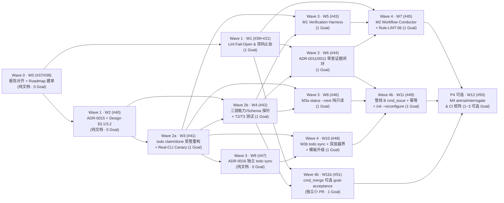

# LoopX-Workflow 整合与 ADR-0008～0012 全量收口实施计划

- **状态**：Approved Plan（Wave 0 已完成 GitHub `#37`～`#51` 建单、旧 PR `#23` 关闭与调研报告对齐）
- **日期**：2026-11-20
- **文档分级**：L3 实施计划留档（依据 [ADR-0001](../adr/0001-product-source-of-truth.md) 与 [ADR-0006](../adr/0006-document-code-change-governance.md)，本文件不替代 `docs/prd/loopx-workflow.md`、`docs/design/loopx-workflow-design.md` 与 `docs/adr/` 产品正文）
- **仓库基线**：`main@f90d7b6`（最新 ADR 为 [ADR-0014](../adr/0014-temp-artifact-path-remediation-and-history-sanitization.md)）
- **授权模式**：`single_owner`（见 [loopx-workflow.config.json](../../loopx-workflow.config.json)）
- **上游锚点**：
  - LoopX：`loopx-project/loopx@f4c5d6d7`（本机实测 `loopx 2.3.0`）
  - Pstack：`pstack@0.15.46`（MIT 协议，仅稀疏拉取 R0 原文与 `LICENSE` 后即删临时缓存）
- **关联调研与存量 ADR**：
  - [2026-11-19 Pstack / Magpie / LoopX 整合调研报告](../research/2026-11-19-pstack-magpie-loopx-integration-validation.md)
  - [ADR-0008](../adr/0008-application-orchestration-layer.md) ～ [ADR-0014](../adr/0014-temp-artifact-path-remediation-and-history-sanitization.md)

---

## 一、已拍板决策与开工前置核对

### 1.1 五项已确认决策

| 编号 | 决策主题 | 最终拍板口径 |
|---|---|---|
| **决策 1（Q1）** | `claim_operation_id` 跨进程缓存与过期恢复 | `loopx-flow todo claim` 缓存凭证至 `$LOOPX_TMP_DIR/claims/<gid>--<tid>.json`，读回校验五元组（`goal_id` / `todo_id` / `agent_id` / `registry_path` / `handoff_mode`）。`todo done` 走**双分流契约**：租约有效且同 Owner 时自动补领 receipt；**已过期 / 已释放 / 已转让 / `deferred` 时一律停机、原样透出 LoopX `recovery` 信息并提示显式重跑 `loopx-flow todo claim`**（不静默重新 claim）。 |
| **决策 2（Q2）** | 受管 Agent Todo 注入时机与幂等策略 | 拆分为独立命令 **`loopx-flow todo sync <feature> [--dry-run] [--supersede <tid>]`**（不耦合在 `approve contract` 内）。采用 `operation_id = wf-sync:<feature>:<sha12>:<story>` 幂等注入；合同修订后保留已 `done` Todo，对漂移的进行中 Todo 阻断并要求显式 `--supersede`。 |
| **决策 3** | 上游 LoopX 契约锚点 | 锚定 `loopx-project/loopx@f4c5d6d7`；通过三层探针（子命令 `--help` 签名 + `schema_version` 白名单 Fail-Closed + 版本号软提示）应对 LoopX 小版本演进，并配 `$LOOPX_TMP_DIR` 隔离 Registry 下的 Real-CLI Canary 测试。 |
| **决策 4** | Pstack Verification Harness 复用方式 | 稀疏拉取 `pstack@0.15.46` R0 原文与 MIT `LICENSE` 落地至 `skills/verification-harness/`，随后彻底清理临时克隆缓存；在仓库内补充 `loopx-adaptation.md` 与 `features/cli-surface.md` 并冷启动 Prove 自证。 |
| **决策 5** | 经验沉淀与 `AGENTS.md` 反膨胀 | 不设机械行数硬阻断 Lint；执行四级漏斗 `Finding → Root Cause → Candidate Guard + Failing Test 先红后绿 → Human Review → Merge`，能进 L1/L2 守卫的规则一律不进 `AGENTS.md`。 |

### 1.2 开工前必须先处理的两项偏差

1. **恢复本地工作区基线**：
   - 当前 `git status` 显示 `skills/*` 存在未提交删除（已镜像于未跟踪目录 `orbital/skills/`）。正式建分支前须在干净 `main@f90d7b6` 上执行 `git checkout -- skills/` 并运行 `./scripts/preflight-check.sh` 验证环境就绪。
2. **在 W0 优先回写 11-19 调研报告偏差**：
   - [2026-11-19 调研报告 §8.3.5 Q1](../research/2026-11-19-pstack-magpie-loopx-integration-validation.md#L380) 仍保留“过期态同 Owner 自动续接/重建”旧表述，须同步改为**过期停机并透出 `recovery`**；
   - [§8.3.5 Q2](../research/2026-11-19-pstack-magpie-loopx-integration-validation.md#L381) 与 [§10.1 M3](../research/2026-11-19-pstack-magpie-loopx-integration-validation.md#L428) 仍保留 `approve contract` 自动注入表述，须同步改为**独立命令 `loopx-flow todo sync <feature>`**，并统一基线为 `main@f90d7b6`。

---

## 二、GitHub 线上号段对齐与存量单据处置

> **严禁编造 `Issue-0 / PR #0` ～ `#10`**：仓库已按 [ADR-0014](../adr/0014-temp-artifact-path-remediation-and-history-sanitization.md#L23) 路径 B 保留了 GitHub 仓库与历史单据，当前线上最新编号已至 **PR `#36`**，且 GitHub Issue 与 PR 共用同一个全局自增序列。

1. **内部代号与真实编号解耦**：
   - 本计划使用 **`W0`～`W12` + `W11b`** 作为工作项代号（Work Item ID）；
   - Wave 0 已通过 `gh issue create` 实建完整追踪树，真实占用 **`#37`（Roadmap 父 Issue）** 与 **`#38`～`#51`（14 个子 Issue：W0～W12 为 `#38`～`#50`，Stage 7 增补的 W11b 为 `#51`）**，后续 PR 从 **`#52` 起**由 GitHub 动态分配；
   - 所有分支名、Commit Message（`Closes #<真实号>`）与文档引用一律使用 `gh issue create` 返回的真实线上编号。
2. **存量线上 `OPEN` 单据对账**：
   - **关闭失效旧 PR `#23`（已完成）**：其分支 `agent/loopx/04388b47602e` 基于 `git filter-repo` 净化前的旧历史，已处于 `DIRTY` 冲突态，已在 W0 关闭并说明由 W1（`#39`）承接；
   - **复用并关闭存量 Issue `#21`（`OPEN`）**：`.gitignore` 补齐 6 类漏项（`.loopx/` 与 `.codex/` 已由 ADR-0014 落地，剩余 `.env*`、`.claude/`、`.cursor/`、`orbital/` 等并入 **W1 `#39`** 彻底收口，`Closes #21`）；
   - **联动推进存量 Issue `#6`（`OPEN`）**：`[backlog] 持续封装 loopx-flow 仍暴露的 LoopX 原生命令` —— 在 **W3 (`#41`)**、**W9 (`#47`)**、**W10 (`#48`)** 中标注 `Part of #6`。

---

## 三、ADR 规划清单（按 ADR 准入矩阵：仅立 2 份新 ADR）

依据 [ADR-0001](../adr/0001-product-source-of-truth.md) 与 [ADR-0008 决策 6](../adr/0008-application-orchestration-layer.md#L20)（**Accepted 前不得冻结契约或开始编码**），全周期仅立 **2 份增量 ADR**：

| ADR 编号 | 目标文件 | 触发节点 | 命中准入矩阵的原因 | 同步修订正文 |
|---|---|---|---|---|
| **ADR-0015** | `docs/adr/0015-todo-managed-execution-and-capability-probe.md` | **W2（P0 / M0 前置）** | 改变共享执行契约与默认失败条件：`todo claim/done` 从手工 `task-lease` 迁移至受管 `loopx todo claim/complete` + 凭证缓存与双分流停机恢复；确立三层能力/`schema_version` Fail-Closed 探针 | 修订 `docs/prd/loopx-workflow.md`（`REQ-LEASE-1`、`REQ-CAPABILITY-1`）、`docs/design/loopx-workflow-design.md`（§3.1 补齐前置/后置与证据契约 2 列、新增 §3.2 L0 7 步执行协议及六结果语义、更新 §10）；在 [ADR-0010](../adr/0010-command-contracts-and-execution-protocol.md) `REQ-LEASE-1` 节标注 `Superseded by ADR-0015` |
| **ADR-0016** | `docs/adr/0016-todo-sync-and-write-scope-boundary.md` | **W9（P3 / M3b 前置）** | 改变 L0 命令面、共享契约 Schema 与默认阻断条件：新增 `loopx-flow todo sync <feature>`；固化 `04-contract.md` Story 执行表；确立合同修订漂移阻断与**双层写范围越界 Fail-Closed**（`todo done` 核验单任务增量 vs `check` 核验本 Feature 所有已同步 Story 的 `required_write_scopes` 并集 ∪ `specs/features/<feature>/**`） | 修订 `docs/prd/loopx-workflow.md`（`REQ-FACADE-1`、新增 `REQ-TODO-SYNC-1`）、`docs/design/loopx-workflow-design.md`（§3、§3.1、§4、§10） |

**2026-11-27 修订：ADR-0017 追加（P0，前置）**

| ADR 编号 | 目标文件 | 触发节点 | 命中准入矩阵的原因 | 同步修订正文 |
|---|---|---|---|---|
| **ADR-0017** | `docs/adr/0017-review-pipeline-reliability.md`（已起草，Proposed） | **W13（P0，插入在 Issue #6「持续封装」相关 ADR 之前）** | 改变审查管线默认行为与非纯增量本地状态：`loopx_flow_review_stage_state_v1` 阶段状态、`REVIEW_TIMEOUT_MS` 超时预算、重试 / salvage 接受策略、并发隔离与跨进程续跑；这些语义此前由 PR #73 夹带引入，无 REQ/ADR 承接 | 修订 `docs/prd/loopx-workflow.md`（`REQ-REVIEW-2` 增补阶段状态与超时契约）、`docs/design/loopx-workflow-design.md`（审查管线章节）；在 [ADR-0013](../adr/0013-align-review-architecture-with-loopx-philosophy.md) 标注衔接关系；新增设计 §8.2.2 可靠性契约与 §8.3 能力消费矩阵 |

**优先级（2026-11-27 拍板）**：ADR-0017 排期**前置**于 Issue #6「持续封装 loopx-flow 仍暴露的 LoopX 原生命令」所涉 ADR。理由：审查管线是 PR 生命周期证据的生产者，其可靠性缺陷会让后续所有 PR 的评审证据失真（Issue #78 已实证 stage1 超时导致证据缺失），属「先修工具、再修产品」。跟踪单：[#79](https://github.com/JustinIanAI/loopx-workflow/issues/79)。

**编号让位**：W12 行预留的「未来升级为默认强制门禁时再立 `ADR-0017`」顺延为 **ADR-0018**。

**明确不立 ADR 的模块（直接引用既有 ADR / REQ）**：
- W1（Lint Fail-Open、现码 Bug 修复、`.gitignore`、`ACTIVE_STATE.md` 清理）→ 归属 `ADR-0014` / `ADR-0008` / `REQ-FAILCLOSED-1`
- W5（M1 `skills/verification-harness/`）→ 归属 `ADR-0011`
- W6（Formal Review 通道切换与证据契约/六问闭环）→ 归属 `ADR-0011` / `ADR-0012`
- W7（M2 `skills/workflow-conductor/` + 命令面守卫）→ 归属 `ADR-0008` / `ADR-0010` / `REQ-CONDUCTOR-1`
- W8（M3a `status --next` 纯只读聚合）→ 归属 `ADR-0010` / `REQ-STATUS-NEXT-1`
- W11（管线 B `cmd_issue` 闭环、幂等重入与 `init --reconfigure`）→ 归属 `ADR-0012` / `ADR-0010` / `ADR-0014`
- W11b（`cmd_merge` 可选 `goal-acceptance` 校验，独立小 PR）→ 归属 `ADR-0012` 决策 8 / `ADR-0015`
- W12（M4 可选 `arena` / `interrogate` 与 CI 兼容矩阵）→ 归属 `ADR-0013` / `REQ-REVIEW-2`（仅未来升级为默认强制门禁时再立 `ADR-0018`；原预留 `ADR-0017` 已让位给审查管线可靠性专项）

---

## 四、执行依赖拓扑（Execution DAG）与并行波次



### 并行波次排程（控制单 PR Diff ≤ 500 行、同时活跃 Goal ≤ 3 个）

| 波次 | 并行工作项 | 同时活跃 Goal 峰值 | 解锁条件 |
|---|---|---|---|
| **Wave 0** | `W0`（恢复 `skills/*` → 建 `#37`～`#51`、关 `#23` → 合入调研报告对齐 PR） | `0` | 无，立即启动 |
| **Wave 1** | `W1`（止血代码） ∥ `W2`（`ADR-0015` 人工评审签批） | `1`（仅 W1） | `W0` 合入 |
| **Wave 2** | `W3`（`todo` 受管重构） → `W4`（三层探针，依赖 `W2` 与 `W3`） | `1`（串行推进） | `W2` 获批 `Accepted` |
| **Wave 3** | `W5`（M1） ∥ `W6`（ADR-0011/0012 收口） ∥ `W8`（M3a `status --next`） ∥ `W9`（`ADR-0016` 纯文档评审） | `3`（W5/W6/W8） | `W1` + `W3` + `W4` 合入 |
| **Wave 4** | `W7`（M2 Conductor） ∥ `W10`（M3b `todo sync`） → `W11`（管线 B 与收尾） ∥ `W11b`（`cmd_merge` 可选 `goal-acceptance` 校验） | `2`（W7/W10，随后 W11/W11b） | `W5`+`W6` 解锁 W7；`W9` 解锁 W10；`W6`+`W8`+`W10` 解锁 W11；`W1`+`W4` 解锁 W11b |
| **Wave 5（可选）** | `W12`（M4 `arena`/`interrogate` & CI 兼容矩阵） | `1`（按需逐项展开） | `W7` + `W11` + `W11b` 稳定运行后评估 |

---

## 五、分优先级任务明细（W0 ～ W12）

### P0：基线止血、报告对齐与控制面契约修复（Pre-M0 + M0）

| 工作项 | 预计真实 Issue（标签 / 关联） | 变更类型 & LoopX Goal | 交付 PR 范围与关键文件 | `Implemented → Verified` 验收门禁 |
|---|---|---|---|---|
| **W0** | **`#37`**（Roadmap 父 Issue，`wayfinder:map`）<br>**`#38`**（子 Issue，`ready-for-human`）<br>引用 `ADR-0006` | 纯文档 PR<br>**0 个 Goal** | `docs(research): align validation report with approved Q1/Q2/Q3 decisions & main@f90d7b6 (Closes #38)`<br>• 恢复 `skills/*` 干净工作区并运行 `./scripts/preflight-check.sh`<br>• 创建 `#37`～`#51` 真实 Issue 树（含 W11b `#51`），关闭过期 `DIRTY` PR `#23`<br>• 回写 [2026-11-19 调研报告](../research/2026-11-19-pstack-magpie-loopx-integration-validation.md) §8.3.5 Q1/Q2、§10.1 M3 与 `main@f90d7b6` 基线 | 文档静态三项核验通过；报告前后无自相矛盾 |
| **W1** | **`#39`**（`ready-for-agent`）<br>**复用 `#21`**（`OPEN`）<br>引用 `ADR-0014`、`ADR-0008`<br>`Closes #21, Closes #39` | Feature 代码 PR<br>**1 个 Goal**<br>`baseline-hygiene-and-lint-guard-goal` | `fix(lint): close gate-lint fail-open, fix locale/pr-create bugs & close #21`<br>• 修 [scripts/gate-lint.sh:173-175](../../scripts/gate-lint.sh#L173-L175) `git ls-files` 失败静默 `exit(0)` 改为 `exit(1)`；补 `LINT-03/04/05` 与 4 类静态守卫自测<br>• **精确清理吞错（禁盲删）**：保留 [bin/loopx-flow:990,1004](../../bin/loopx-flow#L990-L1004) `mode_a/b_readiness_ok` 非 0 JSON 捕获，改为在 [bin/loopx-flow:975](../../bin/loopx-flow#L975) `readiness_json_field` 容忍前置非 JSON 噪声；检查 [L1145](../../bin/loopx-flow#L1145) `register-agent` 幂等退出码；[L2629-2631](../../bin/loopx-flow#L2629-L2631) 留待 W3 随 `cmd_todo_lease` 一并退役<br>• 修 [bin/loopx-flow:314](../../bin/loopx-flow#L314) `${f}：` locale 崩溃与 [bin/loopx-flow:1597-1651](../../bin/loopx-flow#L1597-L1651) `cmd_pr create` 透传 `--base` 与 `passthru_args`<br>• `git rm --cached` 清理 4 个存量 `ACTIVE_STATE.md`（ADR-0008 项 1）<br>• 补齐 `#21` 剩余 `.gitignore` 项（`.env*`、`.claude/`、`.cursor/`、`orbital/` 等） | `LC_ALL=C.UTF-8` 与 `en_US.UTF-8` 下四大门禁全绿；`adr-0012-gate2.test.js` 全绿；`git ls-files` 失败突变测试必红；`#21` 项验收通过 |
| **W2** | **`#40`**（`ready-for-human`）<br>新建 **`ADR-0015`** | 纯文档 / ADR PR<br>**0 个 Goal** | `docs(adr): accept ADR-0015 for managed todo execution, capability probe & L0 contract table (Closes #40)`<br>• 新增 `docs/adr/0015-todo-managed-execution-and-capability-probe.md`<br>• 修订 `docs/prd/loopx-workflow.md`（`REQ-LEASE-1`、`REQ-CAPABILITY-1`）与 `docs/design/loopx-workflow-design.md`（补齐 §3.1 前置/后置条件与证据契约 2 列、新增 §3.2 L0 7 步执行协议及六结果语义、更新 §10）<br>• 在 [ADR-0010](../adr/0010-command-contracts-and-execution-protocol.md) `REQ-LEASE-1` 增补节标注 `Superseded by ADR-0015` | 人类签批 `Accepted`；文档静态三项核验通过；关闭 ADR-0010 项 1 |
| **W3** | **`#41`**（`ready-for-agent`）<br>`ADR-0015`、`REQ-LEASE-1`<br>`Part of #6, Closes #41` | Feature 代码 PR<br>**1 个 Goal**<br>`todo-managed-execution-goal` | `feat(todo): delegate todo claim/done to LoopX managed execution with real-CLI canary (Closes #41)`<br>• `delete-first` 退役 [bin/loopx-flow:2883-3066](../../bin/loopx-flow#L2883-L3066) ~180 行手工 `task-lease` 与 [L2629-2631](../../bin/loopx-flow#L2629-L2631) 旧目录读取<br>• 直接委托 `loopx todo claim` / `loopx todo complete`；在 `$LOOPX_TMP_DIR/claims/<gid>--<tid>.json` 缓存 `claim_operation_id` 并校验四元组<br>• 落地 Q1 双分流恢复：同 Owner 且有效自动补领；过期/释放/转让/`deferred` 停机并原样输出 `recovery`<br>• 新增隔离 Registry（`os.tmpdir()`/`$LOOPX_TMP_DIR`）Real-CLI Canary 测试（覆盖 `hard_lease` / `soft_claim`、`done` / `released`） | 真实 `loopx 2.3.0` 全链路单测全绿；过期/他方持有/`deferred` 均 Fail-Closed 并透出 `recovery`；四大门禁全绿 |
| **W4** | **`#42`**（`ready-for-agent`）<br>`ADR-0015`、`REQ-CAPABILITY-1`<br>`Closes #42` | Feature 代码 PR<br>**1 个 Goal**<br>`loopx-capability-probe-goal` | `feat(probe): add 3-layer LoopX capability & schema_version fail-closed probe (Closes #42)`<br>• 落地集中式 `probe_loopx_capabilities`（子命令 `--help` 必填 Flag 签名 + `schema_version` 白名单 Fail-Closed + 版本号软提示 + 升级差异诊断卡）<br>• 在 `doctor` 中输出 LoopX 能力矩阵<br>• 补齐 ADR-0010 T2/T3 Contract Fake CLI 负向测试（缺 Flag、未知 `schema_version`、`issue-fix`/`integration-branch` 缺失非 0） | 缺 Flag / 未知 `schema_version` 均非 0 退出并输出诊断卡；ADR-0010 T2/T3 全绿 |

### P1～P2：真实表面验证、审查证据闭环与 Conductor 中枢（M1 + ADR-0011/0012 + M2）

| 工作项 | 预计真实 Issue（标签 / 关联） | 变更类型 & LoopX Goal | 交付 PR 范围与关键文件 | `Implemented → Verified` 验收门禁 |
|---|---|---|---|---|
| **W5** | **`#43`**（`ready-for-agent`）<br>`ADR-0011`<br>`Closes #43` | Feature Skill PR<br>**1 个 Goal**<br>`verification-harness-goal` | `feat(skills): add verification-harness with Pstack upstream reuse & cli-surface proof (Closes #43)`<br>• 稀疏拉取 `pstack@0.15.46` R0 原文与 MIT `LICENSE` 至 `skills/verification-harness/` 后即删临时缓存<br>• 编写 `SKILL.md`、`references/loopx-adaptation.md`、`features/cli-surface.md`<br>• 冷启动执行 Prove 自证 `cli-surface.md` 并产出 Proof 证据 | 冷启动 Prove 通过；沙箱清理后 Proof 留存、宿主机零残留；四大门禁全绿 |
| **W6**<br>*(补漏)* | **`#44`**（`ready-for-agent`）<br>`ADR-0011`、`ADR-0012`<br>`Closes #44` | Feature 代码 PR<br>**1 个 Goal**<br>`review-evidence-closure-goal` | `feat(review): switch to GitHub formal review and complete ADR-0011 evidence/freshness/PR-6Q contract (Closes #44)`<br>• [skills/code-review/scripts/respond-report.js:92-93](../../skills/code-review/scripts/respond-report.js#L92-L93) 精确 `head` 缺失改为 Fail-Closed（ADR-0011 T4）<br>• [skills/code-review/scripts/authentic-review.js:172-223](../../skills/code-review/scripts/authentic-review.js#L172-L223) 切换 `pulls/<pr>/reviews` Formal Review 发布并 `delete-first` 退役 `agent_comment_ok` 旧 issue-comment 兜底（ADR-0012 决策 4）<br>• [skills/code-review/scripts/ingest-to-loopx-quality.js](../../skills/code-review/scripts/ingest-to-loopx-quality.js) 补齐 `05-evidence.md` 16 字段/六状态、Freshness 失效矩阵、`REQ-TRACE-3` WARN、运行态 `evidence_refs` 过滤<br>• `buildBody` 接入 PR 六问 + `Real-vs-Mock` 列，同步清理 [docs/QUICKSTART.md](../QUICKSTART.md) 与 [.github/PULL_REQUEST_TEMPLATE.md](../../.github/PULL_REQUEST_TEMPLATE.md) | ADR-0011 T2/T4/T5/T6 与 Formal Review 单测全绿；无旧兜底残留 |
| **W7** | **`#45`**（`ready-for-agent`）<br>`ADR-0008`、`ADR-0010`、`REQ-CONDUCTOR-1`<br>`Closes #45` | Feature Skill + Lint PR<br>**1 个 Goal**<br>`workflow-conductor-goal` | `feat(conductor): add workflow-conductor routing hub, coordinator-worker contract & surface lint (Closes #45)`<br>• 落地 `skills/workflow-conductor/SKILL.md`（`Principles × Playbooks × Skills × L0 Commands` 四层路由、`Coordinator × Worker` 主从规约、阶段 1 只读并行 `architect`、经验沉淀四级漏斗、`REQ-FACADE-2` 降级披露规范）<br>• 在 `scripts/gate-lint.sh` 新增 `Rule-LINT-06` 三方命令面一致性守卫（`bin/loopx-flow` / `docs/design/loopx-workflow-design.md` / `AGENTS.md`） | 命令面三方突变测试必红；ADR-0010 T4/T5 通过；四大门禁全绿 |

### P3～P4：只读 `status --next`、独立 `todo sync`、管线 B 收口与可选 M4（M3 + M5 + M4）

| 工作项 | 预计真实 Issue（标签 / 关联） | 变更类型 & LoopX Goal | 交付 PR 范围与关键文件 | `Implemented → Verified` 验收门禁 |
|---|---|---|---|---|
| **W8** | **`#46`**（`ready-for-agent`）<br>`ADR-0010`、`REQ-STATUS-NEXT-1`<br>`Closes #46` | Feature 代码 PR<br>**1 个 Goal**<br>`status-next-readonly-goal` | `feat(status): refactor status --next into read-only multi-authority projection (Closes #46)`<br>• 重构 `cmd_status_next` 为纯只读多权威聚合：`gate verify contract` + `loopx status --include-task-graph` + `loopx change-quality verify` + `gh pr view` + `loopx pr-review`（禁传 `--goal-id`）<br>• 缺失信号显式输出 `NOT_VERIFIED`，零写入副作用 | ADR-0010 T1 只读零写入测试全绿；缺失任一权威源输出 `NOT_VERIFIED` |
| **W9** | **`#47`**（`ready-for-human`）<br>新建 **`ADR-0016`**<br>`Part of #6, Closes #47` | 纯文档 / ADR PR<br>**0 个 Goal** | `docs(adr): accept ADR-0016 for standalone todo sync and two-level write-scope enforcement (Closes #47)`<br>• 新增 `docs/adr/0016-todo-sync-and-write-scope-boundary.md`（写死双层越界基准：`todo done` 单任务增量 vs `check` 全 Feature Story 并集 ∪ `specs/features/<feature>/**`）<br>• 同步修订 `docs/prd/loopx-workflow.md`（`REQ-FACADE-1`、`REQ-TODO-SYNC-1`）与 `docs/design/loopx-workflow-design.md` | 人类签批 `Accepted`；文档静态三项核验通过 |
| **W10** | **`#48`**（`ready-for-agent`）<br>`ADR-0016`、`REQ-TODO-SYNC-1`<br>`Part of #6, Closes #48` | Feature 代码 PR<br>**1 个 Goal**<br>`todo-sync-write-scope-goal` | `feat(todo): add idempotent todo sync, worktree scope triple & two-level diff guard (Closes #48)`<br>• 实现 `loopx-flow todo sync <feature> [--dry-run] [--supersede <tid>]`（`wf-sync:<feature>:<sha12>:<story>` 幂等、透传 `--task-domain code` / `--task-repository` / `--required-write-scope` / `--unblocks-todo-id` / `--validation-command`）<br>• **一次性升级** [bin/loopx-flow:550-572](../../bin/loopx-flow#L550-L572) `cmd_feature` 的 `04-contract.md` 模板（纳入 AC 矩阵、Scope、五维 Verification Plan、依赖顺序与 Story 执行表；`gate1_spec_complete` 保持对旧测试夹具兼容）<br>• 实现 `todo done`（单任务增量）与 `check`（全 Feature Story 并集 ∪ `specs/features/<feature>/**`）双层写范围越界核验 | 双 Worktree 并行 `todo claim` 实测通过；同 Worktree 冲突拒批；多 Story 连续 `check` 与 `05-evidence.md` 回写不误杀 |
| **W11**<br>*(补漏)* | **`#49`**（`ready-for-agent`）<br>`ADR-0012`、`ADR-0010`、`ADR-0014`<br>`Closes #49` | Feature 代码 PR<br>**1 个 Goal**<br>`issue-pipeline-and-reconfigure-goal` | `feat(flow): wire cmd_issue fix_pr lifecycle, idempotent feature/archive & init --reconfigure (Closes #49)`<br>• `cmd_issue` 在 `decision.route == fix_pr` 时端到端串联 Goal / Todo / Evidence / Gate2（ADR-0012 决策 7）<br>• `cmd_feature` 重入判 Goal、`cmd_archive` 移动前判重不嵌套（ADR-0010 T6）、`pr create --draft` 失败降级提示 `presentation=pending`（ADR-0009 决策 10）<br>• 实现 `loopx-flow init --reconfigure` 授权模式受控切换（ADR-0014 挂账）与 `specs/features/` 存量完结胶囊归档 | ADR-0010 T6、管线 B 与 `init --reconfigure` 单测全绿；配合 W11b 完成 ADR-0008～0012 全量 `Verified` |
| **W11b**<br>*(独立小 PR)* | **`#51`**（`ready-for-agent`）<br>`ADR-0012` 决策 8、`ADR-0015`<br>`Closes #51` | Feature 代码 PR<br>**1 个 Goal**<br>`merge-goal-acceptance-goal` | `feat(merge): wire optional goal-acceptance verification with capability probe (Closes #51)`<br>• 将 `loopx goal-acceptance verify --format json` 接入 W4 统一能力探针与 `schema_version` Fail-Closed 白名单<br>• 在 `cmd_merge` 接入可选 `goal-acceptance` 校验开关/配置（默认关闭，JSON 解析复用 W1 前置噪声容忍）<br>• 启用且失败或解析异常时 Fail-Closed 阻断合入并输出明确 `blocking_reasons` | 覆盖未启用 / 启用通过 / 启用失败阻断 / 未知 `schema_version` 或 CLI 异常单测，四大门禁全绿 |
| **W12**<br>*(可选)* | **`#50`**（`needs-triage`）<br>`ADR-0013`、`REQ-REVIEW-2` | 可选扩展 PR（1～3 个）<br>**1～3 个可选 Goal** | 待 M0～M3 与 W11/W11b 稳定后按需拆分：<br>• `W12a`：Gate1 前沙箱 `arena`（Graft 后重审）<br>• `W12b`：阶段 7 可选异构二审 `interrogate`（与 LoopX `pr-review` 权威解耦）<br>• `W12c`：LoopX 多版本 CI 兼容矩阵 | 默认关闭、显式开启生效；不绕过 Gate1 / Gate2 |

---

## 六、LoopX Goal 产出数量核算

### 6.1 核算规则依据

1. **核心对象模型（[ADR-0008 决策 3](../adr/0008-application-orchestration-layer.md#L16)）**：默认 **`1 Feature : 1 Goal`**（`loopx-flow feature <feature>` 绑定 `<feature>-goal`）；同 Feature 内的多个 Story 注册为该 Goal 下的 Agent Todos，不单独开 Goal；不做 Program-level Goal。
2. **纯文档 / ADR PR 豁免（[ADR-0006 `REQ-DOCS-DELIVERY-1`](../adr/0006-document-code-change-governance.md#L27)）**：纯 Markdown 文档与 ADR 批交付豁免 Feature 胶囊、Gate1 契约锁与代码质量收据，走静态三项核验直接 PR 合入，**产生 0 个 LoopX Goal**。
3. **自动收尾机制（[ADR-0012 决策 8](../adr/0012-delivery-authorization-and-recovery.md#L28)）**：每个代码 Feature PR 合入时，`loopx-flow merge` 会自动执行 `goal-lifecycle stop` + `retire-global-goal` + `sync-global` + 胶囊归档，因此 Goal 不会在主仓库长期堆积。

### 6.2 精确统计结论

| 统计维度 | 数量 | 明细说明 |
|---|---|---|
| **必做核心范围（W0～W11b）生产 Goal 总数** | **10 个** | 13 个必选工作项 = **3 个纯文档 PR（0 Goal：W0、W2、W9）** + **10 个代码/Skill Feature PR（各 1 Goal：W1、W3、W4、W5、W6、W7、W8、W10、W11、W11b）** |
| **可选扩展范围（W12 / M4）Goal 总数** | **1～3 个（可选）** | 仅在 M0～M3 与 W11/W11b 稳定后决定启动时产生（`arena` / `interrogate` / CI 兼容矩阵按需拆 1～3 个 Feature） |
| **全计划上限（含 M4 可选）** | **11～13 个** | 10 个必选 + 1～3 个可选 |
| **测试隔离临时 Goal** | **0 个主仓残留** | W3 Real-CLI Canary 与单测全部在 `os.tmpdir()` / 临时沙箱独立 Registry 中运行并在 `after/finally` 销毁，不写入主仓库 `.loopx/registry.json` |
| **同时活跃的并行 Goal 峰值** | **≤ 3 个** | 仅在 Wave 3（W5 ∥ W6 ∥ W8）达到峰值 3 个，其余波次同时活跃 0～2 个 |

### 6.3 全部 10 个必选 Goal（+ 可选）清单

| 序号 | 工作项 | 建议 `feature` 名 / LoopX `goal_id` | 所属波次 | 生命周期终点 |
|---|---|---|---|---|
| 1 | W1 (`#39` + `#21`) | `baseline-hygiene-and-lint-guard-goal` | Wave 1 | `merge` 后自动 stop + retire + archive |
| 2 | W3 (`#41`) | `todo-managed-execution-goal` | Wave 2a | `merge` 后自动 stop + retire + archive |
| 3 | W4 (`#42`) | `loopx-capability-probe-goal` | Wave 2b | `merge` 后自动 stop + retire + archive |
| 4 | W5 (`#43`) | `verification-harness-goal` | Wave 3 | `merge` 后自动 stop + retire + archive |
| 5 | W6 (`#44`) | `review-evidence-closure-goal` | Wave 3 | `merge` 后自动 stop + retire + archive |
| 6 | W7 (`#45`) | `workflow-conductor-goal` | Wave 4a | `merge` 后自动 stop + retire + archive |
| 7 | W8 (`#46`) | `status-next-readonly-goal` | Wave 3 | `merge` 后自动 stop + retire + archive |
| 8 | W10 (`#48`) | `todo-sync-write-scope-goal` | Wave 4a | `merge` 后自动 stop + retire + archive |
| 9 | W11 (`#49`) | `issue-pipeline-and-reconfigure-goal` | Wave 4b | `merge` 后自动 stop + retire + archive |
| 10 | W11b (`#51`) | `merge-goal-acceptance-goal` | Wave 4b | `merge` 后自动 stop + retire + archive |
| *(可选)* | W12 (`#50`) | `m4-arena-goal` / `m4-interrogate-goal` / `m4-ci-matrix-goal` | Wave 5 | 按需立项，合入即 retire |

> **为什么不强行合并成更少 Goal？**
> - 若将 W3 + W4 合并，单 PR Diff 将突破 500 行上限（仅 W3 删除 180 行 + 受管委托 + Real-CLI Canary 已接近 400 行）；
> - 若将 W8 + W10 合并，W8 会被迫阻塞在 W9（`ADR-0016` 人工签批）之后，丧失 Wave 3 并行度；
> - 将 W11b（`#51`）拆为独立小 PR 避免塞入 W11（`#49`）突破单 PR 500 行上限；
> - 按上述 10 个独立 Goal 拆分，既严格满足单 PR ≤ 500 行与 `1 Feature : 1 Goal` 契约，又能保证每次 `merge` 原子收尾、控制活跃 Goal 峰值 ≤ 3。

---

## 七、关键防踩坑红线（执行必读）

1. **严禁在 W1 盲删 [bin/loopx-flow:990,1004](../../bin/loopx-flow#L990-L1004) 的 `|| true`**：Mode B 依赖解析非 0 退出时的 `pr-review --check-merge-readiness` JSON 中的 `blocking_reasons` 做三档判定；盲删会导致 `set -e` 提前杀死进程、击穿 `adr-0012-gate2.test.js`。正确修法是保留非 0 退出码捕获，并加固 [L975](../../bin/loopx-flow#L975) `readiness_json_field` 的非 JSON 噪声容忍。
2. **严禁对 `todo done` 与 `check` 使用同一把 `git diff` 越界尺子**：在 `ADR-0016` 中必须明确双层基准——`todo done` 校验单任务增量写范围，`check` 校验全分支 diff 落在「已同步 Story `required_write_scopes` 并集 ∪ `specs/features/<feature>/**`」内，避免多 Story 互相误杀与 `05-evidence.md` 回写自我死锁。
3. **一次性升级 `04-contract.md` 模板**：在 W10 一次性将 `cmd_feature` 模板补齐为包含 AC 矩阵、Scope、五维 Verification Plan、依赖顺序与 Story 执行表的完整格式，避免 W5 / W10 两次返工，同时保证 `gate1_spec_complete` 兼容历史单测夹具。
4. **先建真实 Issue 再回填编号**：W0 必须先执行 `gh issue create` 拿到线上真实编号（实际 `#37`～`#51`），再在分支名、Commit Message、Roadmap 追踪树与调研报告中回填真实号段。

---

## 八、Wave 0 开工操作清单

```bash
# 1. 恢复误删的 skills/ 工作区并执行前置体检
git checkout -- skills/
./scripts/preflight-check.sh

# 2. 清理失效旧 PR #23（说明并入 W1 收口 #21）
gh pr close 23 --comment "Superseded by W1 baseline hygiene & .gitignore remediation (reusing #21) on post-ADR-0014 history."

# 3. 创建 Roadmap 父 Issue (#37) 与 W0~W12 + W11b 子 Issue (#38~#51)，记录返回的真实编号
#    （按 docs/agents/issue-tracker.md 打标 wayfinder:map / ready-for-human / ready-for-agent / needs-triage）

# 4. 切出文档对齐分支，同步回写 2026-11-19 调研报告 Q1/Q2/基线并提交首个 PR
git checkout -b docs/align-research-report-and-roadmap
```
