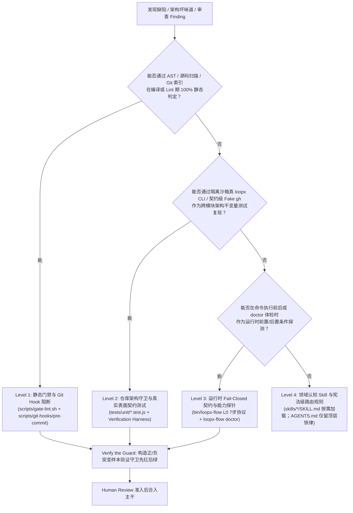
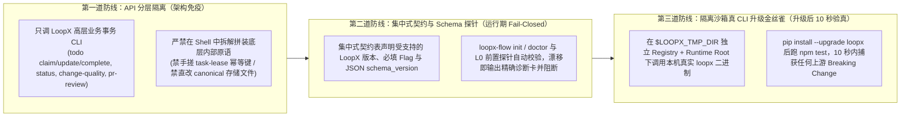

# Pstack、Magpie 与 LoopX-Workflow 源码级工程体系对照及融合校验报告

> **状态**：Research / Validation Report（融合校验与架构对齐报告；已基于上游源码与 LoopX 2.3.0 测试集完成交叉复核，作为后续 Skill 演进、门禁加固与按需 ADR 的决策输入）
> **日期**：2026-11-19（2026-11-20 上游源码与 LoopX 2.3.0 测试集复核定稿；2026-11-22 W0 对齐最终拍板 Q1/Q2/Q3、基线 `main@f90d7b6` 与 GitHub Roadmap `#37`～`#51`）
> **对照基线**：
> - **Pstack**：Cursor 官方仓库 `cursor/plugins@fbb86c09bbb4a25e490aaed136899ced1e9140e4`（`pstack@0.15.46`，MIT License）+ Lauren Tan `poteto/verification-skill-example`
> - **LoopX 上游控制面**：`loopx-project/loopx@f4c5d6d70c4c88ee4dae705c0ea7b5a8ea87e5ff`（与本机安装 `loopx 2.3.0` 的 1,824 个 `.py`/`.ts` 源文件 Blob 哈希 100% 一致，含 1,965 个上游测试文件对照）
> - **Magpie**：仓库级确定性约束、静态守卫与契约测试工程实践
> - **LoopX-Workflow**：[PRD]( ../prd/loopx-workflow.md )、[详细设计]( ../design/loopx-workflow-design.md )、[ADR-0001~0014]( ../adr/README.md )、[AGENTS.md]( ../../AGENTS.md )、`bin/loopx-flow` 与 `skills/*` 现码（基线 `main@f90d7b6`，已合入 ADR-0014；线上 Roadmap 追踪父 Issue `#37`、W0～W12 + W11b 子 Issue `#38`～`#51`）
> **流转约定**：遵循 [ADR-0001]( ../adr/0001-product-source-of-truth.md ) 与 [ADR-0008]( ../adr/0008-application-orchestration-layer.md ) 准入矩阵——不改变权威所有者、默认失败条件或共享契约的工程方法与静态守卫可直接纳入现有 `REQ-*` 实现；改变命令面或默认门禁阻断条件的能力须先经决策分支拍板并立增量 ADR。

---

## 0. 核心校验结论（Executive Summary）

对调研结论进行源码级交叉核验后，结论如下：**该调研对三套体系的分层定位极准，且与 `loopx-workflow` 在 ADR-0008～ADR-0013 确立的架构演进方向高度同构，具备极高的融合价值；但在融入时必须严守「不建第二控制面、不绕 Gate1/Gate2 权威、1 Feature : 1 Goal」三条底线。**

1. **三层互补模型完全成立**：
   - **Pstack（Agent 认知方法与工作流指令层）**：回答 *“Agent 应该怎样按资深工程师的方法完成研发工作？”*
   - **Magpie（仓库级确定性工程约束层）**：回答 *“什么样的代码、路径、契约和测试才被机械允许进入仓库？”*
   - **LoopX + LoopX-Workflow（跨权威研发控制面与流程编排层）**：回答 *“谁持有权威状态、谁获准执行、执行到哪一步、如何幂等恢复、谁有权签字放行交付？”*
2. **融合分类统计（共 12 项核心机制）**：
   - **已原生具备 / 哲学同构（4 项）**：Feature Capsule 规格边界、`Laziness Protocol`（对应 `anti-entropy-governance` 的 `delete-first`）、`Foundational Thinking`（对应 `04-contract.md` 接口冻结先行）、`Never Block on the Human`（对应 `REQ-CONDUCTOR-1` 非 Gate 连续推进、Gate 显式停机）。
   - **高价值可直接融入（6 项，无需新立 ADR，直接填补现有 `REQ-*` 实现空白）**：
     1. 吸收 `/poteto-mode` 的 `Playbook × Skill × Principle × Agent` 四层路由架构，落地规划中的 `skills/workflow-conductor/SKILL.md` 并增强 `loopx-flow status --next`；
     2. 吸收 `/create-verification-skill` 与 `/maintain-verification-skill` 的**五维真实产品表面验证法（Surface / Run / Observe / Invariants / Cleanup）**，补齐 [ADR-0011]( ../adr/0011-evidence-traceability-and-quality.md ) `Real-vs-Mock` 与独立 Oracle 的构造与维护闭环；
     3. 吸收 Magpie 与 Pstack 的 **`Encode Lessons in Structure`（经验沉淀四级漏斗）**，把近期踩坑（临时工件逃逸、CWD 相对路径漂移、CLI 参数拼接、`.loopx/` 运行态误追踪）升级为 `scripts/gate-lint.sh` 与 `tests/unit/` 确定性架构守卫，停止向 `AGENTS.md` 堆砌细碎禁令；
     4. 明确 **主 Agent（持有设计与集成验证责任）× Worker Agent（受 `04-contract.md` 与 `todo claim` 排他租约约束的有限实现范围）** 主从权责契约；
     5. 将 `architect`（多 Agent 只读并行设计探索）融入阶段 1 `design-grill` 的代码库事实探查；
     6. 将 `swarm`（多 Agent 分片并行执行）严格绑定在 LoopX `todo claim`（`--owner` + 代际 `--idempotency-key`）与 `loopx-flow integrate`（`loopx integration-branch`）控制面原语之上。
   - **需受控剪裁后融入（2 项，防止破坏控制面权威边界）**：
     1. **`arena`（多方案竞争与 Graft 合成）**：必须限定在 **Gate1 契约冻结前** 的 `.loopx/tmp/arena-*` 或临时 Worktree 沙箱内预演；**严禁**在 Gate1 锁定 `contract_revision` 之后自由发散改契约，也**严禁**在 LoopX 控制面拆出平行 Goal（违背 [ADR-0008]( ../adr/0008-application-orchestration-layer.md ) `1 Feature : 1 Goal`）。
     2. **`interrogate`（异构多模型只读对抗审查）**：与 [skills/code-review/SKILL.md]( ../../skills/code-review/SKILL.md ) 及 [ADR-0013]( ../adr/0013-align-review-architecture-with-loopx-philosophy.md ) 两阶段审查解耦对接时，需区分「单次审查内部同模型分片（保障覆盖率可归因）」与「显式触发的第二模型交叉对抗审查（Second-Model Pass）」。

---

## 1. 六维治理矩阵对照：Pstack vs Magpie vs LoopX-Workflow

调研指出：*“真正要比较的是：谁定义任务、谁持有状态、谁执行、谁验证、谁有权判定完成，以及失败经验如何沉淀。”* 下表基于 `loopx-workflow` 现行代码与 ADR 基线给出精确映射：

| 治理维度 | Pstack (`cursor/plugins/pstack`) | Magpie（仓库确定性工程约束范式） | LoopX + LoopX-Workflow（现行基线 ADR-0001~0013） | 融合互补点（LoopX-Workflow 吸收什么） |
|---|---|---|---|---|
| **1. 谁定义任务**<br>(Task Definition) | 用户输入 `User Goal + Done Condition`；`/poteto-mode` 识别任务类型、选 Playbook、生成会话内 Todo | 仓库 Issue / 规格约定 + 准入测试契约 | 产品唯一正文 [docs/prd/loopx-workflow.md]( ../prd/loopx-workflow.md ) (`REQ-*`) + [docs/adr/]( ../adr/README.md )；单次交付为 `specs/features/<f>/01..04` 规格包；`1 Feature : 1 Goal`，`Story 1:1 Todo` | 用 Pstack 的 `Playbook` 规范化 Conductor 从「用户意图」到「阶段 1~4 规格包 / Issue 双路径」的前门路由 |
| **2. 谁持有状态**<br>(State Ownership) | 会话级瞬态（Prompt 上下文 + 会话 Todo + 临时 Worktree），无跨会话控制面权威 | Git 仓库树 + CI 状态 | **三分权威**（[ADR-0008]( ../adr/0008-application-orchestration-layer.md#L15 )）：Git 管版本化规格与决策、LoopX 管 `ACTIVE_STATE.md`/Goal/Todo/Lease/Receipt、GitHub/CI 管 PR/Review/Approval；Workflow 只做绑定与只读投影 | **坚守 LoopX 边界**：吸收 Pstack 路由逻辑，但**拒绝**在会话或胶囊内另建独立 Todo/Checkpoint 状态源 |
| **3. 谁执行**<br>(Execution & Concurrency) | 主 Agent 持设计责任，按 `architect` / `arena` / `swarm` / `interrogate` 四种并行模式调度 Subagent | 开发者 / Agent 在本地工作区与测试沙箱内执行 | 编码 Agent 通过 `bin/loopx-flow` 调用 10 项领域 Skills；并行通过 `todo claim` 排他租约（`REQ-LEASE-1`）与 `integrate` 集成分支隔离 | 吸收 Pstack **四类并行模式分类**与**主从责任划分**，用 LoopX `task-lease` 与 `.loopx/tmp` 沙箱为其加装物理护栏 |
| **4. 谁验证**<br>(Verification & Oracle) | `Prove It Works` 原则 + `/create-verification-skill` & `/maintain-verification-skill`（真实产品表面五维验证） | 静态 Lint + 仓库架构守卫单测 + 契约/Fixture 回归测试 | 本地四大硬门禁（`typecheck`/`lint`/`build`/`test`）+ `code-review` + [ADR-0013]( ../adr/0013-align-review-architecture-with-loopx-philosophy.md ) 两阶段审查 + `ingest-to-loopx-quality.js` 生成 `change_quality_agent_result_v2` 收据并回写 `05-evidence.md` | 吸收 Pstack **Verification Skill 五维模型**指导 `Real-vs-Mock = real` 级验证构造；吸收 Magpie **架构守卫测试**加固 `gate-lint.sh` |
| **5. 谁有权判定完成**<br>(Authorization Authority) | 主 Agent 核验 `Done Condition` 与真实产物后向用户交付（无控制面级签名锁） | CI 门禁全绿 + Code Owner 审批 | **双人类断点 + Fail-Closed 铁律**：<br>• **Gate 1**：`loopx-flow approve contract`（锁 `04-contract` SHA256 + 写 `user_gate` + TTY/第二账号校验，[ADR-0009]( ../adr/0009-specification-authorization.md )）<br>• **Gate 2**：Mode A 非作者 GitHub `APPROVE` / Mode B `release-approve` + `loopx pr-review --check-merge-readiness` + 二次 HEAD 核验（[ADR-0012]( ../adr/0012-delivery-authorization-and-recovery.md )） | **LoopX 强项**：保持 Gate1/Gate2 不可绕过；将 Pstack 的 `Done Condition` 映射进 `04-contract.md` 的 AC 矩阵与 `Verification Plan` |
| **6. 失败经验如何沉淀**<br>(Lesson Encoding) | `Encode Lessons in Structure`（重复错误升级为 Lint / Metadata / Runtime Check / Script）+ 维护 Verification Skill | 每次缺陷转化为仓库内的确定性静态规则与契约守卫单测 | 管线 B `systematic-debugging` 七层根因（L1➔L7 定位 Canonical Owner）+ `tests/unit/issues/issue-<id>.test.js` 先红后绿 + `anti-entropy-governance` (`delete-first`) + 行为变更立 ADR | 建立 **经验沉淀四级漏斗（Lint ➔ 架构单测 ➔ 运行时探针 ➔ Skill/AGENTS.md）**，防止 `AGENTS.md` 沦为免责备忘录 |

---

## 2. 深度校验一：Pstack 架构机制与 LoopX-Workflow 的融合边界

### 2.1 前门路由（`/poteto-mode`）与四层解耦 ➔ 落地 `skills/workflow-conductor`

**调研核心洞察**：Pstack 将 `Playbook`（端到端阶段与依赖）、`Skill`（单环节专业方法）、`Principle`（跨任务工程判断路由规则）、`Agent`（执行角色实例）拆成四层，由 `/poteto-mode` 统一路由。

**本仓现状核查**：
- `AGENTS.md` 首段及 [ADR-0008 决策 5]( ../adr/0008-application-orchestration-layer.md#L18 )（`REQ-CONDUCTOR-1`）明确规划了 `skills/workflow-conductor` 作为调度建议层，但目前 `skills/` 目录下只有 10 个领域 Skill，**`workflow-conductor` 尚未创建**。
- `bin/loopx-flow` 的 `cmd_status_next`（[bin/loopx-flow:1721-1745]( ../../bin/loopx-flow#L1721-L1745 )）目前仅做了 3 个文本 `grep` 判断（检查 `04-contract.md` 是否含 `FROZEN & APPROVED`、检查 `05-evidence.md` 是否含 `PASSING`），尚未读回契约 SHA 漂移、LoopX Todo/Lease 状态、Receipt 新鲜度或 GitHub PR 的 Draft/Ready/Gate2 状态。

**融合方案（可直接落地，无需新立 ADR）**：
1. **构建 `skills/workflow-conductor/SKILL.md`**：
   - **入口输入**：接收 `User Goal + Done Condition`（或 Issue ID / PR ID / Feature 名），先调 `loopx-flow doctor` 与增强版 `loopx-flow status --next`。
   - **四层映射结构**：
     ```mermaid
     flowchart TD
       input["User Goal + Done Condition / Issue / PR"] --> conductor["workflow-conductor (Routing Hub)"]
       conductor --> principles["Principles (Core Axioms 0~7 + Pstack 路由原则)"]
       conductor --> playbooks["Playbooks (端到端场景轨)"]
       playbooks --> pbA["Feature Playbook (阶段 0~8)"]
       playbooks --> pbB1["Issue Fast-Path Playbook (≤20行微闭环 + Gate2)"]
       playbooks --> pbB2["Issue Standard-PR Playbook (L1~L7 根因 + Repro + Gate2)"]
       playbooks --> pbC["Anti-Entropy / Remediation Playbook (delete-first)"]
       pbA & pbB1 & pbB2 & pbC --> skills["Domain Skills (design-grill / TDD / code-review / verification...)"]
       skills --> l0["L0/L1/L2 Commands (bin/loopx-flow -> LoopX / Git / GitHub)"]
     ```
2. **增强 `cmd_status_next` 作为 Conductor 的确定性状态探针**：
   - 严格只读读回三类权威来源（Git 胶囊文件 + `loopx-flow gate verify contract` + LoopX Todo/Receipt + GitHub PR/Review 状态），按 [ADR-0010]( ../adr/0010-command-contracts-and-execution-protocol.md#L27 ) 六种结果语义（`SUCCESS / FAILED / BLOCKED / PARTIAL / NEEDS_HUMAN / NOT_VERIFIED`）输出下一步推荐命令与应加载的领域 Skill。

---

### 2.2 主从 Agent 责任划分（Coordinator vs Worker）➔ 强化阶段 4~6 契约边界

**调研核心洞察**：Pstack 的 Feature Playbook 强调 *“并不是任务拆分后全部交给 Subagent，而是主 Agent 明确数据结构、类型和模块组织后再委派编码，主 Agent 保持设计和验证责任，Worker 持有有限实现范围。”*

**与 Feature Capsule 的对照与融合**：
- **相同点**：`loopx-workflow` 的 `04-contract.md` 要求在 Gate1 前冻结顶部 TypeScript 接口签名、断言不变量、AC 矩阵与 Scope（[ADR-0009]( ../adr/0009-specification-authorization.md#L22 )），天然就是“先锁定数据结构与接口契约，再进入阶段 5 实现”。
- **差异与互补**：Pstack 定义了**动态执行时的主从 Agent 权责分配**，而 Feature Capsule 定义了**持久化的规格与授权锚点**。
- **融入规约**：
  1. **设计责任不可委派**：阶段 1~4 的最终汇总与 `04-contract.md` 契约撰写必须由主 Agent（Coordinator）完成；Subagent 在阶段 1~3 只能承担只读代码探查或红队挑战（`strategy-red-team`）。
  2. **实现范围受双重硬锁约束**：阶段 5 的 Worker Subagent 认领任务时：
     - **控制面锁**：必须持独立注册身份调用 `loopx-flow todo claim <tid> --goal-id <gid>`（[bin/loopx-flow:2834]( ../../bin/loopx-flow#L2834 )）；
     - **契约锁**：Worker 严禁修改 `04-contract.md` 已冻结的接口签名与 AC 矩阵（任何未授权修改都会导致 `gate verify contract` 因 SHA256 与 LoopX `contract_revision` 不匹配而立刻熔断）。
  3. **验证责任归主 Agent**：Worker 完成单 Story 红绿循环后，必须由主 Agent 在主工作区或预集成分支统一运行 `loopx-flow check` 与真实入口验证，禁止直接采信 Worker 的口头“测试已过”自述（`Prove It Works`）。

---

### 2.3 四种并行协作模式（`architect` / `arena` / `swarm` / `interrogate`）的准入与剪裁

调研指出 Pstack 将并行细分为四种模式，避免了“把所有并行都当成任务拆分（Swarm）”。对照 `loopx-workflow` 的控制面约束，四种模式的融合裁决如下：

| Pstack 并行模式 | 核心机制 | 在 `loopx-workflow` 中的准入裁决 | 对应的管线阶段与硬约束（防越界） |
|---|---|---|---|
| **`architect`**<br>多 Agent 设计探索 | 并行理解受影响子系统，探索接口、类型与模块边界 | **✅ 直接融入** | **阶段 1（`design-grill`）**：主 Agent 并发派发**只读** Subagent 探查代码库事实（Step 1 Fact Probing），汇总为 3~6 个决策分支与最小复杂度评估；纯只读，不触碰 LoopX 状态。 |
| **`arena`**<br>多方案候选竞争与 Graft 合成 | `Frame ➔ Fan-out ➔ Cross-judge ➔ Pick ➔ Graft ➔ Verify` | **⚠️ 受控剪裁后融入**<br>（仅限 Gate1 前沙箱预演） | **阶段 1 或阶段 4（Gate1 冻结前）**：<br>1. **禁止拆多 Goal**：遵守 `1 Feature : 1 Goal`（[ADR-0008]( ../adr/0008-application-orchestration-layer.md#L16 )），候选方案不在 LoopX 控制面建平行 Goal/Todo。<br>2. **沙箱隔离**：Fan-out 只能写进 `$LOOPX_TMP_DIR/arena-<feature>.XXXXXX/candidate-*` 或临时 Git Worktree（遵循 [临时文件沙箱规范]( ../agents/temp-artifacts.md )）。<br>3. **Graft 后清理并冻结**：主 Agent 选出基础方案并人工整合（Graft）有价值片段后，清理落选沙箱，将唯一胜出设计写入 `01-decisions.md` 与 `04-contract.md`，再走 Gate1 `approve contract`。 |
| **`swarm`**<br>多 Agent 任务分片执行 | 按文件、模块或验证范围拆分并行编码 | **✅ 绑定控制面原语融入** | **阶段 5（TDD 实现）**：<br>1. **先隔离共享状态**（Pstack `Separate Before Serializing Shared State`）：前置在 `04-contract.md` 固化共享类型。<br>2. **强制租约**：每个分片对应一个 LoopX Todo，Worker 必须通过 `loopx-flow todo claim` 获取排他租约（`REQ-LEASE-1`）。<br>3. **预集成探冲突**：多分支/多 Worktree 分片合流前，必须跑 `loopx-flow integrate`（`loopx integration-branch`）。 |
| **`interrogate`**<br>多模型只读对抗 Review | 多模型/多视角只读深挖当前变更的真实缺陷 | **⚠️ 分层融入**<br>（区分同模型分片与跨模型二审） | **阶段 6（`check`）与阶段 7（`review`）**：<br>1. **单次 `code-review` 内部分片**：遵循 [skills/code-review/SKILL.md:199-205]( ../../skills/code-review/SKILL.md#L199-L205 )，保持**同一最强模型**按契约边界只读分片，确保召回率可归因。<br>2. **跨模型对抗二审（Second-Model Pass）**：利用 `authentic-review.js` 已支持的 `claude` / `codex` 双引擎，在 [ADR-0013]( ../adr/0013-align-review-architecture-with-loopx-philosophy.md#L28 ) **阶段 1（主观对抗审查）**引入异构模型只读对抗（例如编码用 Claude、审查用 Codex），阶段 2 仍由主机统一自动装配静态证据并交 `loopx pr-review --check-result` 权威核验。 |

---

### 2.4 Pstack 的工程原则 ➔ 与 `AGENTS.md` 核心铁律的逐条映射与增量

| Pstack 工程原则 | Pstack 工程含义 | LoopX-Workflow 现行对应条款 | 校验结论与增量动作 |
|---|---|---|---|
| **Laziness Protocol** | 优先删除不必要的抽象、层次和代码 | 核心铁律 4 & `skills/anti-entropy-governance`（`delete-first`、拒绝第 4 套兜底层） | **已高度对齐**。在 `design-grill` 与 `anti-entropy-governance` 中继续严格执行。 |
| **Foundational Thinking** | 写逻辑前先确定数据结构和共享状态 | 核心铁律 3 & `04-contract.md` 顶部冻结不可变 TypeScript 接口签名与不变量 | **已高度对齐**。可补充“共享状态与文件路径所有权表必须在 `04-contract.md` 前置声明”。 |
| **Model the Domain** | 用状态机、类型、注册表表达领域，而非散落条件分支 | [ADR-0010]( ../adr/0010-command-contracts-and-execution-protocol.md ) Required Capability Set、六种结果语义、[ADR-0011]( ../adr/0011-evidence-traceability-and-quality.md ) 六种证据状态 | **可直接强化**。后续将 `bin/loopx-flow` 中散落的命令前置检查收敛为声明式命令契约表（如 [temp-artifact-remediation-plan.md]( ../design/temp-artifact-remediation-plan.md#L92 ) 的命令矩阵）。 |
| **Separate Before Serializing Shared State** | 并行之前先隔离共享写入 | `REQ-LEASE-1` 排他租约 + `REQ-ENV-3` / `ADR-0014` `.loopx/tmp/<cmd>.XXXXXX/` 每进程独立运行目录 | **已对齐并正在加固**。通过 `wf_run_dir()` 每调用一目录彻底消除并发进程间临时文件覆写。 |
| **Sequence Verifiable Units** | 将长工作拆成每一步都可验证的单元 | 阶段 3 `user-stories`（单 Feature Diff ≤ 500 行）+ [ADR-0010]( ../adr/0010-command-contracts-and-execution-protocol.md#L26 ) 7 步 L0 执行协议 | **已高度对齐**。每个 Story 对应独立可验证的 AC 行与 Test Oracle。 |
| **Prove It Works** | 检查真实产物，而非相信 Agent 自述 | [ADR-0011]( ../adr/0011-evidence-traceability-and-quality.md ) 独立 Oracle + `Real-vs-Mock` 列 + [ADR-0013]( ../adr/0013-align-review-architecture-with-loopx-philosophy.md ) 主机自动装配真实退出码 | **需结合 Verification Skill 深化**（见第 3 节），防止单测 Mock 掩盖真实 CLI 入口故障。 |
| **Encode Lessons in Structure** | 重复出现的错误升级为 Lint、Metadata、Runtime Check 或 Script | `scripts/gate-lint.sh` + `tests/unit/issues/issue-*.test.js` + [ADR-0013 否决项 3]( ../adr/0013-align-review-architecture-with-loopx-philosophy.md#L55 ) | **最关键增量**（见第 4 节）。需建立四级沉淀漏斗，升级 `gate-lint.sh`。 |
| **Never Block on the Human** | 可逆操作自行推进，只有真实决策和不可逆操作才停下 | [ADR-0008]( ../adr/0008-application-orchestration-layer.md#L18 ) `REQ-CONDUCTOR-1`（非 Gate 连续执行，Gate1/Gate2 显式人工触发）+ `anti-entropy` 的 `confirmation-first` | **已高度对齐**。明确 Conductor 在阶段 1~3、5~7 自动连续推进，仅在 Gate1、Gate2 及 `persistent-state-risk` 停机。 |

---

## 3. 深度校验二：Verification Skill（生成与维护）如何融入 `loopx-workflow`

调研指出，Pstack 最有价值的部分是 `/create-verification-skill` 与 `/maintain-verification-skill`——**不仅要求 Agent 跑 `npm test`，而是为项目建立并持续维护一套“像真实用户一样驱动产品表面、观察真实副作用并留下可复核证据”的验证能力**。

### 3.1 为什么 `loopx-workflow` 迫切需要这一机制？

回顾本仓库近期发现的真实缺陷（见 [ADR-0013]( ../adr/0013-align-review-architecture-with-loopx-philosophy.md ) 与 [temp-artifact-remediation-plan.md]( ../design/temp-artifact-remediation-plan.md#L20-L34 )）：
1. **单测全绿，但真实 CLI 传参触碰物理上限**：`authentic-review.js` 将巨型 Prompt 作为 CLI `argv` 传给 `codex exec`，在真实大 PR 上撞击 macOS `ARG_MAX`（`E2BIG`），此前靠 240,000 字符硬截断掩盖。
2. **单测全绿，但 `gh api` 参数拼接带前导空格**：`authentic-review.js:191` 曾将 `-F body=@${postedFile}` 拼成 `spawnSync` 的单个数组元素，真实调用 `gh api` 时行为异常。
3. **单测全绿，但从子目录调用时缓存漂移**：`REVIEW_RESULT_DIR = '.loopx/reviews'` 使用了 CWD 相对路径，在非仓库根目录执行时写到了错误位置。
4. **单测全绿，但临时文件逃逸到系统 `/tmp`**：`respond-report.js:222` 在未传 `--output-file` 时回落 `os.tmpdir()`，而 `cmd_respond` 恰好没传该参数。

**根本原因**：尽管 [ADR-0011]( ../adr/0011-evidence-traceability-and-quality.md#L16 ) 规定了 `05-evidence.md` 必须区分 `Real-vs-Mock`（`real` vs `mock`），但此前缺少一套类似 Pstack `Verification Skill` 的**五维真实表面建模与持续维护规程**，导致部分测试停留在“对内部辅助函数或过度豁免的正则做检验”，而未覆盖真实用户交互表面（Surface）。

### 3.2 Pstack 五维验证模型向 `loopx-workflow` 的精确映射

我们可以将 `create-verification-skill` 的五个核心问题直接固化为 `loopx-workflow` 的 **`Verification Harness` 规范**（同时服务于本仓库自身研发，以及任何接入 `loopx-workflow` 的目标项目）：

| Pstack 验证维度 | 核心必须回答的问题 | 在 `loopx-workflow` 中的具体实例化（本仓库 Surface） | 在 `04-contract.md` 与 `05-evidence.md` 中的落点 |
|---|---|---|---|
| **1. Surface**<br>（真实交互表面） | 用户/调用方实际操作的是什么入口？（CLI / Web / API / Desktop） | • 主 CLI：`bin/loopx-flow <subcmd>`（含从子目录、Worktree、非 TTY 调用）<br>• 独立脚本：`scripts/preflight-check.sh`、`scripts/workflow-init.sh`、`scripts/gate-lint.sh`<br>• 审查/质量引擎：`authentic-review.js`、`ingest-to-loopx-quality.js`、`respond-report.js` | `04-contract.md` 的 `Verification Plan` 必须逐条标明被测 `Surface`（严禁用内部私有函数替代 CLI 入口充当 `real` 证据） |
| **2. Run**<br>（真实启动与驱动） | 如何构建、启动并在隔离环境中驱动真实入口？ | 通过 `tests/unit/helpers/m0-sandbox.js` 与 `repo-isolation.js` 创建真实临时 Git 仓库 + 真实 `spawnSync('bash', ['bin/loopx-flow', ...])` 进程调用；外部二进制（`loopx`/`gh`）仅在边界层使用严格校验参数契约的 Fake CLI | `05-evidence.md` 的 `Oracle` 列记录完整可复跑命令；真实子进程驱动标 `Real-vs-Mock = real`，纯内存/桩函数标 `mock` |
| **3. Observe**<br>（多维状态与副作用观测） | 除了退出码 0/非 0，哪些外部产物证明它真的生效了？ | 1. **进程退出码与标准流**：`status`、`stdout`、`stderr` 诊断卡<br>2. **Git 状态**：分支、HEAD SHA、`git status --porcelain`（无脏文件）<br>3. **胶囊与控制面产物**：`04-contract.md` SHA256、`05-evidence.md` 16 列、`LoopX user_gate` / `change_quality_agent_result_v2` 收据<br>4. **跨进程参数审计**：Fake `gh`/`loopx` 记录的精确 `argv` 数组与 `stdin` 字节流 | 每条 AC 至少绑定一项**状态/产物级观测断言**，禁止仅断言 `exitCode === 0` 或输出包含静态字符串 |
| **4. Invariants & Failure Modes**<br>（不变量与失败模态） | 什么是不允许被破坏的全局不变量？常见的假阳性是什么？ | • **Fail-Closed 不变量**：缺配置/非 TTY/SHA 漂移/收据失效/head 不匹配时**必须非 0 且不留半成品标记**<br>• **零逃逸不变量**：执行前后系统 `/tmp` 与仓库工作区零残留；临时工件只进 `$LOOPX_TMP_DIR/<cmd>.XXXXXX/`<br>• **双根锚定不变量**：在子目录或 linked worktree 下调用行为一致 | 对应 [详细设计 §10 失败即停矩阵]( ../design/loopx-workflow-design.md#L293 ) 与 [ADR-0009~0012]( ../adr/README.md ) 的负向验收用例（`T1~T9`） |
| **5. Cleanup & Isolation**<br>（隔离与清理） | 验证如何保证不污染宿主机 `$HOME`、主仓库或远端 GitHub？ | 单测使用 `fs.mkdtempSync(path.join(os.tmpdir(), ...))` 并在 `after`/`finally` 清理；显式注入 `HOME`、`LOOPX_TMP_DIR`、`LOOPX_REGISTRY` 环境变量，严禁触碰宿主机 `~/.loopx` 或真实 GitHub 远端 | 由 `scripts/gate-lint.sh` 与测试沙箱助手统一强制保障 |

### 3.3 融入方式：新增 `skills/verification-harness`（或 `maintain-verification` 闭环）

建议在 `skills/` 下新增或扩充验证技能规程（可命名为 `skills/verification-harness/SKILL.md`，并在 `workflow-conductor` 的阶段 4、阶段 5、阶段 6 中自动编排）：
1. **阶段 4（契约冻结前 — Create / Align Verification Plan）**：
   - 检查项目是否已有针对目标 `Surface` 的真实入口验证沙箱；
   - 在 `04-contract.md` 的 `Verification Plan` 章节强制按 **五维表格（Surface / Run / Observe / Negative Invariant / Real-vs-Mock）** 编写验证计划；未写明真实入口（`real`）与负向熔断断言（`Negative Invariant`）的契约，不得进入 Gate1 `approve contract`。
2. **阶段 5/6（实现与收据生成前 — Maintain Verification Harness）**：
   - 对照本次 Git Diff 触发 `/maintain-verification-skill` 检查：
     - **触发器 1**：新增或修改了 `bin/loopx-flow` 子命令 / flags ➔ 必须更新 CLI Surface 测试与 `usage()` 对齐守卫；
     - **触发器 2**：修改了跨进程调用（`loopx` / `gh` / `git` / `codex` / `claude`）➔ 必须在 Fake CLI 契约测试中校验精确的 `argv` 拆分与 `stdin` 管道（防止 `-F body=@file` 单参数拼接之类 Bug 漏网）；
     - **触发器 3**：修复了线上或历史 Issue（管线 B）➔ 必须将该故障模式沉淀为永久架构守卫不变量（进入第 4 节漏斗）。

---

## 4. 深度校验三：Magpie 范式与 `Encode Lessons in Structure` 的落地路径

调研指出：*“Magpie 最值得借鉴的是如何把工程经验变成仓库中的确定性约束……不要反复修改 `AGENTS.md`，而要把错误转成静态约束（Lint、Metadata、Runtime Check 或 Script）。”*

### 4.1 现状诊断：`loopx-workflow` 已有 5 阶段 `gate-lint.sh`，但仍存 Fail-Open 缺口与契约守卫空白

核查本仓库基线现码（`main@f90d7b6`，含 [ADR-0014]( ../adr/0014-temp-artifact-path-remediation-and-history-sanitization.md )）：
- **已有的好实践**：
  - [ADR-0013 否决项 3]( ../adr/0013-align-review-architecture-with-loopx-philosophy.md#L55 ) 已经明确提出：*“否决将审查命令细节直接追加到 `AGENTS.md`：保持 `AGENTS.md` 宪法级精简（当前仅 103 行）。”*
  - [scripts/gate-lint.sh]( ../../scripts/gate-lint.sh#L1-L223 ) 已扩充为 5 阶段：语法检查（`[1/5]`、`[2/5]`）、可执行位检查（`[3/5]`）、生产代码临时工件与跨平台路径卫生守卫（`[4/5]`，拦截裸 `mktemp`、`os.tmpdir()`、`which`、`python3`、CWD `.loopx/`）、受跟踪文件边界与凭据脱敏守卫（`[5/5]`）。
- **存在的薄弱点**：
  - **P0 Fail-Open 漏洞**：[scripts/gate-lint.sh:173-175]( ../../scripts/gate-lint.sh#L173-L175 ) 在 `[5/5]` 调用 `git ls-files` 的 `catch (_)` 分支中直接执行了 `process.exit(0)` 并打印 `PASS`，违反 Fail-Closed 铁律。
  - **高层契约防退化守卫缺失**：ADR-0013 的文件+`stdin` 审查契约、控制面调用禁 `|| true` 吞错、以及 `bin/loopx-flow` / PRD / Design 三方命令面一致性，尚未进入 `gate-lint.sh` 与契约级单测。

### 4.2 建立 `loopx-workflow` 的「经验学习与结构化沉淀闭环（Engineering Learning Loop）」

每次在 Code Review（阶段 6/7）、Issue 修复（管线 B `systematic-debugging` L7 规格缺口）或架构复盘中发现重复性错误时，采用 **`Finding → Root Cause → Candidate Guard (Lint/Test) → Verify the Guard (Failing Test 先红后绿) → Human Review → Merge`** 闭环，强制按以下四级漏斗自上而下转化，**凡能由 L1/L2 机械拦截的规则一律不写进 `AGENTS.md`（已拍板 D4 方案 A）**：



### 4.3 `scripts/gate-lint.sh` 与架构单测的确定性守卫清单（基于 ADR-0014 现码校准）

结合 `main@f90d7b6` 已落地的 `[4/5]`、`[5/5]` 阶段守卫与本轮核验结论，确定性守卫聚焦以下 **4 项增量加固（消除重复建设）**：

1. **Rule-LINT-01（P0 修复）：消除 `scripts/gate-lint.sh` 第 5 阶段 Fail-Open 漏洞并收紧 `# loopx-allow:`**
   - **静态规则**：将 [scripts/gate-lint.sh:173-175]( ../../scripts/gate-lint.sh#L173-L175 ) 的 `catch (_) { process.exit(0); }` 改为打印错误并 `process.exit(1)`；将 `# loopx-allow:` 注释锁定为必填理由且全仓生产代码豁免总数 ≤ 6 处。
2. **Rule-LINT-02：审查管线反退化守卫（落实 ADR-0013）**
   - **静态规则**：扫描 `skills/code-review/scripts/authentic-review.js`，禁止重新引入 `240000` 字符硬截断常量，禁止将 Prompt 正文作为 `spawnSync(agentBin, ['exec', prompt])` 的 CLI `argv` 参数传递（必须走 `.loopx/tmp` 沙箱留证 + `stdin` 管道）。
3. **Rule-LINT-03：控制面与门禁调用禁吞错守卫（落实 Fail-Closed 铁律）**
   - **静态规则**：扫描 `bin/loopx-flow` 与 `scripts/*.sh` 的核心门禁/控制面调用链，禁止在 `loopx todo`、`loopx change-quality`、`loopx pr-review`、`loopx configure-goal` 上使用未捕获退出码的 `|| true` 或 `|| echo '{}'` 吞错拼接。
4. **Rule-LINT-04：命令面三方对齐守卫（落实 ADR-0010 `REQ-FACADE-1`）**
   - **契约测试**：自动解析 `bin/loopx-flow` 的 `usage()` + `case` 分发分支、[docs/prd/loopx-workflow.md]( ../prd/loopx-workflow.md#L124 ) 的 `REQ-FACADE-1` 命令清单、[docs/design/loopx-workflow-design.md]( ../design/loopx-workflow-design.md#L52 ) §3 命令表，三者出现未登记漂移时测试直接 FAIL。

---

## 5. 边界红线：哪些外部机制绝对不能照搬？

为确保融入 Pstack 与 Magpie 时不破坏 `loopx-workflow` 已在 [ADR-0008~0013]( ../adr/README.md ) 确立的架构基线，必须明确以下 **5 条否决红线**：

| # | 外部机制的原始做法 | 为什么不能原样照搬进 `loopx-workflow`？ | `loopx-workflow` 的正确裁剪方式 |
|---|---|---|---|
| **R-1** | Pstack `/poteto-mode` 在会话内维护自己的 Todo 列表并作为执行进度权威 | 违反 [ADR-0008]( ../adr/0008-application-orchestration-layer.md#L17 )「不维护与 LoopX 并行的权威执行状态」。若会话 Todo 与 LoopX Goal/Todo 双写，断线重连后会出现双源冲突。 | Conductor 可以用宿主 IDE 的任务视图（如当前会话的 Plan UI）展示**单轮会话内动作步骤**，但**特性级与 Story 级研发任务状态必须以 `loopx-flow todo list/claim/done`（LoopX 控制面）为唯一权威**。 |
| **R-2** | Pstack 主 Agent 在 Verification 通过后直接判定任务 Done 并结束交付 | 违反 [ADR-0009]( ../adr/0009-specification-authorization.md ) 与 [ADR-0012]( ../adr/0012-delivery-authorization-and-recovery.md )。在 `loopx-workflow` 中，Agent 的验证通过只能产出**过程性证据与质量收据**，绝不等于规格授权（Gate1）或合并授权（Gate2）。 | `Prove It Works` 产出的证据写入 `05-evidence.md` 与 LoopX Receipt；在 Gate1 (`approve contract`) 与 Gate2 (`release-approve` / GitHub Non-author Approve + `merge`) 处**必须显式停机（`NEEDS_HUMAN`）**。 |
| **R-3** | Pstack `arena` 在实现期自由并发多个候选实现并由 Agent 自行裁决合并 | 若在 Gate1 之后执行，会破坏 `04-contract.md` 的 `contract_revision` SHA256 锁定，或诱发在 LoopX 中创建多个竞争 Goal（违背 `1 Feature : 1 Goal`）。 | `arena` **只能前置到阶段 1~4（Gate1 冻结前）**，且必须在 `.loopx/tmp/arena-*` 或临时 Worktree 沙箱内运行；胜出方案确定并冻结进 `04-contract.md` 后，进入阶段 5 的编码只能有唯一契约基线。 |
| **R-4** | Pstack `interrogate` 在单次代码审查中随意混用多模型并直接拼接结论 | 违反 [skills/code-review/SKILL.md:199-205]( ../../skills/code-review/SKILL.md#L199-L205 ) 的可归因性原则（混用便宜模型分片会导致跨边界缺陷漏检且无法归因），且不能绕过 LoopX `pr-review --check-result` 的 schema 核验。 | 区分**同模型分片覆盖**（阶段 6 `code-review` 内部）与**异构模型交叉对抗**（阶段 7 `authentic-review.js` 阶段 1 主观审查可选异构引擎），且最终输出必须经过 [ADR-0013]( ../adr/0013-align-review-architecture-with-loopx-philosophy.md#L32 ) 阶段 2 主机静态事实装配与 `loopx pr-review --check-result` 核验。 |
| **R-5** | 把所有新总结的 Pstack 原则与 Magpie 规则直接全文贴进 `AGENTS.md` | 违反 Pstack 自身的 `Encode Lessons in Structure` 原则以及本仓 [ADR-0013 否决项 3]( ../adr/0013-align-review-architecture-with-loopx-philosophy.md#L55 )，会导致 `AGENTS.md` 上下文通胀与注意力稀释。 | 遵循第 4.2 节「经验沉淀四级漏斗」：能进 `gate-lint.sh` 进 Lint，能进 `tests/unit/` 进单测，属于工作流路由进 `skills/workflow-conductor/SKILL.md`，属于验证方法进 `skills/verification-harness/SKILL.md`。 |

---

## 6. 分阶段融入路线图（M0~M4 里程碑 · 严守 `Accepted / Implemented / Verified` 三态）

遵循 [PRD §9]( ../prd/loopx-workflow.md )、[ADR-0010]( ../adr/0010-command-contracts-and-execution-protocol.md#L5 ) 与本轮架构裁决，所有改动严格区分 **`Accepted`（设计/ADR 拍板）→ `Implemented`（代码/Skill 落地）→ `Verified`（在 `$LOOPX_TMP_DIR` 隔离环境跑过真实 `loopx` CLI 与正/负突变回归测试）**，按 **M0 → M1 → M2 → M3 → M4** 推进：

| 里程碑 | 核心目标与交付项 | 直接复用的 LoopX 原生能力 / 外部范式 | 仓库落点（Target Files） | 依赖的 REQ / ADR | 是否需新立/修订 ADR |
|---|---|---|---|---|---|
| **M0**<br>基线修复、薄编排收口与升级金丝雀<br>*(最高优 P0；W1 `#39`/`#21`、W2 `#40`、W3 `#41`、W4 `#42`)* | **M0.1 修复 `gate-lint.sh` 第 5 阶段 Fail-Open 漏洞**（`git ls-files` 失败即 `exit 1`）并补齐 LINT-02~04<br>**M0.2 重构 `loopx-flow todo claim/done` 为原生高层委托**：退役 180 行手工 `task-lease inspect/acquire/release` 拼接代码，直接委托 `loopx todo claim`（原生 `manage_execution`）与 `loopx todo complete`（原生自动释放租约）<br>**M0.3 建立「LoopX 持续升级三道防线」**：集中式契约/Schema 探针 + `$LOOPX_TMP_DIR` 隔离 Registry 下的 **真实 `loopx` CLI 金丝雀测试** | • LoopX 2.3.0 `todo claim` (`manage_execution`) & `todo complete` (`claim_operation_id` + 自动 `releasedLease`)<br>• Magpie `Verify the Guard` | `scripts/gate-lint.sh`、`bin/loopx-flow` (`cmd_todo_lease` / `probe_loopx_capabilities`)、`tests/unit/native-dispatch.test.js` | `REQ-GATE-1`、`REQ-CAPABILITY-1`、`REQ-LEASE-1`、[ADR-0010]( ../adr/0010-command-contracts-and-execution-protocol.md )、[ADR-0014]( ../adr/0014-temp-artifact-path-remediation-and-history-sanitization.md ) | **新建 `ADR-0015`**（W2 `#40`，在 ADR-0010 `REQ-LEASE-1` 标注 `Superseded by ADR-0015`） |
| **M1**<br>真实表面验证体系（Verification Harness）<br>*(已拍板 D3 方案 A；W5 `#43`、W6 `#44`)* | **M1.1 按分步粒度创建 `skills/verification-harness/`**：<br>• 稀疏拉取 `pstack@0.15.46` R0 原文与 MIT `LICENSE`，落地 `SKILL.md` + `references/loopx-adaptation.md`（`Surface / Run / Drive / Observe / Isolate` 五维模型与 `Docs Drift / Harness Gap / Product Bug` 三分类）+ `features/cli-surface.md` 并冷启动 Prove 自证<br>**M1.2 补齐 ADR-0011/0012 审查与证据闭环（W6 `#44`）**：Formal Review 发布通道、16 字段/六状态证据契约与 PR 六问 | • LoopX 2.3.0 `todo --validation-command` & `goal-acceptance`<br>• Pstack `create-verification-skill` & `maintain-verification-skill` | `skills/verification-harness/`、`skills/code-review/scripts/` | `REQ-CHECKPOINT-1`、`REQ-EVIDENCE-1`、[ADR-0009]( ../adr/0009-specification-authorization.md )、[ADR-0011]( ../adr/0011-evidence-traceability-and-quality.md )、[ADR-0012]( ../adr/0012-delivery-authorization-and-recovery.md ) | **否**（直接兑现 ADR-0009/0011/0012 契约与证据要求） |
| **M2**<br>Conductor 编排中枢与学习闭环<br>*(已拍板 D4 方案 A；W7 `#45`)* | **M2.1 落地 `skills/workflow-conductor/SKILL.md`**：<br>• 建立 `Principles × Playbooks × Skills × L0 Commands` 四层路由<br>• 固化 Coordinator × Worker 主从规约与 `architect`（阶段 1 只读并行探查）<br>• 固化 `Finding → Root Cause → Candidate Guard + Failing Test → Human Review` 经验沉淀准入规程（保持 `AGENTS.md` 103 行精简基线）与三方命令面一致性守卫 | • LoopX 2.3.0 `todo plan` & `turn plan`<br>• Pstack `/poteto-mode` & `architect`<br>• Magpie `Engineering Learning Loop` | `skills/workflow-conductor/SKILL.md`、`scripts/gate-lint.sh` | `REQ-CONDUCTOR-1`、[ADR-0008]( ../adr/0008-application-orchestration-layer.md ) | **否**（直接兑现 ADR-0008 规划的 `workflow-conductor`） |
| **M3**<br>`status --next` 只读权威聚合与独立 `todo sync` 作用域管控<br>*(已拍板 D2 + Q2；W8 `#46`、W9 `#47`、W10 `#48`、W11 `#49`、W11b `#51`)* | **M3.1 重构 `loopx-flow status --next`（W8 `#46`）**：直接组合 `loopx status --format json --goal-id <id> --include-task-graph`、`gate verify contract`、`loopx change-quality`、`gh pr view` 与 `loopx pr-review`，输出含 `NOT_VERIFIED` 的结构化七段视图<br>**M3.2 独立受管 Agent Todo 同步与双层写范围边界（已拍板 Q2；W9 `#47` + W10 `#48`）**：在 `04-contract.md` 标准化 Story 执行表（`Story ID`、`Required Write Scope`、`Depends On`、`Validation Command`），新增独立命令 **`loopx-flow todo sync <feature> [--dry-run] [--supersede <tid>]`**（不耦合在 `approve contract` 内），以 `operation_id = wf-sync:<feature>:<sha12>:<story>` 幂等调用 `loopx todo add --role agent --required-write-scope <glob> --task-domain code --task-repository <repo> --unblocks-todo-id <tid> --validation-command <cmd>`，合同修订保留已 `done` Todo、漂移中进行中 Todo 阻断并要求显式 `--supersede`，并实施双层写范围越界核验 | • LoopX 2.3.0 `status --include-task-graph`、`todo --required-write-scope`、`claim_worktree_candidate`、`--unblocks-todo-id`、`--validation-command`、`integration-branch`<br>• Pstack `swarm` | `bin/loopx-flow` (`cmd_status_next` / `cmd_todo_sync` / `cmd_feature`)、`tests/unit/` | `REQ-STATUS-NEXT-1`、`REQ-TODO-SYNC-1`、[ADR-0008]( ../adr/0008-application-orchestration-layer.md )、[ADR-0010]( ../adr/0010-command-contracts-and-execution-protocol.md ) | **新建 `ADR-0016`**（W9 `#47`，固化独立 `todo sync` 与双层写范围边界；W8 `#46` 无需新 ADR） |
| **M4**<br>高阶可选并行与对抗模式<br>*(按需演进)* | **M4.1 阶段 1/4 受控沙箱 `arena` 原型竞争与 Graft 规程**（仅限 Gate1 前 + 不确定性准入 + `$LOOPX_TMP_DIR/arena-*` 隔离 + Graft 后完整契约重审）<br>**M4.2 阶段 7 `interrogate` 异构双模型对抗二审可选开关**（与阶段 2 Host 事实装配及 LoopX `pr-review --check-result` 权威裁决解耦） | • LoopX 2.3.0 `pr-review --check-result`、`--excluded-agent`<br>• Pstack `arena` & `interrogate` | `skills/design-grill/SKILL.md`、`skills/code-review/scripts/authentic-review.js` | `REQ-REVIEW-2`、[ADR-0013]( ../adr/0013-align-review-architecture-with-loopx-philosophy.md ) | 作为可选 Skill 动作**无需新 ADR**；若未来升级为默认强制门禁再立增量 ADR |

---

## 7. 历史决策项归档（已被第 8 节二轮交叉核验与架构师拍板吸收）

- **DP-1（Verification Skill 组织形态）** ➔ 已并入 **议题 D3（已拍板方案 A）**：采用独立的 `skills/verification-harness/`，M1 先交付 `SKILL.md` + `references/verification-model.md` + `features/cli-surface.md`。
- **DP-2（`workflow-conductor` 与 `AGENTS.md` 边界）** ➔ 已并入 **议题 D4（已拍板方案 A）**：创建 `skills/workflow-conductor/SKILL.md`，不设机械行数硬阻断 Lint，采用 `Finding → Candidate Guard + Failing Test → Human Review` 准入机制。
- **DP-3（`gate-lint.sh` 静态守卫升级时机）** ➔ 已并入 **M0.1**：立即修复 `[5/5]` `git ls-files` Fail-Open 漏洞并补齐增量契约守卫。

---

## 8. 二轮源码级交叉核验（针对 GPT 可行性审查意见的逐项裁决）

> **核验基线**：本仓库基线 `main@f90d7b6`（已合入 [ADR-0014]( ../adr/0014-temp-artifact-path-remediation-and-history-sanitization.md )）+ 本机安装的 `loopx 2.3.0` 原生包源码（`loopx/cli_commands/todo.py`、`loopx/control_plane/todos/handoff_mode.py`、`loopx/control_plane/work_items/task_lease_acquire_decision.ts`、`loopx/control_plane/work_items/task_lease_lifecycle_decision.ts`）。

### 8.1 属实可接受项（共 7 项，含本轮深挖出的底层 CLI 契约失配实锤）

| 编号 | GPT 审查意见核心主张 | 双仓源码级核验证据 | 采纳后的修正动作 |
|---|---|---|---|
| **A-1** | **严格区分 `Accepted / Implemented / Verified` 三态，M0 先于新 Skill 建设** | [PRD §9]( ../prd/loopx-workflow.md ) 与 [ADR-0010:5,53]( ../adr/0010-command-contracts-and-execution-protocol.md#L5 ) 明确规定「Accepted 不等于 Verified，T1–T6 须在隔离环境真实跑过」。 | 将路线图由 Phase 1~4 重排为 **M0（基线与契约修复）→ M1（Verification Harness）→ M2（Conductor）→ M3（`status --next` 与多 Agent 租约加固）→ M4（Arena/Interrogate）**。 |
| **A-2** | **`scripts/gate-lint.sh` 已扩充为 5 阶段，但第 5 阶段 `git ls-files` 异常时 `process.exit(0)` 存在 Fail-Open 漏洞** | 核验 [scripts/gate-lint.sh:80-215]( ../../scripts/gate-lint.sh#L80-L215 )：提交 `f90d7b6`（ADR-0014）已落地 `[4/5] 卫生守卫`（覆盖 LINT-01）与 `[5/5] 跟踪边界守卫`（覆盖 LINT-02）；但 **第 173-175 行 `catch (_) { process.exit(0); }` 100% 属实**——当 `git ls-files` 失败时直接静默返回 0（显示 `PASS`），违背 Fail-Closed 铁律。 | **列入 M0 P0 立即修复**：`scripts/gate-lint.sh:173-175` 捕获异常时输出错误并 `process.exit(1)`；删除已落地的 LINT-01/02 重复建设，聚焦补齐 LINT-03（ADR-0013 防退化）、LINT-04（吞错守卫）、LINT-05（命令面三方对齐）。 |
| **A-3** | **`loopx-flow todo claim/done` 与 LoopX 2.x 租约/Handoff 语义存在断层，不能仅靠简单 Mock 验证** | 对照 [bin/loopx-flow:2883-3066]( ../../bin/loopx-flow#L2883-L3066 ) 与本机 `loopx 2.3.0` 源码，**实锤发现 3 个被 [tests/unit/native-dispatch.test.js:21-69]( ../../tests/unit/native-dispatch.test.js#L21-L69 ) 假脚本掩盖的真实契约 Bug**：<br>1. **无子命令报错**：`bin/loopx-flow:3056` 调用 `loopx todo --goal-id ... --todo-id ... --status done`；而真实 `loopx 2.3.0`（`cli_commands/todo.py:324-329`）在 `todo_command is None` 时直接抛 `ValueError: loopx todo requires an explicit command`。<br>2. **Release 幂等键 CAS 必败**：`bin/loopx-flow:3052-3060` 在释放时重新生成 `loopx-flow:release:<sha256>`；而真实 `loopx 2.3.0`（`task_lease_lifecycle_decision.ts:253-258` 与 `task-lease --help`）强制校验 `lease.idempotency_key === command.idempotency_key`（必须复用 acquire 时的原始代际 key），否则直接返回 `lease_cas_mismatch`。<br>3. **未感知 `handoff_mode`**：`loopx 2.3.0`（`handoff_mode.py:10-15`、`task_lease_acquire_decision.ts:669-671`）在 `soft_claim` 模式下调用 `task-lease acquire` 直接拒绝并返回 `handoff_mode_forbids_lease`。 | **列入 M0 P0 最高优修复**（详见 8.3 节议题 D1）。 |
| **A-4** | **Pstack `Verification Skill` 应完整还原 `Surface / Run / Drive / Observe / Isolate` + `Feature Map` + 维护闭环，且兼顾 Real 与 Isolate** | 核验 Pstack 官方 `create-verification-skill` 与 `maintain-verification-skill`：核心确实包含 `Drive`（真实交互驱动）、`Isolate`（实例/数据/环境隔离）、`Feature Map` 及区分 `Docs Drift / Harness Gap / Product Bug`。 | 将 `skills/verification-harness` 升级为涵盖 **Design（阶段 1~4）× Execution（阶段 5~6）× Maintenance（阶段 5~7）** 的完整闭环，并严格区分本地真实 CLI（真 `loopx` + `$LOOPX_TMP_DIR` 隔离 Registry）与外部网络（契约级 Fake `gh`）。 |
| **A-5** | **`status --next` 应只读组合各权威源查询，不自建状态，且必须显式输出 `NOT_VERIFIED`** | 核验 [bin/loopx-flow:1721-1745]( ../../bin/loopx-flow#L1721-L1745 ) 与 [ADR-0010 §决策 6]( ../adr/0010-command-contracts-and-execution-protocol.md#L27 )：当前 `cmd_status_next` 仅做两处文件 `grep`；ADR-0010 已定义 `NOT_VERIFIED` 为六种标准结果语义之一。 | `status --next` 统一委托 `gate verify contract`、LoopX `todo/task-lease/change-quality`、`gh pr view` 与 `loopx pr-review`，输出结构化七段视图（含 `NOT_VERIFIED`），绝不将查询失败当成“状态为空”。 |
| **A-6** | **Magpie 应准确定位为「Engineering Learning Loop（经验学习与约束闭环）」，规则沉淀需自身负向回归验证且经人类 Review 准入** | `yetone/magpie` 本质是本地模型网关，其借鉴价值在于 `Finding → Root Cause → 机械化守卫 → 先红后绿 Guard Test → Human Review` 的持续防复发机制。 | 在四级漏斗基础上增加 **「守卫自身的负向突变检验（Verify the Guard）」** 与 **「Agent 提候选守卫 + 人类 Review 准入」** 规则。 |
| **A-7** | **`Architect`（阶段 1 只读并行探查）、`Arena`（仅限 Gate1 前且按不确定性准入 + Graft 后重审完整契约）、`Interrogate`（可选异构二审且独立归因，与阶段 2 Host 装配和 LoopX 权威裁决分离）** | 完全契合 [ADR-0008]( ../adr/0008-application-orchestration-layer.md )、[ADR-0009]( ../adr/0009-specification-authorization.md ) 与 [ADR-0013]( ../adr/0013-align-review-architecture-with-loopx-philosophy.md )。 | 原样采纳进 `design-grill` 与 `code-review` 的演进规约。 |

---

### 8.2 不符合本仓实际情况、予以拒绝/澄清项（共 3 项）

| 编号 | GPT 审查意见主张 | 为什么不符合本仓实际源码？（源码反证） | 裁决结论 |
|---|---|---|---|
| **R-1** | **第 4.4 节称：“Gate1 不能只检查 `04-contract.md` 是否有 `FROZEN & APPROVED` 字符串，需要验证当前 Contract SHA、LoopX 版本绑定、`user_gate` 决策记录、授权主体和范围”**（误将 `status --next` 的简化逻辑当成 Gate1 现码） | GPT 仅看到 `cmd_status_next`（[bin/loopx-flow:1732]( ../../bin/loopx-flow#L1732 )）的 `grep`，未看到本仓 [bin/loopx-flow:2145-2233]( ../../bin/loopx-flow#L2145-L2233 ) 的 `cmd_gate` 与 [bin/loopx-flow:772-818]( ../../bin/loopx-flow#L772-L818 ) 的 `gate1_verify_authorization` **早已 100% 实现了五重硬校验**：<br>1. 实时计算 `04-contract.md` SHA256；<br>2. 比对 `.loopx/registry.json` 的 `progress_review.contract_revision`；<br>3. 调 `loopx todo list --role user` 检索未失效的 `task_class=user_gate & decision_outcome=approve & scope_key==sha`；<br>4. 解析 `evidence` 核对 `authorization_mode`、`contract_sha`、`spec_commit`、`principal` 及 `risk_acceptance`；<br>5. 由 [tests/unit/adr-0009-gate1-auth.test.js]( ../../tests/unit/adr-0009-gate1-auth.test.js ) 完整覆盖。 | **拒绝将 Gate1 核心校验列为未实现缺口**；仅需在 `cmd_status_next` 中直接复用 `cmd_gate` / `gate1_verify_authorization`。 |
| **R-2** | **第 9.2 节质疑：“Gate1/Gate2 是否真的实现了双人治理？不能在架构宣传中将所有模式描述为双人授权，不能把 Agent/Bot 当成独立人类审批主体”** | 本仓在 [ADR-0009]( ../adr/0009-specification-authorization.md ) 与 [ADR-0012]( ../adr/0012-delivery-authorization-and-recovery.md ) 中早已彻底废除“伪双人审批”表述，并在代码（[bin/loopx-flow:966, 1097-1123, 1666-1719]( ../../bin/loopx-flow#L1097-L1123 )）中严格区分：<br>• `independent`：强制校验 `approver !== executor` 且 `review.author !== prAuthor`；<br>• `single_owner`：显式命名为**单人风险接受模式**（强制 TTY 输入 `yes` + 记录 `risk_acceptance=accepted_by@accepted_at`）；<br>• 严禁 Agent 发送 `APPROVE` 或 author-owned 批准标题。 | **拒绝列为待整改问题**（本仓 ADR-0009/0012 与现码已完全满足该治理要求）。 |
| **R-3** | **第 5.1 节建议为 `# loopx-allow:` 建立含 `Rule ID / File / Reason / Owner / Expiry / Test` 六字段的豁免生命周期管理机制** | 经全仓源码扫描（`grep -rn "loopx-allow:"`），全仓生产代码仅 **5 行** 使用 `# loopx-allow:`（其中 3 行是 `bin/loopx-flow` 打印 `python3 -m pip install` 的提示文本，1 行是 `--project` 相对路径，1 行是独立调试脚本 `find-polluter.sh`），且 [ADR-0014]( ../adr/0014-temp-artifact-path-remediation-and-history-sanitization.md#L27 ) 已清除了 `issue-8.test.js` 的宽泛白名单。为 5 行注释建设带到期日（`Expiry`）和责任人（`Owner`）的六字段制度属于过度设计。 | **拒绝引入带 `Expiry/Owner` 的六字段豁免管理系统**；仅在 `gate-lint.sh` 中将正则收紧为必填理由并在单测中锁定豁免总行数上限（≤ 6 处）。 |

---

### 8.3 架构师针对 D1~D4 的拍板结论与「薄编排、零重造」深度重构方案

根据架构师指导意见（**「D1 需解决 LoopX 持续升级免疫；D2 既然 LoopX 已完备则直接使用 LoopX 原生能力，回归 `loopx-workflow` 薄编排初衷；D3 选方案 A；D4 选方案 A」**），我们再次下探 `loopx 2.3.0` 的 `claim_execution.ts`、`todo_claim.ts`、`todo_terminal_lifecycle.ts` 与 `loopx commands` 官方分组手册，找到了**为什么此前 `todo claim/done` 会在 LoopX 升级后断裂的根本原因**，并据此完成彻底的「去重造」优化。

#### 8.3.1 根因穿透：为什么 `bin/loopx-flow` 会在 LoopX 升级到 2.3.0 时出现 3 处断裂？

在 `loopx 2.3.0` 的 `loopx commands` 官方分组说明及源码注释（`claim_execution.ts:1-2`、`todo_terminal_lifecycle.ts:1500-1502`）中，LoopX 明确划定了**高层事务接口**与**底层适配器原语**的边界：

> - `loopx commands` 原文：**"`loopx task-lease --help` - Host/adapter execution ownership protocol; ordinary task work uses `todo claim` and `update`."**
> - `claim_execution.ts:1-2` 原文：**"Ordinary task operations carry the accepted claim, not hand-copied lease counters. The canonical lifecycle/fence owners still decide every effect."**

对照这一边界，`bin/loopx-flow:2883-3066` (`cmd_todo_lease`) 此前的做法恰恰**违背了薄编排原则**：
1. 它绕过了 LoopX 的高层事务入口（`loopx todo claim` / `loopx todo complete`），在 Shell 中手工调用底层原语 `task-lease inspect` → 手工用 SHA-256 伪造 `loopx-flow:claim:<sha>` / `loopx-flow:release:<sha>` → 手工拆分为 `task-lease acquire` + `loopx todo --status done` + `task-lease release` 三步非原子调用。
2. 而在 `loopx 2.3.0` 中，**`loopx todo claim` 与 `loopx todo complete` 早已原生实现了完整的受管执行（`manage_execution=True`）原子事务**：
   - **原生 `loopx todo claim --goal-id <gid> --todo-id <tid> --agent-id <owner> --claimed-by <owner>`**：
     - 当 `agent_id == claimed_by` 且未手传底层 lease 计数器时，自动开启 `manage_execution=True`（`cli_commands/todo.py:503-504`）；
     - 在 `hard_lease` 下，**单次 CAS 事务原子完成**：认领 Todo + 自动生成/续期 canonical task lease（`prepareClaimExecution`）+ 自动读取 Todo 上的 `required_write_scopes` 进行 Glob 冲突拦截 + 自动探测 Git Worktree 物理隔离（`claim_worktree_candidate()` 并输出 `integration_overlap_advisories`）+ 自动校验前置依赖（`todoExecutionDependencyRejection`）；
     - 在 `soft_claim` 下，自动按软认领策略完成授权，无需外层 Shell 感知或判断 `handoff_mode`；
     - 统一返回权威执行凭证 `claim_operation_id` 与下一步标准 CLI 模板 `next_cli_actions`。
   - **原生 `loopx todo complete --goal-id <gid> --todo-id <tid> --agent-id <owner> [--claim-operation-id <op_id>] [--evidence <ev>]`**：
     - 自动通过 `claimExecutionProof` 核验执行权；
     - 自动执行 Todo 绑定的 `--validation-command` 或 `goal-acceptance` 验收命令并校验 Receipt；
     - **在同一 CAS 事务内将 Todo 状态置为 `done` 并自动将关联 Lease 置为 `released`（`todo_terminal_lifecycle.ts:1968` `releasedLease`）**！

---

#### 8.3.2 议题 D2 落地清单：`loopx-workflow` 直接委托 LoopX 原生完备能力（零重造映射表）

既然 LoopX 2.3.0 控制面已经完备，`loopx-workflow` 绝不在 Shell 或 JS 中重造任何已有控制面逻辑，全部改为**「规格/编排参数提取 → 原生 LoopX 高层 CLI 委托」**：

| 研发编排场景 | 删除/禁止在 `loopx-workflow` 中自造的逻辑 | 直接调用的 LoopX 2.3.0 原生高层能力 |
|---|---|---|
| **1. 任务认领与排他租约获取**<br>(`loopx-flow todo claim <tid>`) | **删除** `bin/loopx-flow` 中 120 行 `task-lease inspect` + `claim_idempotency_key` SHA-256 派生 + `task-lease acquire` 拼接代码 | 直接调用：<br>`loopx --format json todo claim --goal-id <gid> --todo-id <tid> --agent-id <owner> --claimed-by <owner>`<br>（`cli_commands/todo.py:521-524` 会主动剥离内部 `lease`/`original_receipt`，仅暴露 `claim_operation_id`、`execution_managed`、`next_cli_actions`）并将返回的 `{goal_id, todo_id, agent_id, registry_path, handoff_mode, claim_operation_id}` 缓存在仓库沙箱 `$LOOPX_TMP_DIR/claims/<gid>--<tid>.json` 供后续 `update/done` 自动引用（**已拍板 Q1**） |
| **2. 任务完成与排他租约原子释放**<br>(`loopx-flow todo done <tid>`) | **删除** `bin/loopx-flow` 中 65 行 `task-lease inspect` + `loopx-flow:release:<sha>` 伪造 + 无子命令 `loopx todo --status done` + `task-lease release` 双步非原子调用 | 直接调用：<br>`loopx --format json todo complete --goal-id <gid> --todo-id <tid> --agent-id <owner> --claim-operation-id <op_id> [--evidence <ev>]`<br>• **跨会话与过期双分流恢复（已拍板 Q1，经 `managed_claim_execution_conformance.ts` 复核）**：优先读取 `$LOOPX_TMP_DIR/claims/<gid>--<tid>.json` 并校验五元组（`goal_id` / `todo_id` / `agent_id` / `registry_path` / `handoff_mode`，或 CLI 显式传入 `--claim-operation-id`）；**双分流契约**：仅当缓存缺失且目标租约仍处于**有效态且同 Owner**时，自动补领 receipt 后执行 `todo complete`；**一旦租约已过期（`lease_state == "expired"`）、已释放、已转让或处于 `deferred` 状态，一律 Fail-Closed 停机并原样透出 LoopX `recovery` 指引（提示操作者显式重跑 `loopx-flow todo claim`），严禁静默重新 claim**；若为 `todo update` 且携带了 `provider_revision` CAS，须先 `todo list --todo-id` 对账 `authority_read.provider_revision` 后再重试（`claim_execution_recovery.ts:43-51`） |
| **3. 多 Agent 并行 (`swarm`) 的写入范围冲突与跨 Worktree 感知** | **不自造** Shell/JS 文件锁或 Glob 冲突检查器 | **独立命令 `loopx-flow todo sync <feature> [--dry-run] [--supersede <tid>]` 幂等注入（已拍板 Q2，不耦合在 `approve contract` 内，经 `claim_execution.ts:116-118` 与 `test_task_lease_worktree.py:124-180` 复核）**：在 `04-contract.md` 标准化 Story 执行表（`Story ID`、`Required Write Scope`、`Depends On`、`Validation Command`），Gate1 放行后通过独立命令 `loopx-flow todo sync <feature>` 先 `todo list` 判重，再以稳定 `operation_id = wf-sync:<feature>:<sha12>:<story>` 幂等调用：<br>`loopx todo add --role agent --required-write-scope <glob> --task-domain code --task-repository <git_repo_id>`<br>合同修订后保留已 `done` Todo，漂移中的进行中 Todo 阻断并要求显式 `--supersede`；**关键前提**：必须同时具备 `task_domain=code`、`task_repository`（如 `git:github.com/owner/repo`）与非空 `required_write_scopes` 三元组，LoopX 才激活同仓异 Worktree 物理隔离（`write_workspace`）并只输出 `integration_overlap_advisories`；缺一则保守退化为全局 `write_scope_conflict` 互斥 |
| **4. Story 级 DAG 依赖顺序与完成自验证** | **不自造** 任务依赖拓扑排序器或独立任务验收运行器 | 创建/更新 Story Todo 时直接透传：<br>• `--unblocks-todo-id <downstream_tid>` / `--resume-when`<br>• `--validation-command <cmd>` / `--validation-timeout-seconds <sec>`<br>由 LoopX 在 `todo claim` 时原生阻断未解封任务，在 `todo complete` 时原生跑完验证命令才允许 `done` |
| **5. 实现者与审查者角色隔离** | **不自造** 额外的 Agent 黑名单状态表 | 直接使用 LoopX `todo add/update --excluded-agent <impl_agent_id>`，以及 Gate1/Gate2 的 `user_gate`（`--role user --task-class user_gate --decision-scope other:goal:<sha> --global-gate`） |
| **6. 下一步动作推导 (`loopx-flow status --next`)** | **不自造** 独立的状态机存储，废止仅靠 `grep 04-contract.md` 的简陋逻辑 | 直接调用 `loopx --format json status --goal-id <gid> [--agent-id <aid>] --include-task-graph` 与 `loopx ready-score --goal-id <gid>`，结合 `gate verify contract` 与 `gh pr view` 只读映射为 8 阶段动作建议 |

---

#### 8.3.3 议题 D1 专项方案：如果后续 LoopX 持续升级（`2.3.x → 2.4+ / 3.0`），如何彻底防止再次断裂？

针对「LoopX 持续升级演进」这一长期架构挑战，建立 **「LoopX 持续升级三道防线（Three-Line Upgrade Immunity Architecture）」**：



1. **第一道防线：API 分层隔离（High-Level Semantic Delegation Only）**
   - **为什么有效**：LoopX 的底层原语（如 `task-lease` 的 CAS 代际算法、`handoff_mode` 从 `legacy` 向 `soft_claim/hard_lease` 的迁移、权威存储从 `file_v0` 向 `sqlite_v0` 的演进）属于高频演进的内部实现；而高层事务入口（`loopx todo claim`、`loopx todo complete`、`loopx status`、`loopx change-quality`、`loopx pr-review`）是 LoopX 对所有宿主（Codex App、Claude Code、KunlunCode）承诺的稳定门面。
   - **硬约束**：在 `scripts/gate-lint.sh` 中新增一条静态守卫——除 `doctor` 诊断外，`bin/loopx-flow` 严禁直接调用 `loopx task-lease acquire/release/renew`，统一收口于 `loopx todo claim/update/complete`。
2. **第二道防线：集中式契约矩阵与 Schema 版本探针（落实 `REQ-CAPABILITY-1`，已拍板 Q3 方案 A）**
   - 将目前散落在 `bin/loopx-flow` 中的 `--help | grep` 升级为集中式契约探针（`probe_loopx_capabilities`），采用 **「契约特征与 `schema_version` Fail-Closed + 版本号软提示」**（不硬编码锁死精确 `loopx --version == 2.3.0`，保证日常 `pip install --upgrade loopx` 平滑升级不被误杀）：
     - **命令与 Flag 签名校验（经本机 `loopx 2.3.0` CLI 实测校准）**：按子命令实际帮助入口探测——对 `loopx todo claim --help`（`action_help`）探测 `--claim-operation-id` / `--claimed-by` / `--agent-id`；对 `loopx todo add --help` / `complete --help`（共享 `todo_parser`）探测 `--required-write-scope` / `--task-domain` / `--task-repository` / `--validation-command` / `--operation-id`；对 `loopx change-quality prepare|record|verify --help`（子命令树）分别探测 `--goal-id` / `--result-json` / `--execute`；对 `loopx pr-review --help`、`loopx integration-branch --help`（`configure|status|sync`）、`loopx issue-fix --help`（`feasibility|caller-repo-branch`）探测子命令与参数签名；
     - **JSON 载荷 `schema_version` 校验（经 `loopx 2.3.0` 源码常量核实）**：在解析 LoopX JSON 返回时，校验 `schema_version` 是否属于已知兼容代际，包括：
       - Todo 事务：`loopx_coordination_todo_claim_result_v0`、`loopx_coordination_todo_update_result_v0`、`loopx_coordination_todo_terminal_lifecycle_result_v0`
       - 状态与任务图：`task_graph_projection_v0`、`agent_lane_next_action_projection_v0`
       - 质量与审查：`change_quality_prepare_packet_v2` / `change_quality_receipt_v2` / `change_quality_receipt_verification_v2`、`pull_request_review_execution_contract_v2` / `pull_request_review_result_v1`
       若未来 LoopX 升级到不兼容的新 Schema 或必填 Flag 被移除，命令立刻 **Fail-Closed 并打印「LoopX 版本契约变更诊断卡」**（指明当前 `loopx --version`、变更的 Flag/Schema 及适配位置），绝不静默吞错或误判状态。
3. **第三道防线：隔离沙箱下的真 CLI 升级金丝雀测试（Real-CLI Upgrade Canary，与 D3 方案 A 合一）**
   - 在 `tests/unit/` 中建立 **真实 `loopx` CLI 契约金丝雀测试**（使用 `$LOOPX_TMP_DIR` 创建一次性 `--registry` 与 `--runtime-root`，绝不污染宿主机 `~/.loopx`）：
     - 真实跑通 `loopx bootstrap/connect` → `register-agent` → `todo add (--required-write-scope)` → `loopx-flow todo claim` → `loopx-flow todo done` 全链路；
     - 每当本机执行 `pip install --upgrade loopx` 后，运行一次 `npm test` 或 `loopx-flow doctor`，10 秒内即可验证新版 `loopx` 与 `loopx-workflow` 的契约兼容性。

---

#### 8.3.4 领域模型核心术语对齐表（Domain Model Alignment）

为消除 `loopx-workflow`（编排层）与 `loopx`（控制面层）之间的概念混用，固化以下标准领域词汇：

| 标准领域术语 | 所属权威层 | 精确定义与边界 | 禁止混用的反模式 |
|---|---|---|---|
| **Managed Task Execution**<br>（受管任务执行） | LoopX 控制面<br>(`todo claim / complete`) | Agent 通过 `loopx todo claim --agent-id <A> --claimed-by <A>` 发起的高层原子执行周期；由 LoopX 内部根据 `handoff_mode` 自动管理底层 Lease 的获取、续期、作用域冲突校验及 `todo complete` 时的自动释放。 | 禁止在 `loopx-workflow` 中跨过它去手工调用 `task-lease acquire/release`。 |
| **Claim Operation ID**<br>(`claim_operation_id`) | LoopX 控制面<br>(`todo_claim_receipt_v0`) | `loopx todo claim` 成功后签发的**唯一执行权凭证**。后续 `todo update`（进度回写）与 `todo complete`（完成并释放租约）凭此 ID 证明执行权连续性。 | 禁止由 `loopx-workflow` 自行用 SHA-256 拼接伪造 `lease_idempotency_key` 或手工传递 `lease_expected_version`。 |
| **Required Write Scopes**<br>(`required_write_scopes`) | LoopX 控制面<br>(`todo_write_scopes.ts`) | 绑定在 canonical Todo 上的文件/目录 Glob 集合（通过 `loopx todo add/update --required-write-scope <glob>` 声明），由 LoopX 在 `todo claim` 时结合 Worktree 自动执行排他冲突检测。 | 禁止仅写在 Markdown 注释里而不透传给 LoopX Todo 元数据。 |
| **Contract Fake CLI vs Real Isolated CLI** | `loopx-workflow` 验证沙箱<br>(`Verification Harness`) | • **Real Isolated CLI**：在 `$LOOPX_TMP_DIR` 独立 Registry/Runtime 下运行本机**真实 `loopx` 二进制**；<br>• **Contract Fake CLI**：仅用于隔离外部网络（如 `gh`）或注入负向能力缺失（ADR-0010 T2），且必须严格校验 `argv` 与 `stdin`。 | 禁止用无状态 `echo "[Mock LoopX]" && exit 0` 假脚本代替真实 `loopx` CLI 测试正常流转。 |

---

#### 8.3.5 D1~D4 及 Q1~Q3 最终裁决状态汇总（Grill 全部闭合）

| 议题 | 最终拍板方案 | 核心落地动作 |
|---|---|---|
| **D1 · `todo claim/done` 契约修复与 LoopX 持续升级防线** | **已拍板（直接委托 `loopx todo claim/complete` + 三道升级防线）** | 退役 `cmd_todo_lease` 中 180 行手工 `task-lease` 拼接逻辑，直接委托 `loopx todo claim`（缓存 `claim_operation_id`）与 `loopx todo complete`；建立「高层委托 + 集中契约/Schema 探针 + 真 CLI 金丝雀测试」三道升级防线，新建 `ADR-0015`（W2 `#40`）并在 ADR-0010 `REQ-LEASE-1` 标注 `Superseded by ADR-0015`（实现拆分为 W3 `#41` / W4 `#42`）。 |
| **D2 · 多 Agent 并行 `Write Scope` 与控制面能力复用** | **已拍板（100% 复用 LoopX 原生能力）** | `loopx-workflow` 回归纯粹编排定位：直接复用 `loopx todo --required-write-scope`、`--task-domain code`、`--validation-command`、`--unblocks-todo-id`、`--excluded-agent` 与 `loopx status --include-task-graph`。 |
| **D3 · `Verification Harness` 真实度边界与目录粒度** | **已拍板（方案 A）** | 本地 `loopx` 契约测试升级为 **Real CLI + Isolated Registry (`$LOOPX_TMP_DIR`)**；外部 `gh` 与能力缺失测试使用严格校验参数的 Contract Fake CLI；M1（W5 `#43`）稀疏拉取 `pstack@0.15.46` R0 原文与 MIT `LICENSE` 后即删缓存，落地 `SKILL.md` + `references/loopx-adaptation.md` + `features/cli-surface.md` 并冷启动 Prove 自证。 |
| **D4 · `AGENTS.md` 反膨胀与经验沉淀准入** | **已拍板（方案 A）** | 不设机械行数硬阻断 Lint（保持当前 103 行精简基线）；执行 `Finding → Root Cause → Candidate Guard + Failing Test 先红后绿 → Human Review → Merge` 闭环，能进 L1/L2 的规则一律不进 `AGENTS.md`。 |
| **Q1 · `claim_operation_id` 跨进程传递与过期恢复** | **已拍板（`$LOOPX_TMP_DIR/claims/` 五元组缓存 + 双分流恢复：有效同 Owner 补领 / 过期态停机并原样透出 LoopX `recovery`）** | `loopx-flow todo claim` 缓存 `claim_operation_id` 至 `$LOOPX_TMP_DIR/claims/<gid>--<tid>.json` 并校验五元组（`goal_id` / `todo_id` / `agent_id` / `registry_path` / `handoff_mode`）；`todo done` 走**双分流契约**：仅当租约有效且同 Owner 时自动补领 receipt 后执行 `todo complete`；**已过期（`lease_state=expired`）/ 已释放 / 已转让 / `deferred` 一律 Fail-Closed 停机并原样透出 LoopX `recovery` 指引（提示显式重跑 `loopx-flow todo claim`），严禁静默重 claim**。 |
| **Q2 · 独立受管 Agent Todo 同步注入（`loopx-flow todo sync <feature>`）** | **已拍板（独立命令 `loopx-flow todo sync <feature> [--dry-run] [--supersede <tid>]` + 三元组隔离前置 + 双层写范围越界核验）** | **不耦合在 `approve contract` 内**；在 `04-contract.md` 标准化 Story 执行表，Gate1 放行后通过独立命令 `loopx-flow todo sync <feature>` 先 `todo list` 判重，再以 `operation_id = wf-sync:<feature>:<sha12>:<story>` 幂等调用 `loopx todo add --role agent`，完整透传 `--task-domain code`、`--task-repository`、`--required-write-scope`（三元组齐备才开启同仓异 Worktree 物理隔离）、`--unblocks-todo-id` 与 `--validation-command`；合同修订保留已 `done` Todo，漂移中进行中 Todo 阻断并要求显式 `--supersede`；由 `ADR-0016`（W9 `#47`）冻结双层写范围越界基准并由 W10（`#48`）落地。 |
| **Q3 · LoopX 升级探针阻断粒度** | **已拍板（方案 A：子命令签名 + 实测 `schema_version` Fail-Closed + 版本号软提示）** | 不硬锁精确版本号（避免日常 `pip install --upgrade loopx` 小版本升级被误杀）；按子命令实际帮助入口（如 `todo claim --help`、`change-quality prepare/record/verify --help`）探测必填 Flag 签名，并校验 `loopx_coordination_todo_*_v0` / `change_quality_*_v2` / `pull_request_review_*` 白名单，一旦失配立即 Fail-Closed 并输出《LoopX 升级契约差异诊断卡》。 |

---

## 9. 上游源码与 LoopX 2.3.0 测试集复核附录（Verification Addendum）

在初步校验后，我们直接拉取了上游双仓源码与完整测试集进行二次核验，确保所有整合方案都有上游测试语义背书，而非仅凭静态阅读推断：

### 9.1 上游版本精确锚定

1. **LoopX 上游控制面（`loopx-project/loopx`）**：
   - 将本机 `site-packages/loopx`（版本 `2.3.0`）全部 **1,824 个** `.py` / `.ts` 文件计算 Git Blob 哈希并与上游主线逐提交比对，精确锁定在 **`f4c5d6d70c4c88ee4dae705c0ea7b5a8ea87e5ff`**（`1,824 / 1,824` 全量字节一致），检出其全部 **1,965 个**测试文件参与对照。
2. **Pstack 官方插件（`cursor/plugins`）**：
   - 稀疏检出 `pstack/` 目录并锁定在 **`fbb86c09bbb4a25e490aaed136899ced1e9140e4`**（`plugin.json` 版本 `0.15.46`，`LICENSE` 为 MIT License, `Copyright (c) 2026 Lauren Tan`，共 553 个文件）。

### 9.2 用 LoopX 2.3.0 测试集复核 5 项核心结论

| 复核对象 | 对照的 LoopX 2.3.0 测试与源码 | 复核结论与精校点 |
|---|---|---|
| **1. `claim_execution` 与 `claim_operation_id` 边界** | `tests/control_plane/test_canonical_claim_execution_proof.py`<br>`tests/control_plane_ts/managed_claim_execution_conformance.ts`<br>`loopx/cli_commands/todo.py:521-524` | **成立且进一步收紧**：`loopx todo claim` 在受管执行模式下**故意从 CLI 返回体剥离 `lease`、`lease_changed`、`lease_idempotent`、`original_receipt`**，只对外暴露 `claim_operation_id` 与 `next_cli_actions`。历史 `receipt` 仅证明曾经受理，过期或已被释放/转移后的旧 `claim_operation_id` 会被明确拒绝（`idempotency_key_reuse` / `owner_conflicts_with_claim` / `claim_execution_unavailable`）。 |
| **2. 同 Owner 续接 vs 过期恢复 vs `todo update` CAS** | `tests/control_plane/test_todo_claim_argument_recovery.py`<br>`tests/control_plane/test_todo_update_lease_recovery.py`<br>`loopx/control_plane/coordination/claim_execution_recovery.ts:28-58` | **成立并补齐细节**：<br>• 活跃同 Owner 租约下再次 `todo claim`（无底层 lease 参数）自动 `manage_execution=True` 沿用/续期并返回新 `claim_operation_id`；<br>• 租约过期后调 `todo complete` 拒批并返回 `recovery.action = "claim_task"` + `lease_state = "expired"` + `execution_authority_granted = false`，再次 `todo claim` 可建立下一代际（`lease_epoch + 1`）；<br>• 若恢复对象是带 `--update-expected-provider-revision` 的 `todo update`，还必须先调 `todo list --todo-id` 取回最新 `authority_read.provider_revision`，不得静默 rebase 并发编辑。 |
| **3. `deferred` 挂起态恢复禁直接 `claim`** | `tests/test_todo_deferred_lease_recovery.py:69-130` | **新增边界约束**：处于 `deferred` 状态的 Todo 无法直接 `todo claim`（`todo_not_open`）；必须先由 Owner 调用 `todo update --status open --clear-resume-when`（该动作显式声明 `execution_authority_granted = false`），再执行 `todo claim`。 |
| **4. 多 Worktree 物理隔离激活三元组** | `tests/test_task_lease_worktree.py:124-180`<br>`tests/control_plane/test_canonical_lease_scopes.py:270-325`<br>`loopx/control_plane/coordination/claim_execution.ts:116-118` | **精校 Q2 前置条件**：只有 Todo 同时具备 `task_domain="code"`、`task_repository="git:..."` 与非空 `required_write_scopes` 时，LoopX `todo claim` 才绑定物理 `write_workspace` 并容许异 Worktree 并行（只发 `integration_overlap_advisories`）；缺少 `task_domain` 或 `task_repository` 将退回保守全局互斥（`write_scope_conflict`）。 |
| **5. `change-quality` 与 `pr-review` v2 契约及 CLI 帮手差异** | `tests/capabilities/test_change_quality.py`<br>`tests/capabilities/test_pr_review_contract.py`<br>本机 `loopx 2.3.0` CLI 实测 | **精校 Q3 探针规则**：<br>• `loopx todo claim --help` 使用专属 `action_help`，而 `todo add/complete --help` 输出联合帮助；<br>• `loopx change-quality` 的真实标志位（`--goal-id`/`--result-json`/`--execute`）挂载在 `prepare|record|verify` 二级子命令下；<br>• 实际常量已逐一对齐 `loopx_coordination_todo_*_v0`、`change_quality_*_v2`、`pull_request_review_execution_contract_v2`、`pull_request_review_result_v1`、`task_graph_projection_v0`。 |

### 9.3 本仓库现码行号与 Pstack 原型复核

1. **本仓库现码行号校准**：核对基线 `main@f90d7b6` [bin/loopx-flow]( ../../bin/loopx-flow )，`cmd_status_next` 位于第 `1774-1798` 行（前文 §8.1 `A-5`/`R-1` 所引 `1721-1745` 为早期草稿行号），`gate1_verify_authorization` 位于第 `787` 行，`cmd_gate` 位于第 `2117` 行，`cmd_approve` 位于第 `1040-1188` 行，`cmd_todo_lease` 位于第 `2883-3066` 行；[scripts/gate-lint.sh]( ../../scripts/gate-lint.sh#L173-L175 ) 第 173-175 行的 `catch (_) { process.exit(0); }` Fail-Open 缺陷依然存在，[AGENTS.md]( ../../AGENTS.md ) 为 103 行。
2. **Pstack 原型行为复核**：对照 `pstack@0.15.46` 原文——`create-verification-skill` 强制 `Interview → Launch/Doctor/Drive/Evidence/Cleanup/Helpers → Feature Map（4 个固定 H2）→ Prove once & confirm evidence survives cleanup`；`maintain-verification-skill` 规定仅编辑验证技能自身目录、禁止借维护改动产品代码，并将偏差严格归类为 `Doc Drift / Harness Gap / Product Bug`；`arena`、`interrogate` 与 `swarm` 均明确要求独立工作区（worktree）与“仅可复现事实才算有效 Finding”。

---

## 10. 最终实施蓝图与验收门禁（M0~M4 Actionable Blueprint）

### 10.1 里程碑执行顺序、ADR 准入边界与真实 GitHub Issue 追踪树

> **真实 GitHub Issue 追踪树（基线 `main@f90d7b6`，PR `#36` 之后实建；失效冲突旧 PR `#23` 已关闭，存量 `#21` 由 W1 `#39` 复用关闭，存量 `#6` 由 W3 `#41` / W9 `#47` / W10 `#48` 以 `Part of #6` 推进）**：
> - **Roadmap 父 Issue**：`#37`（`wayfinder:map`）
> - **Wave 0（P0 准备）**：W0 `#38`（纯文档 · 0 Goal，本 PR `Closes #38`）
> - **Wave 1（P0 止血与 ADR）**：W1 `#39`（复用 `#21`，1 Goal）∥ W2 `#40`（`ADR-0015`，纯文档 · 0 Goal）
> - **Wave 2（M0 控制面重构）**：W3 `#41`（`Part of #6`，1 Goal）→ W4 `#42`（三层探针，1 Goal）
> - **Wave 3（M1/M3a/ADR-0016 并行）**：W5 `#43`（M1 Verification Harness，1 Goal）∥ W6 `#44`（ADR-0011/0012 审查证据闭环，1 Goal）∥ W8 `#46`（M3a `status --next`，1 Goal）∥ W9 `#47`（`ADR-0016`，`Part of #6`，纯文档 · 0 Goal）
> - **Wave 4（M2/M3b/收口）**：W7 `#45`（M2 Conductor，1 Goal）∥ W10 `#48`（M3b 独立 `todo sync`，`Part of #6`，1 Goal）→ W11 `#49`（管线 B `cmd_issue` + 幂等 + `init --reconfigure`，1 Goal）∥ W11b `#51`（`cmd_merge` 可选 `goal-acceptance` 校验，独立小 PR · 1 Goal）
> - **Wave 5（可选 M4）**：W12 `#50`（`needs-triage`，1～3 可选 Goal）

1. **M0（基线修复与控制面契约对齐 — 最高优 P0；W1 `#39`/`#21`、W2 `#40`、W3 `#41`、W4 `#42`）**：
   - 修复 [scripts/gate-lint.sh:173-175]( ../../scripts/gate-lint.sh#L173-L175 ) Fail-Open 漏洞，补齐 Rule-LINT-01~04（含禁止 `bin/loopx-flow` 除 `doctor` 外直调 `task-lease acquire/release/renew`），清理 locale / `cmd_pr create` 现码缺陷并收口 `#21`（W1 `#39`）。
   - 立项并批准 **`ADR-0015`**（W2 `#40`，并在 [ADR-0010]( ../adr/0010-command-contracts-and-execution-protocol.md ) `REQ-LEASE-1` 标注 `Superseded by ADR-0015`，同步更新 [PRD]( ../prd/loopx-workflow.md#L202 ) 与 [设计文档]( ../design/loopx-workflow-design.md#L60 ) §3.1/§3.2）。
   - 重构 `cmd_todo_lease` 为直接委托 `loopx todo claim/complete`（W3 `#41`，落实 Q1 `$LOOPX_TMP_DIR/claims/` 五元组缓存 + 双分流恢复：有效同 Owner 补领、过期/释放/转让/`deferred` 一律停机并原样透出 LoopX `recovery` 指引），配 `$LOOPX_TMP_DIR` 隔离 Registry 下的 **Real-CLI Upgrade Canary** 测试。
   - 落地集中式 `probe_loopx_capabilities`（W4 `#42`，落实 Q3 子命令签名 + `schema_version` 白名单 Fail-Closed + 版本号软提示）与 ADR-0010 T2/T3 负向测试。
2. **M1（Verification Harness 真实表面验证与审查证据闭环 — 无需新 ADR；W5 `#43`、W6 `#44`）**：
   - 稀疏拉取 `pstack@0.15.46` R0 原文与 MIT `LICENSE` 至 `skills/verification-harness/` 后即删临时缓存，编写 `SKILL.md`、`references/loopx-adaptation.md`、`features/cli-surface.md` 并冷启动 Prove 自证（W5 `#43`）。
   - 完成 ADR-0011 证据契约/六问与 ADR-0012 Formal Review 发布通道切换（W6 `#44`）。
3. **M2（Conductor 四层编排中枢与结构化学习闭环 — 无需新 ADR；W7 `#45`）**：
   - 创建 `skills/workflow-conductor/SKILL.md`，落地 `Principles × Playbooks × Skills × L0 Commands` 四层路由、`Coordinator × Worker` 主从规约、阶段 1 只读并行 `architect`，以及 `Finding → Root Cause → Candidate Guard + Failing Test → Human Review` 经验沉淀规则与三方命令面一致性守卫（W7 `#45`）。
4. **M3（`status --next` 只读聚合、独立 `todo sync` 与管线收口 — W8 `#46` / W11 `#49` / W11b `#51` 无需新 ADR；W9 `#47` 立 `ADR-0016` + W10 `#48` 实现）**：
   - 重构 `cmd_status_next` 纯只读聚合 `loopx status --include-task-graph`、`gate verify contract`、`loopx change-quality`、`gh pr view`、`loopx pr-review`，显式输出 `NOT_VERIFIED`（W8 `#46`）。
   - 立项并批准 **`ADR-0016`**（W9 `#47`），并实现独立命令 **`loopx-flow todo sync <feature> [--dry-run] [--supersede <tid>]`**（W10 `#48`，落实 Q2，**不耦合在 `approve contract` 内**）：先 `todo list` 判重，再以 `operation_id = wf-sync:<feature>:<sha12>:<story>` 幂等透传 `--task-domain code`、`--task-repository`、`--required-write-scope`、`--unblocks-todo-id`、`--validation-command`；合同修订保留已 `done` Todo，漂移中进行中 Todo 阻断并要求显式 `--supersede`；一次性升级 `04-contract.md` 模板并落地双层写范围越界核验（`todo done` 单任务增量 vs `check` 全 Feature Story 并集 ∪ `specs/features/<feature>/**`）。
   - 完成管线 B `cmd_issue` 闭环、幂等重入、`init --reconfigure`（W11 `#49`）与 `cmd_merge` 可选 `goal-acceptance` 校验（W11b `#51`）。
5. **M4（高阶可选 `arena` / `interrogate` 开关与 CI 兼容矩阵 — 默认可选无需新 ADR；W12 `#50`）**：
   - 仅限 Gate1 前沙箱 `arena`（Graft 后完整契约重审）、阶段 7 可选异构二审 `interrogate`（严格与阶段 2 Host 事实及 LoopX `pr-review --check-result` 权威裁决解耦）及 LoopX 多版本 CI 兼容矩阵。

### 10.2 `Implemented → Verified` 强制验收矩阵

| 里程碑 | 必跑真实门禁与测试用例 | 必须观测到的通过证据 |
|---|---|---|
| **M0** | 1. **Real-CLI Canary**：在 `$LOOPX_TMP_DIR` 独立 `--registry` / `--runtime-root` 下驱动真实 `loopx 2.3.0` CLI；<br>2. **Q1 双分流恢复矩阵**：缓存命中 `todo done`、缓存丢失且同 Owner 有效租约自动补领 receipt、过期租约（`lease_state=expired`）/已释放/他方抢占/`deferred` 一律 Fail-Closed 停机并原样透出 LoopX `recovery` 指引（禁静默重 claim）；<br>3. **Q3 负向探针（ADR-0010 T2/T3）**：Contract Fake `loopx` 模拟缺失 Flag 或未知 `schema_version`；<br>4. **Verify the Guard**：`gate-lint.sh` 正/负突变样本测试（含 `git ls-files` 失败必红）。 | • 真实 `loopx` 返回 `status: "done"` 且 `task-lease inspect` 为 `released`；<br>• 过期/释放/他方持有/`deferred` 均非 0 退出并透出 `recovery`；<br>• 非兼容探针输出诊断卡并非 0 退出；<br>• 测试结束宿主机 `~/.loopx`、工作区与系统 `/tmp` 零残留。 |
| **M1~M2** | 1. 按 `verification-harness` 自身指令冷启动跑通 `features/cli-surface.md`；<br>2. **Rule-LINT-06**：三方命令面一致性守卫；<br>3. `npm test` 与 `scripts/gate-lint.sh` 全绿。 | • 清理沙箱实例后，Proof 工件仍留存于约定位置；<br>• `AGENTS.md` 保持精简，不引入第二权威 Todo 存储。 |
| **M3** | 1. **ADR-0010 T1**：`status --next` 前后 Git / `.loopx/` / Registry 零变更，缺失某侧信号时输出 `NOT_VERIFIED`；<br>2. **Q2 独立 `todo sync` 与同仓异 Worktree 并行实测**：运行 `loopx-flow todo sync <feature>` 注入 `task_domain=code` + `task_repository` + `--required-write-scope` 后双 Worktree 并发 `todo claim` 成功且产出 `integration_overlap_advisories`，同 Worktree 冲突时 `write_scope_conflict` 拒批，双层写范围越界核验不误杀多 Story 与 `05-evidence.md`。 | • 重复执行 `loopx-flow todo sync <feature>` 不产生重复 Todo（`wf-sync:<feature>:<sha12>:<story>` 幂等），合同修订保留已 `done` Todo、漂移中进行中 Todo 阻断并要求 `--supersede`；<br>• 同 Worktree 重叠 Glob 严格 Fail-Closed。 |

### 10.3 明确不做清单（Non-Goals / 防止 Scope Creep）

- **不新建第二状态库或任务表**：不以会话 Markdown/YAML Todo 替代 LoopX `todo` / `user_gate`；
- **不以静态文件行数阈值卡死 `AGENTS.md`**，也不引入带 `Owner/Expiry` 的六字段豁免管理系统；
- **不在 `loopx-workflow` 中自造 Glob 冲突引擎、DAG 调度器或外部 PR 权限体系**；
- **不跳过 Gate1/Gate2 停机点**：`verification-harness` 通过仅是 `05-evidence.md` 与 Receipt 的输入，绝不自动签署或合并。

---

## 11. 源码索引、开源合规与研究边界（References, License & Boundaries）

### 11.1 关键源码与测试锚点

- **LoopX 上游（`loopx-project/loopx@f4c5d6d70c4c88ee4dae705c0ea7b5a8ea87e5ff`，对应本机 `loopx 2.3.0`）**：
  - 核心协调实现：`loopx/cli_commands/todo.py`、`loopx/cli_commands/todo_registration.py`、`loopx/cli_commands/status.py`、`loopx/control_plane/coordination/claim_execution.ts`、`loopx/control_plane/coordination/claim_execution_recovery.ts`、`loopx/control_plane/coordination/todo_claim.ts`、`loopx/control_plane/coordination/todo_terminal_lifecycle.ts`、`loopx/control_plane/coordination/todo_update.ts`、`loopx/capabilities/change_quality/receipt.py`、`loopx/capabilities/pr_review_queue/review_contract.py`
  - 复核测试文件：`tests/control_plane/test_canonical_claim_execution_proof.py`、`tests/control_plane/test_todo_claim_argument_recovery.py`、`tests/control_plane/test_todo_update_lease_recovery.py`、`tests/control_plane/test_canonical_lease_scopes.py`、`tests/control_plane_ts/managed_claim_execution_conformance.ts`、`tests/test_todo_deferred_lease_recovery.py`、`tests/test_task_lease_worktree.py`、`tests/capabilities/test_change_quality.py`、`tests/capabilities/test_pr_review_contract.py`
- **Pstack 上游（`cursor/plugins@fbb86c09bbb4a25e490aaed136899ced1e9140e4`，`pstack@0.15.46`）**：
  - 许可证：`pstack/LICENSE`（**MIT License, Copyright (c) 2026 Lauren Tan**；后续在 `skills/verification-harness/` 或 `skills/workflow-conductor/` 中吸收或改编其设计文本/结构时，须保留相应的来源致谢与 MIT 声明）。
  - 核心参考文件：`pstack/plugin.json`、`pstack/skills/poteto-mode/SKILL.md`、`pstack/skills/create-verification-skill/SKILL.md`、`pstack/skills/create-verification-skill/references/feature-map-example/README.md`、`pstack/skills/maintain-verification-skill/SKILL.md`、`pstack/skills/architect/SKILL.md`、`pstack/skills/arena/SKILL.md`、`pstack/skills/interrogate/SKILL.md`、`pstack/skills/swarm/SKILL.md`
- **本仓库（`loopx-workflow`）**：
  - [bin/loopx-flow]( ../../bin/loopx-flow )、[scripts/gate-lint.sh]( ../../scripts/gate-lint.sh )、[AGENTS.md]( ../../AGENTS.md )、[tests/unit/native-dispatch.test.js]( ../../tests/unit/native-dispatch.test.js )、[docs/prd/loopx-workflow.md]( ../prd/loopx-workflow.md )、[docs/design/loopx-workflow-design.md]( ../design/loopx-workflow-design.md )、[docs/adr/0008~0014]( ../adr/README.md )

### 11.2 研究边界声明

1. **已实测/实码核验部分**：本机 `loopx 2.3.0` CLI 的 `--version`、`todo add/claim/complete --help`、`status --help`、`change-quality prepare|record|verify --help`、`pr-review --help`、`integration-branch --help`、`issue-fix --help` 均已在当前环境实测；LoopX 2.3.0 源文件与本机安装包已完成 1,824 个文件逐 Blob 哈希校验；LoopX 上游 9 个关键 Python/TS 测试文件与 Pstack 上游 Skill 原文均已逐行核读。
2. **尚未在本仓库运行态实证部分**：Pstack Skill 并未在 Cursor Runtime 中现场执行；M0~M4（含重构后的 `cmd_todo_lease`、`probe_loopx_capabilities`、独立命令 `todo sync`、`skills/verification-harness` 与 `skills/workflow-conductor`）尚处于**调研校验定稿阶段**，其代码实现与 Real-CLI Canary 实跑将在后续 M0~M4 实施 PR（`#39`～`#51`）中逐项完成并达到 `Verified`。


