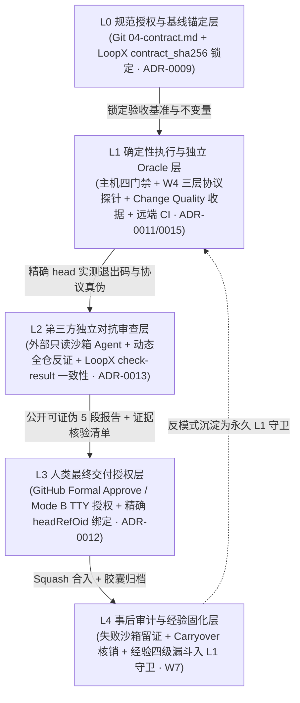
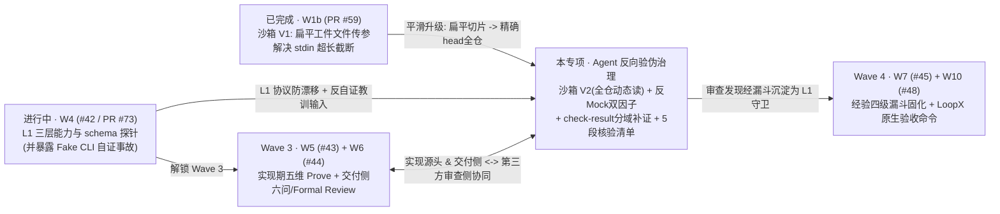
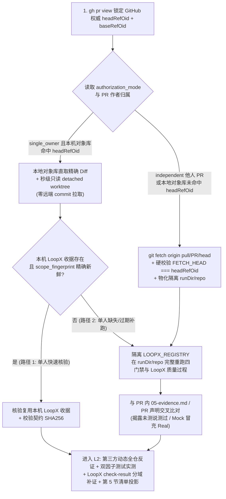

# Agent 反向验伪治理与第三方独立审查体系专项调研方案

- **状态**：`Research / Discussion Draft (v1.2)`（按 2026-11-25 评审意见优化：实施波次重排为 P0/P1a/P1b/P2/P3、`independent` 零信任全量重跑降级为条件触发、立项路径锁定为修订 ADR-0013、新增反熵增硬约束与「编排层不裁决」措辞红线；尚未立项/合入，不改变既有 ADR 冻结口径）
- **日期**：2026-11-25（v1.2 优化稿）
- **代码基线**：`JustinIanAI/loopx-workflow`（`main@bf1da34` + PR `#69` `e17200a`；上游控制面锚点 `loopx 2.3.0` / `loopx-project/loopx@f4c5d6d7`）
- **关联规范**：`ADR-0008`（应用编排层与三类权威边界）、`ADR-0009`（规格授权与契约锁）、`ADR-0011`（证据契约与独立 Oracle）、`ADR-0012`（交付授权与决策面）、`ADR-0013`（原生文件契约与两阶段解耦）、`ADR-0015`（受管 Todo 执行与三层能力探针）
- **关联调研与路线图**：`docs/research/state-evidence-boundary.md`、`docs/research/2026-11-19-pstack-magpie-loopx-integration-validation.md`、Roadmap `#37`（W0～W12）

> **前置能力前提声明**：第三方独立代码审查需要底座模型具备强长上下文推理、跨文件反证分析及深度嵌套 JSON 契约遵循能力。本方案聚焦于**架构边界、证据真伪校验机制与渐进演进路径**，不在编排层内置模型选型或路由策略；审查模型的选用由调用方/运维侧独立保障。

---

## 0. 核心结论（Executive Summary）

1. **反向验伪的本质定位**：反向验伪不是为了应付格式门禁，而是为了**防范实现 Agent 在编码与自测过程中陷入“局部最优”**（例如用无状态 Mock 掩盖真实契约断裂、未测而声称已测、或紧贴自身实现写死自圆其说的测试）。校验对象必须同时覆盖 **Specs / Skills 约束** 与 **实际交付物**，且全部证据标准、一致性核验与执行状态面统一归 **LoopX 控制面** 管理。
2. **近期“证据不足被封顶”的真实根因**：对 PR `#59`、`#68`、`#69`、`#71` 以及 `#42`（PR `#65`/`#66` → `#73`）的源码级复盘表明，除模型能力前提外，当前审查管线本身存在 **4 处硬工程断口**——① 沙箱仅含 4~5 个扁平切片，审查员物理上看不到全仓 Specs/Skills/调用方/完整测试；② 主机 `gates()` 与未传 `repoRoot` 的 `buildEvidenceGraph` 跑在本地 cwd 而非远端 PR 精确 `headRefOid`；③ Stage 2 单轮塞入十余项嵌套 Schema 且失败静默吞错；④ 封顶提示为黑盒一句，人类审查员无法看清应审/通过/未通过明细。
3. **坚持零伪造红线**：`loopx pr-review --check-result` 明确声明自己**只验证一致性与公开可审计性，不验证语义真伪**（`evidence_truth_verified: false`）。因此**绝对禁止**通过“主机自动从 diff 拾取测试路径”“主机按路径正则兜底语义分类”或“主机规则批量预填 `not_applicable`”来绕过封顶——主机只做**客观事实呈堂**与**反向验伪（Falsification）**，绝不做**代填造假（Fabrication）**。
4. **区分单人仓库（`single_owner`）与多人协作（`independent`）双模式，且实施节奏分级（v1.2）**：
   - **单人仓库模式（`single_owner`，当前主路径，P1a 落地）**：所有开发与 LoopX 控制面证据都在本机。通过 GitHub 校验权威 `headRefOid` 后，若本地 Git 对象库已命中该 commit，则**直接从本地不可变提交对象获取精确 PR Diff 与只读代码树（无需再从 GitHub 拉取 commit）**，并对本机 LoopX 收据做指纹新鲜度校验后复用，重点投入 L2 第三方反向验伪与双因子不变量实测。
   - **多人协作模式（`independent`，机制设计保留，实施降级为 P3 条件触发）**：本仓库当前为 `single_owner` 且无外部贡献者 PR，为避免超前建设（YAGNI），零信任隔离完整重跑与作者声明交叉比对**不在近期波次实施**；触发条件为 `authorization_mode` 切换为 `independent` 或出现第一个真实的他人 PR，触发时随 ADR-0013 第二次修订裁决最小闭环边界（见第 6 节议题 5）。其中**通用的物化机制**（远端 `git fetch` + `FETCH_HEAD === headRefOid` 硬校验、隔离 `runDir/repo/`）随 P1a 一并落地——换机、洁净审查环境同样需要。
5. **与在研/已排期方案逐层叠加、绝不推翻**：
   - 在 `W1b`（PR `#59`）已落地的「沙箱 V1：扁平工件路径只读传参 + 截断守卫」基础上，平滑升级为 **「沙箱 V2：精确 `headRefOid` 只读代码树（本地优先 / 远端按需拉取）+ 按路径动态按需加载」**；
   - 与 `W4`（`#42`/PR `#73` L1 协议探针）、`W5`（`#43` 实现期五维验证）、`W6`（`#44` 交付侧六问/Formal Review）、`W7`（`#45` 编排与经验沉淀漏斗）、`W10`（`#48` LoopX 原生 `validation-command`）构成**从实现源头到第三方终审再到人类授权的逐层纵深体系**，无任何推倒重来。
6. **实施节奏重排（v1.2）**：纯工程断口修复不等治理立项——
   - **P0**：G2 锚定纠偏（`repoRoot` 参数贯通 + `gates()` 精确 head 校验），立即以独立小 PR 落地（普通 Bug 修复按 ADR 准入矩阵不立 ADR，引用既有 `REQ-REVIEW-2` / ADR-0013 即可）；
   - **P1a**：沙箱 V2 收窄版（仅 `single_owner` 主路径物化与锚定 + 通用 fetch 硬校验），与 W5 并行；
   - **P1b**：G3/G4 透明化（废除 Stage 2 静默吞错 + `approval_blockers` 机械投影为第 5 段核验清单），**不依赖沙箱 V2，可先于 W6 落地**；
   - **P2**：分域靶向补证与客观锚点反向验伪，紧随 W6 串行；
   - **P3**：`independent` 零信任全量重跑与 `reviewer_execution` 升级，条件触发 / 随 W7、W10 演进。

---

## 1. 设计哲学与完整分层验证体系

### 1.1 为什么单靠 `check-result` 无法证明「要素非伪造」

LoopX 原生审查核验模块对自身边界有极其诚实的源码定义：
- `loopx/capabilities/pr_review_queue/result_check.py:1`：`Check a review's declared evidence for consistency, never its truth.`
- `loopx/capabilities/pr_review_queue/result_check.py:677-678`：每次校验输出均固定返回 `"evidence_truth_verified": false` 与 `"remote_head_verified": false`。
- `loopx/capabilities/pr_review_queue/README.md:145, 174`：明确声明校验器只负责类型化声明、结论自洽性与公开可审计性，无法替代真实调用方核查与反事实验证。

因此，“防止证据伪造与局部最优”不能寄希望于任何单一校验脚本，而必须依托当前已构建的**跨三类权威来源（Git 规范权威 / LoopX 控制面权威 / GitHub-CI 交付权威）的五层纵深验证体系**：



### 1.2 五层防伪矩阵（每层防什么、证明不了什么）

| 层级 | 权威载体 | 防伪核心机制（如何证明非伪造） | 固有盲区（必须由下一层兜底） |
| :--- | :--- | :--- | :--- |
| **L0 规范基线层** | Git `04-contract.md` + LoopX `contract_revision` 锁 | 人类审批锁定 `contract_sha256`，防止实现 Agent 事后篡改需求/AC 来“削足适履”。 | 只锁“应该做什么”，不证明代码实现了它。 |
| **L1 机器实测与协议探针层** | 主机 Oracle + W4 三层探针 + LoopX `change-quality` + GitHub Actions CI | ① 四门禁真实执行并绑定 `scope_fingerprint`；`package-lock.json` blob 变更使旧测试失效。<br/>② 主机强制覆盖模型对四门禁的宣称（防口头虚报）；W4 探针按真实 `--help` 与 `schema_version` 白名单校验工具契约。<br/>③ 远端 CI 在洁净环境独立复现，分支保护禁止绕过。 | 机器只证明“退出码为 0”，**证明不了测试不是无状态 Mock 自证或局部最优空壳**。 |
| **L2 第三方独立对抗审查层** | 外部只读沙箱 Agent + LoopX `pr-review --check-result` | ① 执行者外部化、只读隔离、输入源于 GitHub 远端权威提交。<br/>② 发布前复核 `headRefOid` 防漂移（INV2），命中截断标记 Fail-Closed。<br/>③ 缺宿主运行态观测时 `declaration_source` 锁死 `self_reported`（INV5）。<br/>④ 强制核心判断、`spec_ref@rev`、`architecture_assessment` 公开写入正文，杜绝隐藏声明。 | `check-result` 不验语义真伪；若主机替审查员代填证据或审查员看不到全仓，L2 防线即被击穿。 |
| **L3 人类交付授权层** | GitHub Formal Review (Mode A) / Owner TTY `release-approve` (Mode B) | 人类审批人依据 L2 公开的精确证据链与清单做可证伪抽查；Mode A 强绑 `commit_id == headRefOid`，Mode B 禁自动化伪造批准标题（T8）并诚实标记 `separation_of_duties=false`。 | 依赖 L2 报告的可读性与可定位性；若报告只给黑盒报错，人类抽查成本极高。 |
| **L4 事后审计与进化层** | 失败沙箱留证 + `review-carryover.json` + W7 经验漏斗 | 失败保留完整运行沙箱；复审强制逐条核销上轮 findings（INV4）；将反复出现的伪造/缺陷模式固化为 L1 Lint/单测守卫。 | 事后追责与长期免疫，不替代当次阻断。 |

### 1.3 必须守住的架构红线（明确否决的“伪解法”）

为避免“治标毁架构”，以下 3 类看似能快速消除 `[VERDICT CAPPED]` 的做法予以明确否决：
- **否决 1：主机自动扫描 `git diff` 中的 `tests/**/*.test.js` 填入 `changed_invariant_positive`** —— 等同于“被测 PR 交一个能跑通的空壳/Mock 测试，主机自动替它背书为不变量已证明”，直接违反 `ADR-0011` 决策 3 与 `skills/code-review/scripts/evidence-builder.js:211`（`npm run test passing does not prove this invariant`）。
- **否决 2：主机按文件路径正则兜底填写 `behavior_role`、`compatibility_assessment` 等语义字段** —— 属于 `ADR-0013` 明确否决的 Fake Evidence Filling。
- **否决 3：编排层按规则批量预填 `not_applicable`** —— 违反 `ADR-0008`（「Workflow 只做跨来源绑定、校验、投影，不裁决」）；是否适用必须由独立审查员基于代码与约束判断后亲自声明。

---

## 2. 问题现状复盘与源码级断口实证

### 2.1 两类高频实战问题样本

1. **样本类 A：第三方审查频繁触发 `[VERDICT CAPPED]`（PR `#59`、`#68`、`#69`、`#71`）**
   - 对比 `PR #58`、`PR #63` 原生一次通过 `APPROVE`，近期 PR `#59`/`#68`/`#69`/`#71` 在四门禁与远端 CI 全绿、评审报告正文给出 0 Blocker 的情况下，均因 `approval_contradicts_evidence` 被封顶为 `REQUEST_CHANGES`。
   - 以 PR `#69` 为例：LoopX 契约要求 15 项证据，阶段 1 结束时 14 项处于 `unverified` 且缺失两项不变量测试路径；阶段 2 组装 11,188 字符提示词一次性追问全部 14 项仍未闭环，最终 `check-result` 返回 39 个 `approval_blockers`，但公开评论末尾仅打印了一句笼统的 `[VERDICT CAPPED]`，人类审查员完全看不出缺了哪几项、为什么缺。
2. **样本类 B：实现期“无状态 Fake CLI 自证”陷入局部最优（Issue `#42` 的 PR `#65` / `#66`）**
   - 在 W4（三层能力探针 `#42`）推进过程中，首批交付的 PR `#65` 和 `#66` 的单元测试均在本地与远端 CI Four Gates 全绿。
   - 但在针对真实 `loopx 2.3.0` 锚点做独立核验时，两份实现均大面积误判 `BLOCK`（例如探测不存在的 `--strict`，或在 `goal-lifecycle --help` 中探测实际为独立顶层命令的 `sync-global`、漏匹配 `--operation {stop,resume}` 的 `{` 边界）。
   - **根因实锤**：两份 PR 的 Contract Fake `--help` 直接按实现代码期望的签名硬编码了返回字符串（`tests/unit/capability-probe.test.js`），导致测试验证的是「实现自己声明的假设」而非「真实锚点契约」，退化为典型的局部最优自证。

### 2.2 当前审查代码中的 4 处硬工程断口（源码定位）

| 断口编号 | 源码位置 | 现状问题 | 直接后果 |
| :--- | :--- | :--- | :--- |
| **G1 沙箱物理盲区** | `skills/code-review/scripts/authentic-review.js:1632-1637`、`1125-1149` | `runDir` 仅写入 `packet.json`、`pr.diff`、`evidence-output.md`、`remote-checks.txt`（及 stage2 `stage1-review.md`）；`codex exec --sandbox read-only -C <runDir>` 被锁死在 `runDir`。 | 审查 Agent 物理上无法读取 `specs/`、`skills/`、`docs/adr/`、上下游调用方与完整测试文件，只能盲审 diff 片段，既难以发现无状态 Mock 自证，又难以补齐 `spec_basis` / `repository_reuse` / `compatibility_assessment`。 |
| **G2 远端 PR 与本地 cwd 锚点错位** | `skills/code-review/scripts/authentic-review.js:568-580`、`1640`、`1719`、`1790`；`evidence-builder.js:138` | `gates()` 在本地工作目录运行；`buildEvidenceGraph` 调用处**未传 `repoRoot`**，内部回退为 `process.cwd()`。 | 当本地工作区未检出该 PR 的精确 `headRefOid` 时：① 四门禁跑的不是 PR 精确代码；② 审查员指认 PR 新增的测试文件时，因本地不存在该文件，`resolveRepoTestPath` 返回 `null`，直接错判 `unverified`！ |
| **G3 Stage 2 单轮超载 + 静默吞错** | `skills/code-review/scripts/authentic-review.js:1736-1797` | 一次性向模型发送全部未通过项（PR `#69` 为 14 项 + 2 项不变量）；且第 1763 行在 `stage2Run.error` / 超时 / JSON 解析失败时**静默跳过**，继续向下走并发布封顶评论。 | 把「审查基础设施超时或解析失败」伪装成「PR 被审查员判为 `REQUEST_CHANGES`」，污染 PR 评审结论。 |
| **G4 报告黑盒封顶** | `skills/code-review/scripts/authentic-review.js:1289-1302`、`1900-1913` | `approval_blockers` 明细只打印在本地 stdout 日志中；`capVerdictInBody` 仅在评论末尾追加一句通用提示。 | 人类审查员在 GitHub PR 页面完全看不到 LoopX 契约应审哪 15 项、过了哪些、哪几项因何未通过、以及这是代码问题还是证据缺口。 |

---

## 3. 进行中与已排期方案全景分析（逐层推进，绝不推翻）

本专项不是孤立重造，而是嵌入现有 Roadmap `#37`（W0～W12）与近期热修演进脉络中的精准补环。下表完整梳理各工作项的现状、解决的层次以及与本专项的继承/协同关系：

### 3.1 已完成、进行中与待解锁工作项全景映射

| 工作项 / PR / Issue | 当前状态 | 所属验证层 | 核心解决的问题 | 与本专项治理方案的关系（继承 / 协同） |
| :--- | :--- | :---: | :--- | :--- |
| **ADR-0013**（PR `#36`） | 已合入 | L2 底座 | 废除 CLI argv 巨型传参与 240KB 硬截断，确立文件/stdin 传参与两阶段解耦 | **直接基石**：本方案所有设计严格遵守其“文件只读传参 + 不伪造 verified + LoopX 原生 `check-result` 权威”三原则。 |
| **W1b**（`#57` / PR `#59`） | 已合入 (`ac918b4`) | L2 输入沙箱 V1 | 将 `packet.json`、`pr.diff`、`evidence-output.md` 等落盘 `$LOOPX_TMP_DIR/review-pr<N>-XXXXXX/`，`stdin` 仅送紧凑路径清单（`REVIEW_STDIN_BYTE_LIMIT`），增加 `[... N bytes omitted ...]` 截断 Fail-Closed 守卫 | **平滑升级（V1 → V2），零推翻**：W1b 解决了“参数/stdin 过长被截断”的第一跳；本方案在其 `runDir` 架构内新增 `runDir/repo/` 精确提交只读树，把“读扁平切片”升级为“按路径动态读取全仓”。 |
| **W3**（`#41` / PR `#58`） | 已合入 (`514032b`) | L1 受管执行 + Canary | 退役手工租约拼接，接入 LoopX 2.3.0 原生 `todo claim/complete`；引入隔离 Registry 的 **Real-CLI Canary** 击穿无状态 Mock 盲区 | **范式先行**：W3 证明了真实 CLI 金丝雀的价值，本方案将其推广为审查期优先剔除无状态 Mock 自证的通用审计准则。 |
| **W1c**（`#62` / PR `#63`） | 已合入 (`d4ee41b`) | L1 测试完整度 | 单测目录自动发现（防并发合入漏跑测试）+ `isolatedGateEnv` 隔离 `LOOPX_TMP_DIR` | **前置保障**：确保主机 Oracle 在隔离环境中跑全量单测无静默漏项。 |
| **PR `#68` / `#71` / `#69`** | 已合入 | L2 声明 / 校验 / 准入 | `#68` 模型与 effort 透传与家族名剥离；`#71` locale 隔离与 `compatibility_assessment` 嵌套校验收口；`#69` 移除 500 行硬限额，对齐 LoopX「结果 + 证据 + 边界」准入范式 | **直接前置**：PR `#69` 取消行数限制后，单个高内聚 PR 的文件与上下文跨度天然增大，使「动态按路径读取全仓 + 人类可读证据核验清单」变得更为迫切。 |
| **W4**（`#42` / PR `#73`） | **进行中（`in_review`）** | L1 协议探针 | 集中式三层 LoopX 能力与 `schema_version` Fail-Closed 探针（`--help` 真实签名 + 白名单 + 版本软提示） | **双向关联**：① W4 守住 L1 协议契约防漂移；② W4 早期的 PR `#65`/`#66` 正是“Contract Fake 自证局部最优”的典型事故样本，直接驱动本专项的防 Mock 审计设计；③ PR `#73` 自身进入 Stage B 审查时即可检验本方案的痛点与需求。 |
| **运行环境与仓库边界治理** | **进行中（`in_review`）** | 架构边界 | 严禁仓库内耦合上层宿主工具内容，规范沙箱抽象与环境隔离 | **硬约束**：本方案所有设计保持纯仓库/LoopX 原生，仅使用通用的 `sandbox` / `runDir` 语义，不引入上层工具耦合。 |
| **W5**（`#43` / M1） | 待解锁（依赖 W4） | L1 实现期自证 | 落地 `skills/verification-harness`（Pstack 五维验证 `Surface/Run/Drive/Observe/Isolate` + 冷启动 Prove + `Doc Drift / Harness Gap / Product Bug` 三分类） | **前后夹击（源头治理）**：W5 在**实现阶段（Stage 5-6）**强迫实现 Agent 走真实入口 Prove，从源头减少无状态 Mock 与未测说测过；本专项在**第三方审查阶段（Stage 7）**做独立反证兜底。 |
| **W6**（`#44`） | 待解锁（依赖 W4） | L1→L3 交付桥接 | `05-evidence.md` 16 字段/六状态、Freshness 失效矩阵、PR 六问 + `Real-vs-Mock` 列、`pulls/<pr>/reviews` Formal Review 发布与 `respond` 精确 head Fail-Closed | **同层镜像协同**：W6 规范**作者交付侧**（PR 正文六问、Real-vs-Mock、`05-evidence.md`）与 Formal Review 发布通道；本专项规范**第三方审查报告侧**（第 5 节内嵌 LoopX 证据核验清单），两者共享同一 LoopX 契约与 `authentic-review.js` 发布链路。 |
| **W7**（`#45` / M2） | 待解锁（依赖 W5/W6） | 编排与进化 | `skills/workflow-conductor` 四层路由、`Rule-LINT-06` 三方命令面守卫、经验沉淀四级漏斗 | **闭环固化**：将本专项在审查中高频抓出的局部最优/伪造模式，经四级漏斗沉淀为永久 L1 Lint/单测守卫。 |
| **W10**（`#48` / M3b） | 待解锁（依赖 W9） | L0→L1 控制面收口 | `todo sync` 幂等注入、升级 `04-contract.md` 模板纳入五维 Verification Plan、透传 `--validation-command` 由 LoopX 在 `todo complete` 原生执行 | **控制面深化**：把验证命令与写范围约束直接交由 LoopX 原生控制面强执行，进一步压缩实现期局部最优空间。 |
| **W12**（`#50` / M4） | 可选远期 | L2 扩展 | 可选 `arena` / 异构二审 `interrogate` / LoopX 多版本 CI 兼容矩阵 | **远期叠加**：在本专项把单主审 L2 证据链打稳后，按需启用异构对抗二审。 |

### 3.2 核心疑问精确回应：W4（`#42`）与 W1b（`#59`）跟本方案是什么关系？



- **关于“从文档读取证据、避免参数过长截断”**：这一步已在 **W1b（`#57` / PR `#59`）** 完成了 V1 落地（从 inline stdin 改为沙箱文件只读读取 + 截断 Fail-Closed 守卫）。本专项完全复用其沙箱目录、只读权限模型（`codex --sandbox read-only -C <runDir>` / `claude --tools Read --add-dir <runDir>`）和 `REVIEW_STDIN_BYTE_LIMIT` 守卫，仅将其内部内容从「4 个扁平切片」扩展为「`meta/` 工件 + `repo/` 精确 `headRefOid` 只读代码树」，是**自然递进的 V2**。
- **关于 W4（`#42` / PR `#73`）**：W4 聚焦的是 **L1 协议契约防漂移**（探针核验 LoopX `--help` 签名与 `schema_version`），而非文件读取；但 W4 早期提交的 PR `#65`/`#66` 亲身暴露了“实现 Agent 写假 `--help` Mock 通过全量 CI”的局部最优事故，恰好为本专项「优先剔除无状态 Mock 自证」提供了最直接的实战依据。

---

## 4. Agent 反向验伪治理专项设计（目标落盘方案）

### 4.1 设计一：沙箱 V2 —— GitHub 精确提交只读物化与按路径动态加载

在沿用 `$LOOPX_TMP_DIR/review-pr<N>-XXXXXX/`（成功即清理、失败即留证）的前提下，将沙箱目录升级为清晰的双分区结构：

```text
$LOOPX_TMP_DIR/review-pr<N>-XXXXXX/
├── meta/
│   ├── packet.json              # LoopX 原生评审包（唯一契约与模板权威）
│   ├── pr.diff                  # gh pr diff 远端权威 diff
│   ├── evidence-output.md       # LoopX evidence_commands 实测输出
│   ├── remote-checks.txt        # gh pr checks 远端 CI 观测
│   ├── prior-findings.md        # 上轮 findings（复审时存在）
│   ├── artifact-index.json      # 动态加载导航索引（变更文件、关联 Spec/ADR/Skill、变更测试清单）
│   ├── test-audit-hints.json    # 主机静态扫描生成的 Mock/Skip/空断言线索（仅呈堂，不裁决）
│   └── stage1-review.md         # 阶段 1 评审正文（阶段 2 使用）
└── repo/                        # 基于 GitHub 精确 headRefOid 物化的只读完整代码树
    ├── specs/...
    ├── skills/...
    ├── docs/adr/...
    ├── tests/...
    └── ...
```

**关键防伪硬约束**：
1. **GitHub 权威 `headRefOid` 强绑定 + 本地对象优先策略**：
   - 无论哪种协作模式，均先通过 `gh pr view` 获取 GitHub 权威 `headRefOid`（与 `baseRefOid`），绝不以本地当前分支头替代远端权威 SHA。
   - **本地优先命中（`single_owner` 主路径）**：先执行 `git cat-file -e <headRefOid>^{commit}`（及基线 commit）检测本地 `.git` 对象库是否已完整持有该提交；命中时**无需从 GitHub 重复拉取 commit**，直接由本地不可变 Git 对象生成精确 Diff（`git diff <baseRefOid>...<headRefOid>`）并秒级创建只读 detached worktree 物化至 `runDir/repo/`（**严禁直接读取开发者可能含未提交脏改动的 working tree**）。
   - **远端按需拉取（`independent` 他人 PR 或跨机/洁净审查环境主路径）**：当本地对象库未命中 `headRefOid` 时，执行 `git fetch origin pull/<PR>/head`，并**硬校验 `FETCH_HEAD === headRefOid`**（不一致立即 `[NOT_VERIFIED]` 退出），再物化至 `runDir/repo/`。
2. **紧凑 `stdin` + 按需动态读取**：`stdin` 严格受 `REVIEW_STDIN_BYTE_LIMIT` 约束，仅传入原生模板、紧凑契约与 `meta/artifact-index.json` 路径摘要；审查 Agent 在只读沙箱内按需通过相对路径（`repo/specs/...`、`repo/skills/...`、`repo/tests/...`）动态加载目标文件全文与上游调用方源码。**语义澄清（v1.2）**：该守卫是「检测超限即 Fail-Closed 报错」，不是截断内容丢弃，与 ADR-0013「彻底废除人工字符截断」不冲突（废除的是静默截断）；此澄清随 ADR-0013 修订节一并落文（见 7.1）。
3. **主机 Oracle 同步锚定 `runDir/repo/`**：彻底修复断口 G2——主机执行的门禁验证与 `buildEvidenceGraph({ repoRoot: path.join(runDir.dir, 'repo') })` 全部在精确 `headRefOid` 对应的 `runDir/repo/` 执行，确保主机实测与审查输入针对**同一个精确字节快照**。

---

### 4.2 设计二：优先剔除三类「局部最优 / 伪造自证」的三道防线

将反局部最优审计明确拆分为**「主机静态线索呈堂 → 审查员动态全仓反证 → 主机双因子反空壳实测」**三步，严格遵守权责分离：

| 目标剔除的伪造/局部最优模式 | 第一道：主机静态线索呈堂（`meta/test-audit-hints.json`，仅客观标注） | 第二道：审查 Agent 动态全仓反证（读取 `repo/` 全文） | 第三道：主机双因子实测与 LoopX 裁决 |
| :--- | :--- | :--- | :--- |
| **1. 无状态 Mock 伪造自证**（如 PR `#58` 历史断裂、PR `#65`/`#66` 自编 `--help`） | 扫描 PR 涉及的测试文件，客观列出：fake-bin / mock / stub 拦截点、外部权威命令（`loopx`/`gh`）是否被替换、与 `05-evidence.md` `Real-vs-Mock` 列的对照索引。 | 动态读取测试全文 + `repo/specs/.../04-contract.md` + `repo/skills/**/SKILL.md`，核查测试是否用固定返回串掩盖真实协议/状态机/权限边界。 | 审查员必须在 `failure_analysis.real_boundary_and_mock_limits` 披露盲区；若核心契约仅靠无状态 Mock 自证，直接输出 Blocker `finding` 并**拒认该测试路径**进入 `validation_matrix`。 |
| **2. 未测而说测过**（文件不存在、全 skip、空用例、未纳入运行器） | 列出测试文件是否存在于 `repo/`、是否命中 `test.skip` / `.todo` / `|| true` / 空测试体。 | 审查员核查 PR 正文与 `05-evidence.md` 的验证声明后，亲自指定真正覆盖正/负向不变量的仓库内 `tests/...` 路径。 | 主机在 `runDir/repo/` 独立运行 `node --test <path>`，并升级 `buildInvariantRow` 解析 TAP/测试统计：**强制要求 `exit_code === 0 && tests > 0 && pass > 0 && fail === 0 && skipped === 0`**；任一不满足即判 `failed`/`unverified`，由 LoopX 阻断 `APPROVE`。 |
| **3. 陷入局部最优的测试用例**（只测改出来的私有实现、绕开规格反例与失败恢复） | 在 `meta/artifact-index.json` 呈堂关联的 `04-contract.md` 不变量列表、受影响的 `SKILL.md` 规范路径及仓库内实际调用方文件清单。 | 审查员对照 Specs/Skills 约束与调用方源码，必须填写 `failure_analysis.counterexample_when_existing_tests_pass`（“现有测试全绿时，何种真实状态仍会击穿”）与负向 `walkthroughs`。 | 反例成立且缺乏对应负向回归测试时，审查员输出可复现反例 `finding` 并判定 `REQUEST_CHANGES`，由 LoopX 记录并进入下轮 `carryover` 核销。 |

---

### 4.3 设计三：保持 5 段结构的人类可审计视图（第 5 节内嵌 LoopX 契约投影）

严格遵守 `loopx/capabilities/pr_review_queue/review_body.py:11-18, 123-148` 的 5 段顶层标题约束（不新增第 6 个 `##` 顶级章节），将所有审核可见性收敛在 **第 5 段 `## 我的整体评价 / Verdict`** 内部末尾（`English verdict:` 之前），以 **`### 证据核验清单（LoopX 契约投影）`** 呈现：

1. **顶部 3 行人类速览**：
   - **核验统计**：`契约应审 N 项 ｜ 通过 X 项（verified A · not_applicable B）｜ 未通过 Y 项`
   - **阻塞归因分类**：明确标明是 `代码/门禁真实失败`、`审查证据缺口` 还是 `两者并存`
   - **建议人类优先抽查项**：高亮未通过项、高风险 `spec_basis` 映射与 `real_boundary_and_mock_limits` 摘要
2. **逐项核验明细表（覆盖全部 `plan.required_evidence_ids`）**：
   - 字段：`LoopX 证据项` ｜ `状态`（`✅ 已通过` / `➖ 不适用` / `❌ 未通过`）｜ `结论 / 实测摘要` ｜ `未通过精确原因（映射 LoopX approval_blockers / errors）或人类抽查指引`
3. **单一事实源与二次一致性校验**：
   - 该清单**100% 由 LoopX `check-result.json` 与 `result.json` 机械投影**，编排层不另设判定规则；
   - 注入清单后**必须再次执行 `loopx pr-review --check-result`** 确认 `ok === true` 才发布，确保 GitHub 公开正文与 LoopX 收据严格一致。

---

### 4.4 设计四：LoopX `check-result` 驱动的分域靶向补证与 Fail-Closed 透明化

在完全由外部独立审查 Agent 作答、主机绝不代填的前提下，重构 Stage 2 闭环：

1. **LoopX 预检导航（消除编排层自猜缺口）**：
   - 阶段 1 完成后，先由主机执行 `buildEvidenceGraph`（基于 `runDir/repo/`）并跑一次 **LoopX 预检 `loopx pr-review --check-result`**。
   - 若 `ok === true` 且 `approval_blockers` 为空，零额外调用直接进入清单投影与终检发布。
2. **按语义域分批靶向追问（解决单轮 14 项 Schema 认知过载）**：
   - 仅当存在未通过项时，将 LoopX 返回的**精确错误码与缺失路径**按最多 3 个内聚域拆分追问同源审查 Agent（仍挂载只读 `runDir/repo/`）：
     - 域 A（问题与规模）：`problem_context`、`changed_line_classification`、`code_volume`
     - 域 B（架构与语义）：`architecture_flow`、`repository_reuse`、`observable_semantics`、`walkthroughs`、`failure_analysis`、`symbol_map`
     - 域 C（边界与不变量）：`scope_fit`、`default_off_isolation`、`behavior_change_disclosure`、`domain_neutrality`、`guidance_vs_obligation`、`semantic_alignment`、`validation_matrix` 不变量路径
   - 最多执行 **2 轮有界收敛**，避免无限重试。
3. **废除 Stage 2 静默吞错（区分“工具故障”与“代码不合格”）**：
   - 当 Stage 2 发生超时、非 0 退出、截断或 JSON 不可解析时，**直接 Fail-Closed 退出非 0（`[NOT_VERIFIED]`）并保留 `runDir` 留证**，禁止带着未补齐的空白证据向 GitHub 误发 `[VERDICT CAPPED]` 评论。
4. **主机客观锚点反向验伪（Falsification）**：
   - 在 `buildEvidenceGraph` 中增加确定性客观锚点核查（全部对照 `runDir/repo/`）：
     - `spec_basis.spec_ref` / `spec_revision` 在 Git 历史中真实存在；
     - `observable_semantics.reviewed_head` 与 `headRefOid` 逐字一致；
     - `symbol_map` 路径与变更行号落在本次 `pr.diff` 范围内；
     - `validation_matrix` 指定的测试满足 `tests > 0 && pass > 0 && skipped === 0`。
   - 任一客观锚点不匹配即回退为 `unverified` 并记录精确失配原因交由 LoopX 裁决。

---

### 4.5 设计五：单人仓库（`single_owner`）与多人协作（`independent`）双模式差异化处理机制

既有的 `ADR-0009` / `ADR-0012` 已通过 `.loopx/config.json`（`authorization_mode`）将仓库运行模式区分为 `single_owner`（单人维护模式）与 `independent`（多人协作模式）。在 Agent 反向验伪治理中，两种模式下**代码来源与 LoopX 控制面证据的在场性存在本质差异**，必须实行差异化路由，而非一刀切：

#### 1. 双模式差异对照与执行路径路由

| 维度 | 模式一：单人仓库模式（`single_owner`） | 模式二：多人协作模式（`independent`，含他人/Fork PR） |
| :--- | :--- | :--- |
| **前提事实** | 所有开发、四门禁、LoopX Goal/Todo 租约与 `change-quality` 收据均产出于本机同一 `.loopx/registry.json`。 | 依据 `ADR-0007` / `ADR-0008`，LoopX 运行态严禁入 Git；他人 PR 仅包含代码、`specs/`、`05-evidence.md` 文本与 PR Body，**审查者本机缺失作者的 LoopX 控制面证据**。 |
| **PR 代码与 Diff 获取** | **GitHub 仅校验 `headRefOid` + 本地对象直取**：`gh pr view` 锁定权威 `headRefOid` 后，`git cat-file -e <headRefOid>^{commit}` 命中即直接从本地对象库生成精确 Diff 与只读 `runDir/repo/`，**无需重复从 GitHub 拉取 commit**。（跨机/沙箱未命中时自动回退 `git fetch` + SHA 校验） | **远端拉取 + SHA 强校验**：必须执行 `git fetch origin pull/<PR>/head` 并硬校验 `FETCH_HEAD === headRefOid`，在隔离 `runDir/repo/` 中物化完整代码树，与审查者本地工作区物理隔离。 |
| **L0 契约基线核验** | 直接校验本机 `.loopx/registry.json` 锁定的 `contract_revision` 与 `runDir/repo/specs/.../04-contract.md` 的 SHA256 一致。 | 审查者本机无作者 Goal 锁，改由 `runDir/repo/.../04-contract.md` 计算 SHA256，与 GitHub Draft PR 上第二账号的 `gate1-authorization:<feature>@<contract_sha>` 评论签名核对（复用 `ADR-0012` 决策 10）。 |
| **L1 LoopX 证据与门禁过程** | **校验新鲜度后复用（Local-Verified Fast Path）**：校验本机 `loopx change-quality verify` 绑定的 `scope_fingerprint` 与当前 `headRefOid` 匹配且未命中 `ADR-0011` Freshness 失效矩阵（如锁文件/diff 变更）；新鲜则直接复用既有收据与状态面，**不重复跑一遍全套 LoopX 创建/记账流程**；过期或缺失则强制补跑。 | **零信任隔离完整重跑（Zero-Trust Full Replay）**：将作者提交的 `05-evidence.md` 与 PR 门禁勾选仅视为**待证伪宣称**。在临时隔离 Registry（`LOOPX_REGISTRY=<runDir>/isolated-registry.json`）下，基于 `runDir/repo/` **完整重跑四门禁 + LoopX 质量核验过程**，并与作者 `05-evidence.md` 逐项交叉比对（凡作者声称 `passed`/`real` 而隔离重跑失败或实为 mock：编排层**只输出差异 `finding` 与实测 evidence，不直接定性**，最终由 LoopX `check-result` 的 `approval_blockers` 机制阻断 `APPROVE`——严守 ADR-0008「Workflow 不裁决」红线，见 7.4）。 |
| **L2 第三方独立审查与防伪底线** | **绝不因单人模式省略或降级**：仍完整执行独立审查 Agent 全仓动态反证、审查员指定正/负向不变量测试的双因子实测（`tests>0 && pass>0 && skipped===0`）与 LoopX `pr-review --check-result` 核验。 | 同左；且优先审查作者提交的测试是否使用无状态 Mock 掩盖真实边界，并在第 5 节核验清单中明确标注 `replay_mode=isolated_full_replay` 与与作者声明的比对结果。 |
| **本机状态面污染防护** | 复用本机主 Registry 只读校验，沙箱 `runDir/` 遵循“成功清理、失败留证”。 | 临时隔离 Registry 随 `runDir/` 原子销毁（失败留证），确保审查他人 PR 对审查者本机 `.loopx/registry.json` **零污染**。 |

#### 2. 由「模式 × 客观探针」驱动的三条确定性执行路径

为避免在“单人模式但换机器/在独立审查容器中跑”等边界场景出现假定失效，管线统一按以下决策流确定执行路径（**不靠人工传 flag 猜，完全由配置与客观探针决定**）：



> **核心不变量**：单人模式省掉的是**重复的网络拉取**与**已验证新鲜的本机 LoopX 流程重跑**，绝不省掉**权威 `headRefOid` 校验**、**不可变提交隔离（防脏工作区泄露）**与 **L2 第三方独立反向验伪**；多人模式补齐的是**零信任下的隔离完整 LoopX 过程重跑**与**作者声明交叉验伪**。

> **实施节奏注记（v1.2）**：上表与决策流描述的是双模式的**目标态设计**。实施上，`single_owner` 主路径（本地对象直取 + 新鲜度复用）在 P1a 落地；`independent` 的零信任完整重跑与交叉比对**降级为 P3 条件触发**（`authorization_mode` 切换或出现第一个真实他人 PR），其间仅落地通用物化机制（`git fetch` 硬校验 + 隔离 `runDir/repo/`）。第 7.4 节的「编排层不裁决」红线对两种模式同样生效。

---

## 5. 逐层推进实施路径与既有 Roadmap 衔接

为坚持「逐层演进、不打断主干节奏、每次改动独立可验」，v1.2 将原「治理 Phase 1/2/3」重排为 **P0 / P1a / P1b / P2 / P3** 五个更细粒度的波次：纯工程断口修复（P0 / P1b）不等治理立项、不依赖沙箱 V2 全量结构即先行止血；`independent` 零信任全量重跑（P3）条件触发。建议按以下节奏无缝挂载到现有 Roadmap `#37`：

| 推进波次 | 挂载时序 | 交付范围（建议独立小 PR，各绑 1 Goal） | 依赖前置 | 核心验收（含负向反伪测试） |
| :--- | :--- | :--- | :--- | :--- |
| **前置收敛** | 当前（Wave 2b 收口） | 完成 **W4（`#42` / PR `#73`）** 独立审查与合入，解锁 Wave 3 | 无 | PR `#73` 真实 `loopx 2.3.0` 实测全绿 + 留痕 |
| **P0（G2 锚定纠偏，立即）** | 当前，不等治理立项、不等 W4 合入 | ① `authentic-review.js` 的两个 `buildEvidenceGraph` 生产调用点（断口 G2，见 §2.2）贯通 `repoRoot` / `runNodeTest` 参数，消除 `process.cwd()` 回退；<br/>② `gates()` 执行前强制校验本地 `HEAD === packet headRefOid`：不匹配则**跳过实测并把对应 validation 行如实标 `unverified`**（宁缺毋假，不产生假 `passed`）。按 ADR 准入矩阵属普通 Bug 修复，不立 ADR，引用既有 `REQ-REVIEW-2` / ADR-0013。 | 无 | 负向测试：① 从仓库子目录 / 异 cwd 调用时 invariant 测试路径解析与本仓一致；② 本地 HEAD 漂移（停在旧分支）时四门禁不写入任何 `passed` 行。当前 PR `#73` 的 Stage B 审查正受此坑影响，为最高性价比修复。 |
| **P1a（沙箱 V2 收窄版，仅 `single_owner` 主路径）** | 与 **W5（`#43`）** 并行（Wave 3） | ① `runDir/repo/` 精确 `headRefOid` 只读物化：**本地对象优先命中（`git cat-file -e`，零 commit 拉取）+ 未命中/跨机时 `git fetch` + `FETCH_HEAD === headRefOid` 硬校验（通用机制，非 `independent` 专属）**；<br/>② `gates()` 与 `buildEvidenceGraph` 切换锚定 `runDir/repo/`；<br/>③ `single_owner` 本机 LoopX 收据新鲜度核验复用（`scope_fingerprint` 匹配 + `ADR-0011` 失效矩阵；过期/缺失强制补跑）；<br/>④ `buildInvariantRow` 接入 TAP 测试计数反空壳校验；<br/>⑤ 生成 `meta/artifact-index.json` 与 `meta/test-audit-hints.json`（静态扫描必须复用 `evidence-builder.js` 既有逻辑，见 7.3）。 | W1b（已合入）、P0 | 负向测试：① 本地工作区有未提交脏改动或停在旧分支时，仍严格基于精确 `headRefOid` 执行；② `single_owner` 本地命中时不触发 `git fetch` 且复用新鲜收据；③ 收据过期（锁文件 blob 变更）时强制补跑而非复用；④ 0 用例或含 `skip` 的测试文件被拒判 `passed`；⑤ `FETCH_HEAD != headRefOid` 必 Fail-Closed。 |
| **P1b（G3/G4 透明化，先于 W6）** | Wave 3，**不依赖沙箱 V2，可与 P1a 解耦先行** | ① 废除 Stage 2 静默吞错：超时/非 0/截断/JSON 不可解析 → 直接 `[NOT_VERIFIED]` 非 0 退出并保留 `runDir` 留证，禁止带空白证据误发 `[VERDICT CAPPED]`；<br/>② 封顶透明化：`capVerdictInBody` 触发时，将 LoopX `check-result` 的 `approval_blockers` 完整明细**机械投影**为第 5 节 `### 证据核验清单（LoopX 契约投影）`（格式见 4.3；数据 100% 来自 `check-result.json` / `result.json`，注入后二次过 `check-result`）；<br/>③ 同步修复 `gates()` / `buildValidationMatrix` 异常静默置空（catch 后至少输出 WARN 与失败原因，不得无日志吞掉）。 | P0 | 负向测试：① Stage 2 坏 JSON/超时必非 0 且不调用 `gh` 发布；② 注入清单后真实 `loopx pr-review --check-result` 返回 `ok=true` 且保持 5 段结构；③ 人类在 GitHub PR 页面可见「应审 N / 通过 X / 未通过 Y + 逐项原因」明细（消除黑盒封顶）。 |
| **P2（分域补证与客观锚点反向验伪）** | 紧随 **W6（`#44`）** 串行落地（Wave 3 尾 / Wave 4 初） | ① Stage 2 改为 LoopX `check-result` 报错驱动的**分域靶向补证**（≤3 个内聚域、≤2 轮有界收敛，见 4.4；静默吞错的废除已由 P1b 先行落地）；<br/>② 补齐 `spec_ref@rev` / `reviewed_head` / `symbol_map` 落 diff 范围等**客观锚点反向验伪**（任一失配回退 `unverified` 并记精确失配原因）；<br/>③ **立项文档动作**：ADR-0013 增补决策节 + `REQ-REVIEW-2` 扩展 + `docs/design/loopx-workflow-design.md` §8 回写 + INV→REQ 映射（见第 7 节）。 | P1a、P1b、W6（共用 `authentic-review.js`，串行规避同文件冲突） | 负向测试：① 编造不存在的 `spec_revision` 被降回 `unverified`；② `reviewed_head` 与 `headRefOid` 不一致必记录精确失配；③ 2 轮补证上限后不再无限重试。 |
| **P3（条件触发的控制面深化）** | 随 **W7（`#45`）**、**W10（`#48`）** 自然演进；`independent` 重跑按触发条件启动 | ① `independent` 零信任隔离完整重跑 + `05-evidence.md` 交叉比对（触发：`authorization_mode` 切换或第一个真实他人 PR；最小闭环边界届时随 ADR-0013 第二次修订裁决，见第 6 节议题 5）；<br/>② `reviewer_execution` 从 `self_reported` 升级 `runtime_reported`（如实披露：仅 Codex App runtime 可观测，其他宿主保持 `self_reported`）；<br/>③ 审查高频反模式经 W7 四级漏斗沉淀为 L1 守卫；<br/>④ 按需评估 W12（`#50`）异构二审。 | W7、W10 或触发条件 | 独立评估，不提前过度建设。 |

---

## 6. 议题裁决（v1.2：4 项收敛、1 项保留）

经 2026-11-25 评审，原 5 项 Open Questions 中前 4 项已收敛为裁决；立项按第 7.1 节路径修订 `ADR-0013`，第 5 项在 P3 触发时裁决：

| # | 议题 | 裁决（v1.2） | 依据 |
| :--- | :--- | :--- | :--- |
| 1 | 远端代码树物化方式 | **采用 `git worktree add --detach`**：共享对象库、秒级创建，支持 `git log` / `git show <base>` 对账基线与核验 `spec_revision`；退出用 `git worktree remove` 并兜底校验无残留 worktree 元数据。不采用 `git archive`（需主机额外提供基线对比命令）。 | 只读沙箱策略 + 基线对账成本 |
| 2 | `gates()` 隔离成本 | PR 未改动 `package-lock.json`（按 blob 比对）时**只读复用仓库 `node_modules`**，避免重复 `npm ci`；blob 变更才在隔离目录安装依赖后执行四门禁。与 `ADR-0011` Freshness 判据天然一致。 | `ADR-0011` 失效矩阵 |
| 3 | 与 W6 的文件写范围切分 | **P1b 先行**（只改 Stage 2 吞错与封顶投影，不碰 W6 的 Formal Review 发布段）+ **P1a 与 W6 并行**（沙箱与 `evidence-builder.js`）+ **P2 紧随 W6 串行**。原 Phase 2 的清单投影拆入 P1b 后，同文件冲突面进一步缩小。 | `authentic-review.js` 单文件冲突排期 |
| 4 | 「证据缺口封顶」发布策略 | **区分两类**：基础设施故障（超时/坏 JSON/截断）一律 `[NOT_VERIFIED]` 非 0 拒发（P1b 落地）；Stage 2 正常但 ≤2 轮补证后仍余 1~2 项 `unverified` 时，**按 LoopX policy 透明封顶 `REQUEST_CHANGES` 并在第 5 节清单列出缺口**——保留 LoopX policy 权威，且在 GitHub 留下可审计痕迹，比拒发更可审计。 | 可审计性优先 |
| 5 | `independent` 隔离重跑范围边界（**保留研讨**） | 已降级 P3 条件触发。届时最小闭环候选仍为「L0 契约 SHA 对账 GitHub Gate1 评论 + L1 四门禁 + `loopx change-quality prepare/record/verify` 临时收据交叉比对 + L2 `loopx pr-review --check-result`」；对无 Feature Capsule 的小型 Fix PR（管线 B）倾向约定轻量豁免（跳过 `04-contract.md` Gate1 评论对账，**四门禁 + `change-quality` + L2 审查不豁免**，与铁律「Fast-Path 不得绕过 Gate2」同构）。触发时随 ADR-0013 第二次修订一并裁决。 | YAGNI |

---

## 7. 立项路径、INV 映射与反熵增约束（v1.2 新增）

### 7.1 立项路径：修订 ADR-0013，不新立 ADR

按 ADR-0008 决策 6 的 ADR 准入矩阵，本专项改变的是审查管线**默认行为与共享契约**（`authentic-review.js` / `evidence-builder.js`），正确路径是**修订 ADR-0013（新增增补决策节）+ 回写正文**，而非新立 ADR-0017（P0 属普通 Bug 修复，直接引用既有 `REQ-REVIEW-2` / ADR-0013，无需 ADR）：

1. ADR-0013 新增「2026-11-25 增补决策：Agent 反向验伪治理（沙箱 V2 与证据透明化）」节，覆盖：沙箱 V2 双分区结构、`runDir/repo/` 精确 `headRefOid` 物化与 `FETCH_HEAD` 硬校验、Stage 2 Fail-Closed、第 5 节核验清单投影、双模式差异化路由（含 P3 条件触发口径）。
2. 顺带澄清 `REVIEW_STDIN_BYTE_LIMIT` 语义（见 4.1 约束 2），消除与「彻底废除人工字符截断」的表面冲突。
3. 回写 `docs/prd/loopx-workflow.md` 的 `REQ-REVIEW-2`（核验清单与 Fail-Closed 语义扩展）、`docs/design/loopx-workflow-design.md` §8。

### 7.2 INV 不变量 → REQ 映射（铁律 2 追溯要求）

正文中的 INV 编号在立项时必须映射到既有 REQ（不新开编号体系，遵守 `REQ-TRACE-2/3`）：

| INV | 含义（本文档） | 挂靠 REQ |
| :--- | :--- | :--- |
| INV2 | 发布前复核 `headRefOid` 防漂移、命中截断标记 Fail-Closed | `REQ-RESPOND-1`（精确 head fail-closed） |
| INV4 | 复审强制逐条核销上轮 findings（carryover） | `REQ-EVIDENCE-1`（证据契约扩展） |
| INV5 | 缺宿主运行态观测时 `declaration_source` 锁死 `self_reported` | `REQ-REVIEW-2` 扩展 |

### 7.3 反熵增与防重复建设硬约束（三项，落地时作为验收项）

1. **静态扫描复用**：`meta/test-audit-hints.json` 的 Mock/Skip/空断言线索扫描，**必须复用/扩展 `evidence-builder.js` 既有 Real-vs-Mock 与测试扫描逻辑**，严禁新建第四套独立扫描器（铁律 4 反熵增）。
2. **渲染单份**：第 5 节「证据核验清单」（审查侧）与 W6 的 PR 六问 / `05-evidence.md` 字段（作者侧）共享同一 LoopX 契约源，**投影/渲染逻辑只写一份**（收敛在 `authentic-review.js` 单一投影函数，W6 复用），严禁两侧各写一份渲染。
3. **`check-result` 调用收敛**：`--check-result` 的三类调用场景——缓存幂等短路、P2 预检导航（4.4 第 1 点）、终检发布——**收敛为单一封装函数的三个显式调用点**，防止三处语义漂移。

### 7.4 措辞红线：编排层不裁决（ADR-0008 决策 2）

4.2 第三道防线、4.4 第 4 点与 4.5 交叉比对的结论表述统一为：**编排层只输出差异 `finding` 与实测 evidence，最终阻断动作由 LoopX `check-result` 的 `approval_blockers` 机制执行**。任何文本与实现不得表述为「编排层直接定性 Blocker / 直接阻断」。
